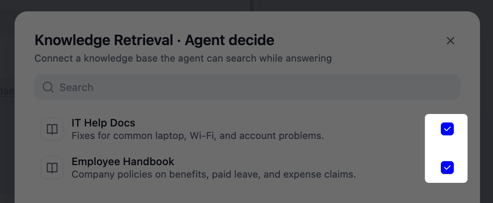
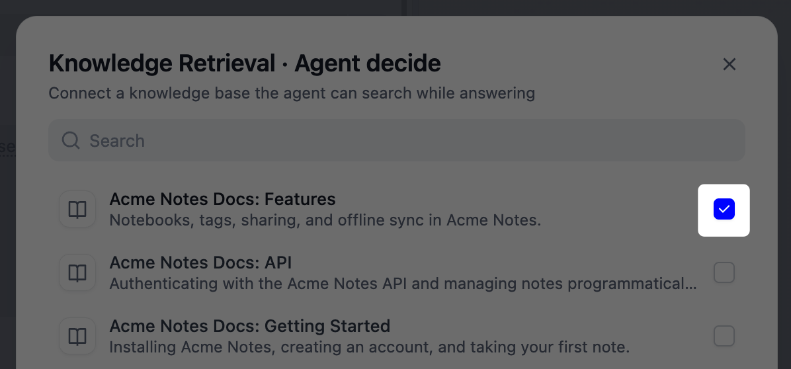
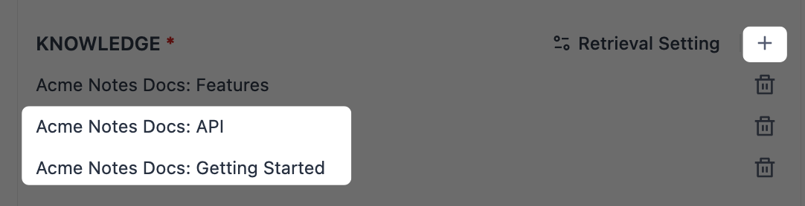

<Note>
The new Agent is in beta. It's on by default on Docker Compose, with its runtime bundled in.

For production, replace [`DIFY_AGENT_SERVER_SECRET_KEY`](/en/self-host/deploy/configuration/environments#dify_agent_server_secret_key) and [`DIFY_AGENT_API_TOKEN`](/en/self-host/deploy/configuration/environments#dify_agent_api_token) with your own random values.
</Note>

## Create an Agent

From **Agents**, click **Create** > **Create from Blank** and give the agent a name; optionally add a role such as *Research Assistant* and a description. Then you shape everything else in **Configure**.

To create an agent from an app package (`.ifpkg`) or a DSL file (`.yml` or `.yaml`), click **Create** > **Import App**. DSL files don't include skills and files, so add them manually after importing.

<Info>
Creating and managing agents requires the Editor role or above.
</Info>

## Configure Its Capabilities

Set up each capability by hand, or describe what you want and build it by chatting in [Build mode](#build-by-chatting).

Everything you set up in **Configure** is saved as the agent's capabilities and used in every task later. Separately, the agent works inside its own *sandbox*, where it runs commands and handles files as it goes.

The agent's capabilities can only be changed here: even if an end user asks a published agent to change its own prompt, skills, or tools, it won't.

### Model

Pick the chat model the agent runs on. Favor models that are strong at reasoning and natively support tool calling, since the agent has to judge when to act, which tool fits, and how to read the result.

<Note>
Agent performance rises and falls with the model, so pick a recent one.

Older models often can't make full use of the sandbox: a common symptom is an agent that never runs commands or installs tools, even when the task needs it.
</Note>

### Prompt {#prompt}

In the prompt, set the agent's role and how it should approach its work. Be specific about how it should reason, when to lean on its tools, and what to avoid.

A few things worth covering:

- **Persona and goal**: who the agent acts as and what it's trying to achieve.
- **Approach**: the steps or order you expect for a typical task.
- **Tool and file use**: when to reach for each, named explicitly.
- **Output**: the format, length, or tone you want back.

You can point the agent at a specific skill, file, tool, or knowledge retrieval, or leave the choice to the agent:

- **Reference it in the prompt** with `/` to send the agent straight to it, right where you want it used. Best when a step depends on a specific one.
- **Just add it to its section** and let the agent decide on its own when to use it. Best when you'd rather trust the agent's judgment than script every move.

### Skills {#skills}

A skill is a procedure the agent follows for one specific task. Unlike the prompt, which sets the agent's overall role, a skill covers just that task.

For example, a support agent's prompt might set its role as a customer helper that handles any issue, while its `refund-requests` skill covers only refunds: look up the order, refund only within 30 days, and end with a help-center link.

Click **Add** and choose which kind of skill to add:

- Choose **Add from library** to add a [*library skill*](/en/self-host/use-dify/build/skills) shared workspace-wide. You can add up to 20 library skills to an agent, and it follows the latest published version of each.

- Choose **Upload skill.zip** to add a `.zip` or `.skill` package as an *embedded skill*, one the agent keeps to itself. 

    The package needs a `SKILL.md` inside and can be up to 50 MB by default, adjustable with [`UPLOAD_SKILL_FILE_SIZE_LIMIT`](/en/self-host/deploy/configuration/environments#upload_skill_file_size_limit).

    To share an embedded skill with other agents, [make it a library skill](/en/self-host/use-dify/build/skills#import-a-skill).
    
You can also have the agent create embedded skills for you in [Build mode](#build-by-chatting).

<Tip>
To make a Dify tool or file part of the agent's own capabilities, add it to the agent directly rather than inside a skill package.
</Tip>

### Files {#files}

Files are reference documents the agent can read while it works, like specs, templates, or guidelines. Unlike a skill, a file is just material to read, not a procedure to run.

Size limits depend on file type; each is a default you can adjust with [environment variables](/en/self-host/deploy/configuration/environments):

| File type | Default limit | Environment variable |
|:----------|:--------------|:---------------------|
| Documents | 15 MB | `UPLOAD_FILE_SIZE_LIMIT` |
| Images | 10 MB | `UPLOAD_IMAGE_FILE_SIZE_LIMIT` |
| Video | 100 MB | `UPLOAD_VIDEO_FILE_SIZE_LIMIT` |
| Audio | 50 MB | `UPLOAD_AUDIO_FILE_SIZE_LIMIT` |

You can also have the agent create files and save them here in [Build mode](#build-by-chatting). 

<Info>
Files the agent creates and saves are capped at 50 MB each by default, adjustable with `DIFY_AGENT_STUB_UPLOAD_FILE_SIZE_LIMIT`. See [Environment Variables](/en/self-host/deploy/configuration/environments) for details.
</Info>

### Tools {#tools}

Give the agent [Dify tools](/en/self-host/use-dify/workspace/tools) so it can act beyond the chat: plugins, custom APIs, workflows, and MCP servers from your workspace. 

Some tools need authentication before use. A workflow tool that contains a Human Input node can't be used by an agent.

<Tip>
Beyond the Dify tools you add here, the agent can also install and run command-line tools on its own inside the sandbox when it needs one. Those tools don't appear in the Tools list.

Tools the agent installs in [Build mode](#build-by-chatting) can stay available after publishing, while anything installed during a published run is temporary.
</Tip>

### Knowledge Retrieval {#knowledge-retrieval}

Connect [knowledge bases](/en/self-host/use-dify/knowledge/readme) the agent can search while it works.

From a knowledge base, the agent sees only the passages retrieved for the query. That makes it the better fit for a lot of material, such as a product's full documentation. For a few documents the agent should read through in full, like a template or a style guide, use [files](#files) instead.

#### Add Knowledge Bases

Click **Add** to open the list of knowledge bases. Each one you tick is added as a *retrieval*, with its own name, description, and settings. A retrieval can also hold several knowledge bases, so decide how to group yours:

- **One retrieval each**: each knowledge base is searched on its own.

  Best when each covers its own subject, like an employee handbook and IT help docs: leave questions go to the handbook, laptop problems to the IT docs.

  Tick each knowledge base in the list. By default, the agent picks among them by their names and descriptions.

  <Frame>
    
  </Frame>

- **Several in one retrieval**: one search covers all of them, and the best matches come back whichever knowledge base they're in.

  Best when an answer could be in any of them, like product docs split across several knowledge bases.

  Tick one knowledge base, then expand **Advanced Settings** below the list and add the rest with the **+** beside **Knowledge**.

  <Frame caption="Tick One Knowledge Base">
    
  </Frame>

  <Frame caption="Add the Rest Under Knowledge">
    
  </Frame>

#### Choose How Each Is Searched

Under **Advanced Settings**, set each retrieval's **Query**:

- **Agent decide**: the agent decides whether to search and writes its own query from the conversation.

  Best when questions vary and you want it to judge what to look for, like a docs assistant that searches for whatever a user asks about.

- **Custom query**: you write a fixed query. The retrieval runs before the agent begins, and the agent works from the matches it returns.

  Best when a source should always be searched the same way, like a returns assistant that always pulls from your return policy, however the question is phrased.

#### Help the Agent Pick the Right One

With **Agent decide**, the agent goes by each retrieval's name and description. You can set alternatives that apply to this agent only:

- Change the **Knowledge retrieval name** when the default wouldn't tell the agent what the retrieval holds.

- Write the **Description** as guidance on when to search, not a summary of its contents: which questions it should answer from here, and which it shouldn't. For example:

  ```text wrap
  Use for questions about employee benefits, leave, and expense policy. Don't use for IT or security questions.
  ```

#### Tune the Results

Under **Retrieval Setting**, choose how many results to keep and how closely they must match:

- **Top K**: the most results to keep. Raise it when answers need more passages; lower it to keep the agent focused.

- **Score Threshold**: each result is scored on how well it matches the query, and results below this score are dropped. Higher is stricter; lower casts a wider net. With a single Economical knowledge base, it has no effect.

When a retrieval holds several knowledge bases, also choose under **Rerank Setting** how their results merge into one ranking:

- **Rerank Model**: a second model scores each result's relevance to the query.

- **Weighted Score**: balances meaning against exact keyword matches.

  <Info>
  **Weighted Score** appears only when all the knowledge bases in the retrieval use High Quality indexing and the same embedding model from the same provider, and none is external.
  </Info>

To search only documents with certain [metadata](/en/self-host/use-dify/knowledge/metadata), set **Metadata Filtering**:

- Choose **Manual** and add conditions when the filter is the same every time, such as one product line.
- Choose **Automatic** when it depends on the question: a model you choose sets the conditions for each search.

#### Check What the Agent Found

In the build chat, ask the agent something your knowledge bases answer. Each **Agent decide** search shows as a `knowledge_base_search` step: expand it to see the query the agent wrote and the passages that came back. A **Custom query** search shows no step, because it runs before the agent begins.

If the agent didn't search, or searched the wrong retrieval, sharpen that retrieval's [name and description](#help-the-agent-pick-the-right-one), or reference it in the prompt with [`/`](#prompt).

If an answer misses something that's in a knowledge base:

- Check that the document has finished indexing and is enabled.
- Check how long its chunks are. Each result reaches the agent cut to 2,000 characters, so a long chunk, such as a parent chunk in Parent-child mode, loses its end. Use shorter [chunks](/en/self-host/use-dify/knowledge/create-knowledge/chunking-and-cleaning-text) to keep it whole; they apply to every app that searches the knowledge base.
- Check **Top K**. All the results of one search together are cut to 12,000 characters, so with a high **Top K**, the last ones can be cut or dropped. Lower it to fit.

<Info>
  Answers don't cite these knowledge bases, even with **Citations and Attributions** turned on.
</Info>

### Environment Variables {#environment-variables}

Under **Advanced Settings**, you can add **environment variables**: key-value pairs the agent can read in its sandbox while it works.

Say your agent's skills all work with the same order system: one checks stock, one files orders, one pulls reports. Store the system's address here as `ORDER_API_URL`, and every script reads it by name. To switch from the test system to the production one, update this one value, and all of them follow.

Import a `.env` file to add several at once. You can also have the agent set them up in [Build mode](#build-by-chatting).

<Note>
Values stored here can surface in command output the agent reads. To mask sensitive strings from it, set `DIFY_AGENT_SHELL_REDACT_PATTERNS`. See [Environment Variables](/en/self-host/deploy/configuration/environments#agent-new) for details.
</Note>

## Build by Chatting {#build-by-chatting}

Instead of setting everything up by hand, you can build the agent by describing what it should do, and as you chat it sets up its *prompt*, *skills*, *files*, and *environment variables* itself.

For example, your first message might be:

```text wrap
Build an agent that turns raw meeting notes into structured minutes: attendees, decisions, and action items.
```

You're talking to the live agent: test it as you build, watch how it behaves, and refine it in the same build chat.

As the agent works, it edits the configuration in the panel directly. Click **Apply** to keep the changes, or **Discard** to drop. Either one exits Build mode and clears the conversation.

<Note>
**Discard** drops everything from this build chat: any changes to the configuration and persistent files in the [**File system**](#file-system).
</Note>

While you're in Build mode, the configuration panel is read-only—just tell the agent what you want to change. It can't change the model or tools, though: set those yourself once you're out of Build mode.

### File System

In Build mode, the agent handles real files in its sandbox: artifacts it generates, programs it installs on its own, and everything else it's working with. During a build chat, click **File system** in the top-right corner to browse them.

Since a build chat is where you shape the agent itself, whatever it adds (a template it drafted, a tool it installed) is **Persistent** by default, kept for every future conversation and workflow run. In effect, these files are part of the agent's setup, like its prompt and skills.

For one-off work, like a test file or a converter it only needs once, tell the agent in the chat, e.g. "keep this file temporary": it goes under **Temporary** and is cleared when this build chat ends.

In published runs, whatever the agent adds is always temporary, so nothing that happens in a run changes the agent itself.

### The Build Note {#the-build-note}

In build chats, the agent records what it set up in a *build note*, a `build_note.md` that appears in **Files** the first time you **Apply**.

The note is saved with the agent's setup, and it reads the note back at the start of every new conversation, combining it with your **Prompt** to form its instructions.

After you apply, open the build note and read what the agent captured:

  - If it covers what you want, you're set.

  - To change what it says, have the agent revise it in Build mode.

    <Info>
    The agent maintains only the auto-generated build note: a downloaded copy you re-upload is just an ordinary file, and the next build chat creates a fresh note alongside it.
    </Info>

  - If anything's missing, add it to the **Prompt**.

  - To start over with a clean record, delete the note in **Files**.

Across build chats, the note also serves as the agent's *memory*. If you shaped the meeting-minutes agent in one chat, a later chat to add action-item owners starts from the format and decisions you already settled, not from scratch.

## Publish {#publish}

Your edits autosave as a draft. When the agent is ready, publish it to make that version live. Open the version history anytime to revisit or restore an earlier version.

<Info>
Restoring a version also restores the persistent files in the agent's sandbox to that version.
</Info>

<Tip>
To polish the chat experience, you can add extras like a welcome message, suggested questions, and voice in **Chat Features**. See [App Toolkit](/en/self-host/use-dify/build/additional-features) for details.
</Tip>

From the **Access Point** tab, host it as a web app at a shareable link, embed it in your site, or call it from your code through the [service API](/en/api-reference/guides/agent).

<Warning>
**Data Security Notice**

Community Edition uses file-access controls to limit access to agent and session files when the same agent is exposed to multiple end users. These controls reduce the risk of cross-conversation data access through the filesystem, but the Agent runtime is not intended to provide a hardened security boundary between mutually untrusted users or workloads.

If your deployment requires strong isolation or strict security or compliance controls, use separately hardened infrastructure or contact Dify to assess an appropriate Cloud or Enterprise option. For Dify Enterprise, [contact sales](https://share-na2.hsforms.com/14-09ff5HS92Sh4m3f4yrcw40s9fk) to learn more.
</Warning>

You can also invite the agent into a workflow's [Agent node](/en/self-host/use-dify/nodes/agent#new-agent) to handle a step.

To share the agent across workspaces, click **Export Agent** from its menu. This exports your current draft, unpublished changes included. To share a published version instead, export it from that version's menu.

### Run Limits

- **Time**

    A single agent run is stopped after 1 hour by default, whichever access point it starts from (web app, service API, or a workflow), and the unfinished reply is discarded.

    If a run gets cut off, try again or break the task into smaller steps. For longer runs, raise `APP_MAX_EXECUTION_TIME`, `WORKFLOW_MAX_EXECUTION_TIME`, and `DIFY_AGENT_RUN_TIMEOUT_SECONDS` above the duration you need.

    See [Environment Variables](/en/self-host/deploy/configuration/environments) for details on these variables.

- **Model requests**

    Every call the agent makes to its model counts toward a cap of 500 per run, so heavy reasoning and frequent tool use spend it faster.

    Try breaking the task into smaller steps to keep each run within the cap.

- **Reply files**

    Each file the agent sends back in a reply can be up to 50 MB by default, and larger files aren't delivered.

    If your agent produces bigger artifacts, raise `DIFY_AGENT_STUB_UPLOAD_FILE_SIZE_LIMIT`. See [Environment Variables](/en/self-host/deploy/configuration/environments) for details.

## Troubleshooting

<AccordionGroup>
  <Accordion title="Agents doesn't appear in the navigation or the node list">
    If only Chatflow apps lack the node, turn on [`NEXT_PUBLIC_ENABLE_AGENT_V2_IN_CHATFLOW`](/en/self-host/deploy/configuration/environments#next_public_enable_agent_v2_in_chatflow); it's off by default.

    Otherwise, the deployment's `.env` predates 1.16.0, so the Agents switch is missing or still off.

    Sync it with `.env.example` (the switch is [`NEXT_PUBLIC_ENABLE_AGENT_V2`](/en/self-host/deploy/configuration/environments#next_public_enable_agent_v2)), then recreate the web container (`docker compose up -d web`) and hard-refresh the browser.

    If other members see **Agents** but you don't, the cause is your workspace role: the entry needs the Editor role or above.
  </Accordion>
  <Accordion title="Agent runs fail as soon as they start">
    If every run errors immediately, the deployment may be running 1.16.0 or later images with an older `docker-compose.yaml`, which lacks the agent's services (including `agent_backend` and `local_sandbox`).

    Update the compose file along with the images, then bring the stack up again.
  </Accordion>
  <Accordion title="The agent errors or never calls tools with an OpenAI-compatible model">
    Models served through OpenAI-compatible endpoints (vLLM and similar) often lack full native tool-calling support, which the agent depends on in build chats as well as published runs.

    Pick a model that supports tool calling natively. If a compatible model still errors, check **Token parameter name** in the model's settings on the provider: some newer models require `max_completion_tokens`, and auto-detection can guess wrong.

    Some OpenAI models reject tool calls when reasoning is enabled over the Chat Completions protocol. For those, set the provider credential's **API Protocol** to Responses API.
  </Accordion>
  <Accordion title="The agent errors on or ignores uploaded images">
    Image upload can be turned on in **Chat Features** regardless of whether the agent's model supports vision. With a non-vision model, the agent may error on an image or reply as if none was sent.

    Switch to a model that supports vision: look for the Vision tag when picking the model.
  </Accordion>
  <Accordion title="The agent can't fetch files or pages from your internal network">
    The sandbox's internet access goes through a proxy that blocks private-network addresses by design. Public URLs work; for material on your intranet, add it to the agent's [Files](#files) instead.
  </Accordion>
</AccordionGroup>
