The Human Input node pauses workflows at key points to deliver a customizable request form. Recipients can use the form to review information, provide input, and choose from predefined decisions that determine how the workflow proceeds.

By embedding human judgement directly where it matters, you can *balance automated efficiency with human oversight*.

<Info>
Human Input comes in two versions. To move a workflow from the old one to the new one, see [Migrate from the Old Node](#migrate-from-the-old-node).
</Info>

<Tabs>
  <Tab title="New Human Input" id="new-human-input">

  With the new Human Input node, requests reach people where they already work. Everyone gets them by email, and workspace members also get them in the team's IM (instant messaging app). Only the people a request is sent to can respond.

  <Note>
  The new Human Input node needs these settings to reach recipients:

  - [`CONSOLE_WEB_URL`](/en/self-host/deploy/configuration/environments#console_web_url) and [`APP_WEB_URL`](/en/self-host/deploy/configuration/environments#app_web_url) = addresses recipients can open
  - For an IM that [shows requests as cards](/en/self-host/use-dify/workspace/channels/overview#connect-your-im), [`TRIGGER_URL`](/en/self-host/deploy/configuration/environments#trigger_url) = an address your IM can reach over the internet, so clicks on card buttons get back to Dify

  Email requests also need the deployment's [mail configuration](/en/self-host/deploy/configuration/environments#mail-configuration).
  </Note>

  <Info>
  A workflow that contains the new Human Input node can't run as a [tool](/en/self-host/use-dify/workspace/tools#workflow).
  </Info>

  <a id="choose-who-responds"></a>

  ## Choose Who Responds

  Anyone you add in **Recipients** can respond, and the first response decides: the request then closes for everyone else. Add only people whose decision you'd accept.

  How you add someone determines how the request reaches them:

  - **A contact**: for people you work with regularly. Pick them from your workspace's [Contacts](/en/self-host/use-dify/workspace/contacts). If their email changes, new requests go to the new address without any change to your workflow.

    - Workspace members get the request by email, and also in your team's IM once their IM identity is [bound in Contacts](/en/self-host/use-dify/workspace/contacts#bind-im-identities).
    - External contacts get it by email only, and need no Dify account to respond.

    When anyone on the team can decide, pick the whole workspace instead. External contacts aren't included.

  - **An email address**: for a one-off recipient you don't need to keep in Contacts. Type it in, and they get the request by email.

  - **A variable**: when the run decides who responds, such as an address an earlier node collected. The variable must hold exactly one address; an empty or invalid value is skipped.

  - **Initiator**: when the person running the app should confirm the step themselves. In a web app, the form appears right in the app. Through the [Service API](/en/api-reference/guides/human-input-flow), your integration responds. Not available in a workflow that starts from a trigger.

  If none of the recipients can be reached, the run fails at this node. When a recipient might be missing at run time, such as a variable that comes back empty, add another recipient you know can be reached.

  <a id="write-the-notification"></a>

  ## Write the Notification

  The message template is the notification that brings people to the form, by email and as a message in IM.

  In **Message template**, write a subject and body that tell people what they're being asked to decide, and click **Insert Request URL** to add the link to the form. The subject and the body can use variables, and the body can also use Markdown.

  <Columns cols={2}>
    <Frame caption="Message Template">
      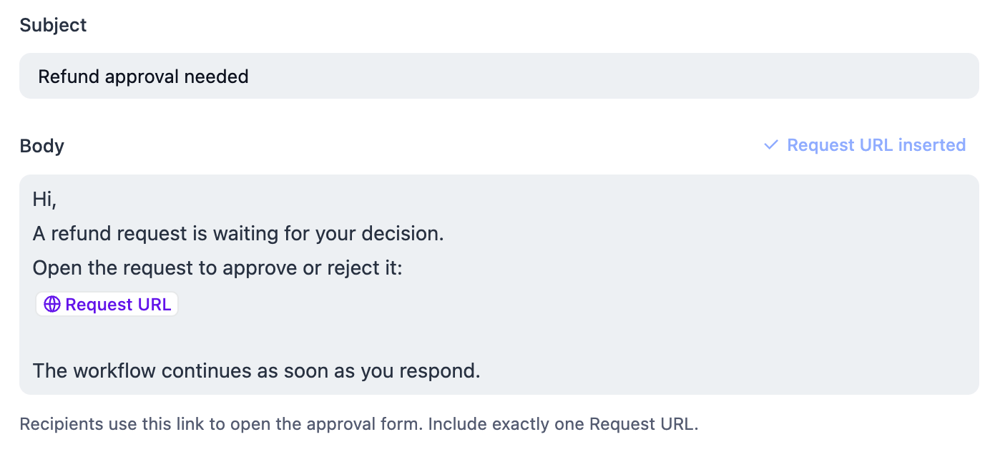
    </Frame>
    <Frame caption="Request as a Link Message">
      
    </Frame>
  </Columns>

  <Info>
    In an IM that [shows requests as cards](/en/self-host/use-dify/workspace/channels/overview#connect-your-im), people get the form itself instead and respond right in the IM. The card is headed by the node's title, so give the node a title that tells people what the request is about.

  <Frame caption="Request as an IM Card">
    
  </Frame>
  </Info>

  To check how it reads, use **Test message**: pick your IM as the **Test channel** and click **Save and test** to send it to yourself. It always arrives as a link message; to see the card your recipients get, do a [test run with Debug Mode on](#test-without-notifying-recipients).

  <a id="design-the-form"></a>

  ## Design the Form

  A form has two parts: the content recipients read and fill in, and the buttons they click to decide.

  <a id="card-or-link"></a>

  <Info>
  To let members respond right in the IM, avoid file fields. In an IM that shows cards, a form with one arrives as a link message instead.
  </Info>

  ### Form Content

  Write what recipients need to see to decide, formatted with Markdown. Reference variables to show their values, such as a draft that an upstream LLM wrote.

  <Info>
    Reasoning models emit their thinking process alongside the final answer, and referencing the LLM node's `text` variable shows both. To show only the answer, turn on **Enable reasoning tag separation** in that LLM node.
  </Info>

  Insert input fields into the content wherever recipients should fill something in. The name you give a field in **Save Response As** becomes its variable downstream.

  | Field type | What recipients do |
  |:-----------|:-------------------|
  | Paragraph | Enter text. The field can start empty, or pre-filled with a variable (such as LLM output to refine) or static text. <br></br><br></br>If the input is optional, pre-fill it with static text such as *None*, so recipients can submit without typing. <br></br><br></br>No maximum length, but very long inputs may exceed downstream LLM context windows. |
  | Select | Pick one option. List the options yourself, or take them from an `array[string]` variable. |
  | Single File / File List | Upload one file, or several. <Info>File upload limits are tunable via environment variables: <ul><li>`UPLOAD_FILE_SIZE_LIMIT`, `UPLOAD_IMAGE_FILE_SIZE_LIMIT`, `UPLOAD_VIDEO_FILE_SIZE_LIMIT`, and `UPLOAD_AUDIO_FILE_SIZE_LIMIT` cap per-file size by extension.</li><li>`WORKFLOW_FILE_UPLOAD_LIMIT` caps the max files a File List field can be configured to accept.</li></ul>See [Environment Variables](/en/self-host/deploy/configuration/environments) for defaults.</Info> |

  <Tip>
  For a decision that sets where the workflow goes next, such as approve or reject, use buttons under **User Actions** rather than a Select field. A Select field records the answer but doesn't branch the workflow.
  </Tip>

  ### User Actions

  Add the buttons recipients choose from. Each button you add gets its own branch from the node, so connect each one to what that decision should lead to.

  <a id="use-the-response"></a>

  ## Use the Response

  After someone responds, downstream nodes can use:

  - Each input field's value.
  - `__action_id`: the action ID you gave the clicked button under **User Actions**.
  - `__action_value`: that button's text.
  - `__rendered_content`: the form content with the submitted values filled in, for when you want to keep or pass on a record of the completed form.

    File fields appear as plain-text placeholders: `[file]` for Single File and `[N files]` for File List.

  On the **Timeout** branch, `__action_id` and `__action_value` are empty, and `__rendered_content` holds the form content without values.

  <a id="set-a-timeout"></a>

  ## Set a Timeout

  Set **Timeout** to how long the decision can wait. When it runs out with no response, the run continues along the node's **Timeout** branch. Connect that branch to a fallback, such as notifying someone or taking a default decision. If you leave it unconnected, the run simply ends there.

  Each run also has an overall limit of 7 days by default, counted from when the run started. When a run reaches it, any request still waiting expires, and the run stops without taking any branch. So a Human Input node later in the run may have less time left than its own timeout.

  For example, a workflow has two Human Input nodes in a row, and someone responds to the first request 5 days after it was sent. When the run reaches the second node, only 2 days are left. If the second node's timeout is 3 days, the run stops after 2 days, and that node's **Timeout** branch never runs.

  To make sure a later node's fallback can run, set its timeout shorter than the time the run will have left. Or raise the overall limit with [`HUMAN_INPUT_GLOBAL_TIMEOUT_SECONDS`](/en/self-host/deploy/configuration/environments#human_input_global_timeout_seconds), which applies to every run on the deployment.

  <a id="test-without-notifying-recipients"></a>

  ## Test Without Notifying Recipients

  Test runs from the editor send real requests to your recipients. To test without reaching anyone else, you have two options:

  - With a connected IM and your own IM identity [bound to your contact](/en/self-host/use-dify/workspace/contacts#bind-im-identities), a test run with **Debug Mode** on goes through the whole flow, but sends the request only to you, in your team's IM. The request arrives the way your recipients would get it.

  - **Run this step** shows only the form, right in the editor, and sends nothing to anyone.

  <a id="what-recipients-see"></a>

  ## How Recipients Respond

  - When the request arrives as an IM card, workspace members can respond right in it. From a link, they sign in to Dify with the account the request was sent to.

    They don't need access to the app itself.

    <Columns cols={2}>
      <Frame caption="Request as an IM Card">
        
      </Frame>
      <Frame caption="Request as a Link Message">
        
      </Frame>
    </Columns>

  - External contacts and people added by email address open the link and enter a code sent to that address before responding.

  Once someone responds, no one else can.

  <a id="examples"></a>

  ## Examples

  <Tabs>
    <Tab title="Approve a Refund">

      <Frame caption="Refund Approval Workflow">
        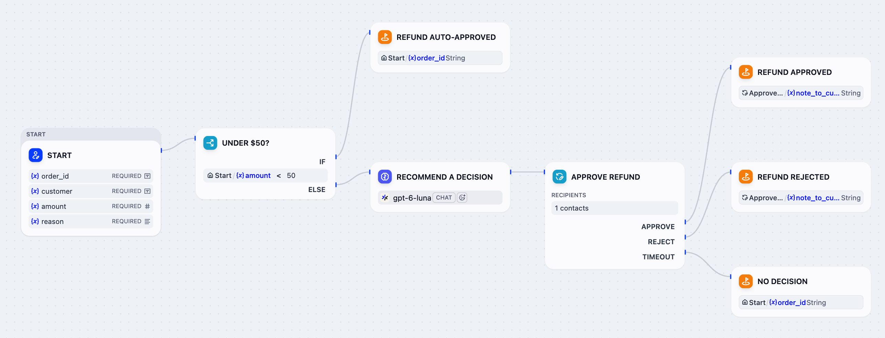
      </Frame>

      This workflow handles refund requests for an online store. Small refunds are approved automatically. For larger ones, an LLM checks the request against the refund policy and recommends a decision, and a support lead approves or rejects it.

      <Tip>
      To try this workflow in your workspace, get its template from [Dify Marketplace](https://marketplace.dify.ai).
      </Tip>

      It's designed around these goals:

      <Steps>
        <Step title="Only refunds that need judgment reach the lead">
          1. Put an If-Else node right after Start that checks whether `amount`, a number input, is under 50.
              <Frame caption="If-Else Condition">
                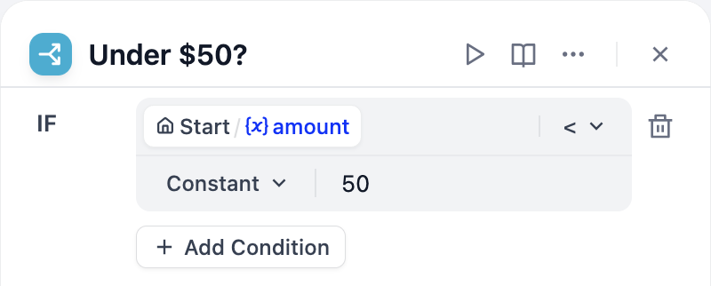
              </Frame>
          2. Connect the branch for refunds under 50 straight to an Output node (*Refund auto-approved*), and the other branch to the LLM.
          
        </Step>
        <Step title="The lead sees what the AI recommends, and why">
          1. In an LLM node (*Recommend a decision*):

              - Put the refund policy in the system prompt and the order in the user prompt: its ID, customer, amount, and reason, all from Start.

              - Ask it to give its verdict, *Approve* or *Reject*, on the first line, then cite the policy in one or two sentences.

              <Frame caption="Prompts in Recommend a Decision">
                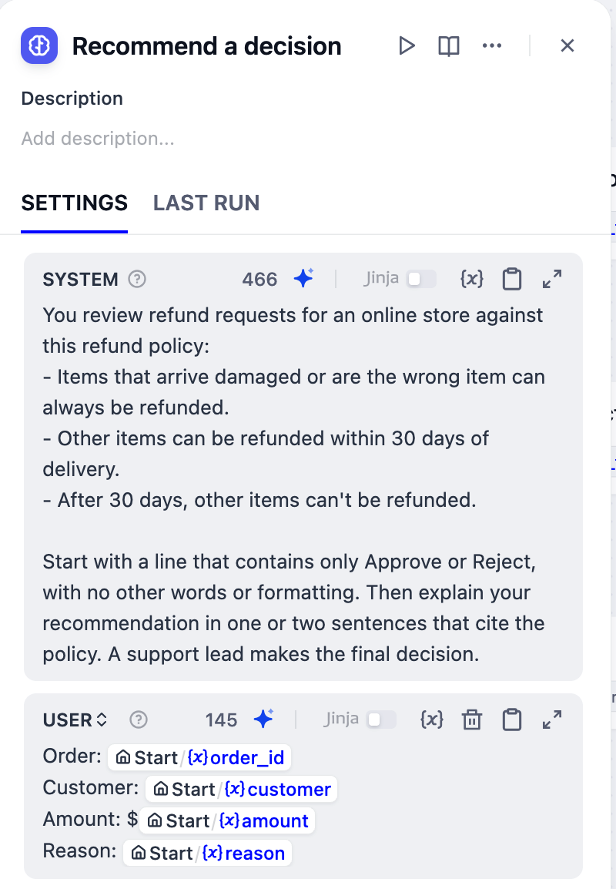
              </Frame>

          2. In the Human Input node's **Form Content**, show the order details, then the LLM's `text` output under a bold *AI recommendation* label.

              With the reason in front of them, the lead can catch a wrong recommendation.

              <Frame caption="Form Content with the AI Recommendation">
                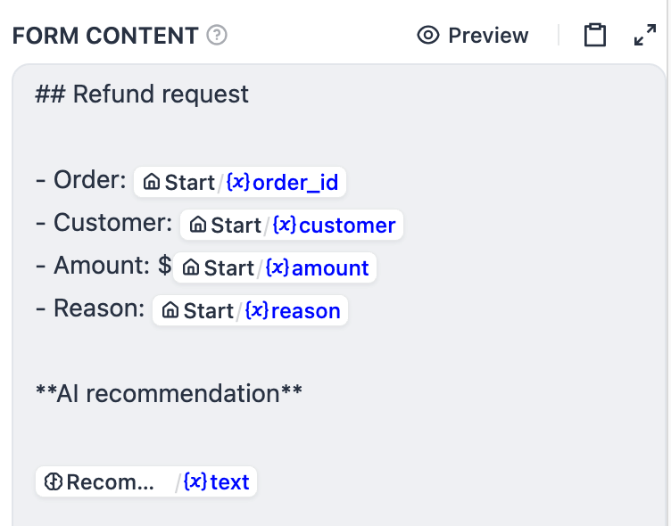
              </Frame>
        </Step>
        <Step title="The lead can respond in one click, with an optional note">
          1. Add the support lead in **Recipients**, and add two buttons under **User Actions**: **Approve** and **Reject**.

          2. For the note, add one Paragraph field named `note_to_customer` and pre-fill it with the static text *None*, so the lead can approve or reject without typing.

          <Columns cols={2}>
            <Frame caption="Note Field Pre-Filled with None">
              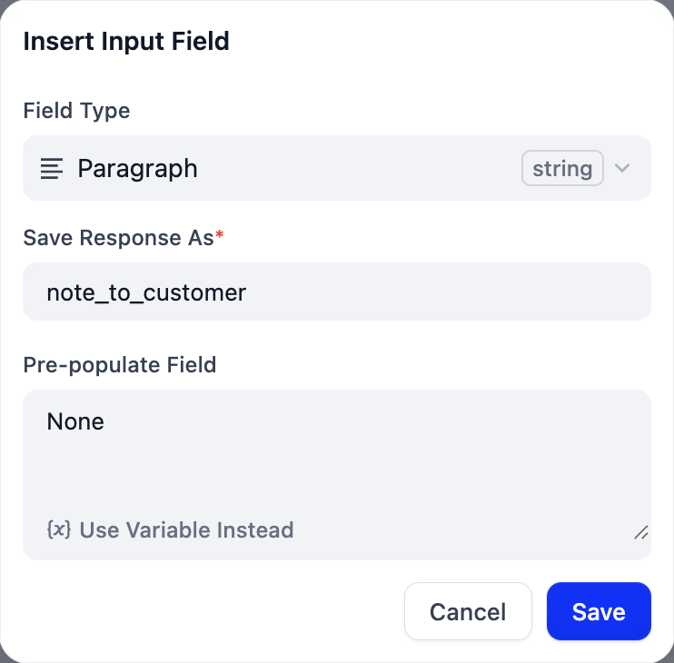
            </Frame>
            <Frame caption="Refund Request">
              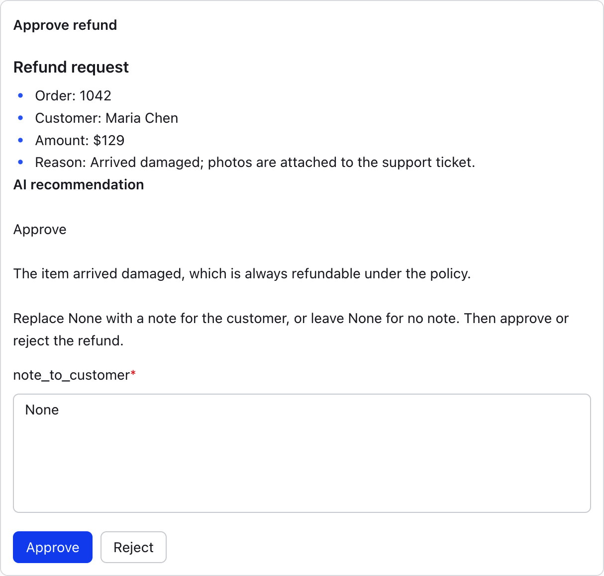
            </Frame>
          </Columns>
        </Step>
        <Step title="The result shows whether the refund was approved, rejected, or never decided">
          1. Connect **Approve** and **Reject** to their own Output nodes (*Refund approved* and *Refund rejected*), each returning the note.

          2. Connect the **Timeout** branch to a third (*No decision*), so a refund no one decided on is never counted as approved or rejected.
        </Step>
      </Steps>

    </Tab>
    <Tab title="Revise a Draft Until Approved">

      <Frame caption="Draft Revision Workflow">
        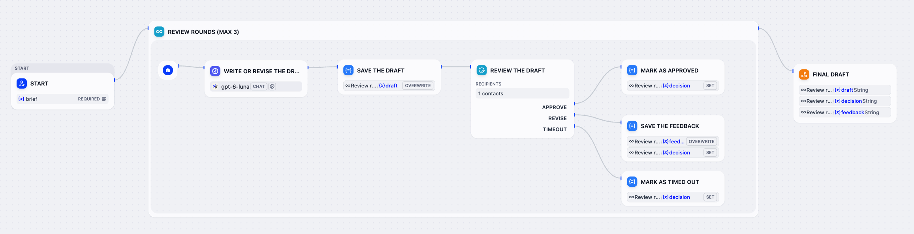
      </Frame>

      This workflow has an LLM write a short blog post from a brief, and a reviewer approves the draft or sends it back with feedback for the LLM to revise. The back-and-forth can go on for up to three rounds.

      At the end, the workflow returns the final draft and how the review ended: approved, timed out, or still unapproved after three rounds.

      <Tip>
      To try this workflow in your workspace, get its template from [Dify Marketplace](https://marketplace.dify.ai).
      </Tip>

      It's designed around these goals:

      <Steps>
        <Step title="The reviewer can go back and forth over several rounds">
          1. Put the LLM node (*Write or revise the draft*) and the Human Input node inside a [Loop](/en/self-host/use-dify/nodes/loop), so each round sends the reviewer a new request with that round's draft.

              Every round is the same two steps: the LLM writes or revises, then the reviewer reviews. The Loop repeats them until a condition says stop, so you build them once instead of copying them for each round.

          2. In the Human Input node, add the reviewer in **Recipients** and two buttons under **User Actions**: **Approve** and **Request changes**.

          <Frame caption="Inside the Loop">
            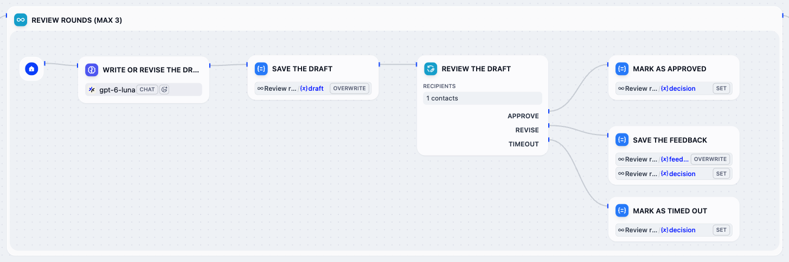
          </Frame>
        </Step>
        <Step title="The reviewer can send the draft back with feedback">
          In the Human Input node's **Form Content**, show the draft, then add a Paragraph field named `feedback`. Pre-fill it with *None*, so the reviewer can approve without typing.

          <Columns cols={2}>
            <Frame caption="Form Content with the Feedback Field">
              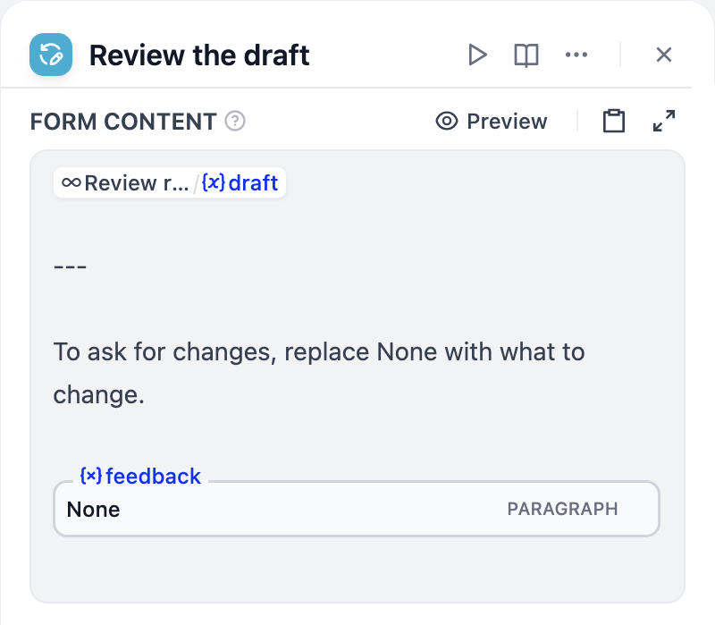
            </Frame>
            <Frame caption="Review Request">
              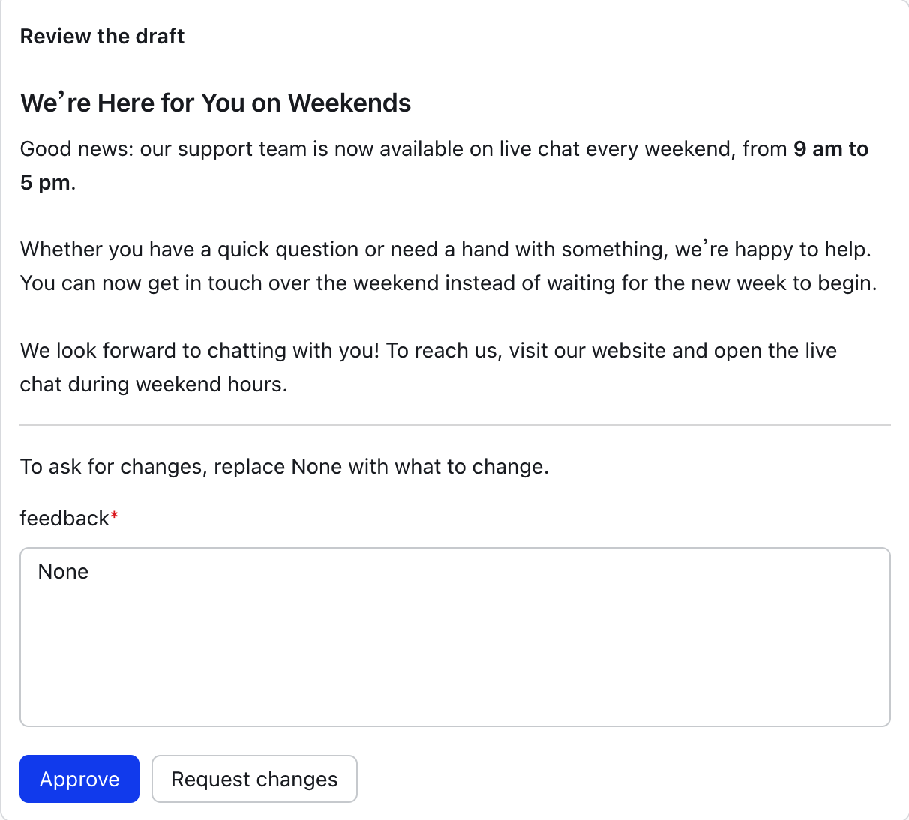
            </Frame>
          </Columns>
        </Step>
        <Step title="Each round revises the last draft instead of starting over">
          When a new round starts, the outputs of the previous round's nodes are gone: round 2 can't read the draft the LLM wrote in round 1, or the feedback the reviewer typed. Only loop variables carry over, along with the workflow's own inputs such as the brief.

          So in the Loop's **Loop Variables**, add `draft` and `feedback`, both strings that start empty.

          <Frame caption="Loop Variables">
            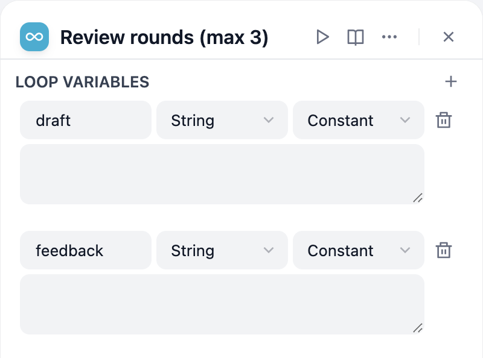
          </Frame>

          A Variable Assigner is the node that saves a value into a loop variable. Add one for each:

          - Right after the LLM, add *Save the draft* to overwrite `draft` with the LLM's output. The next round revises this draft.

            <Frame caption="Save the Draft Assigner">
              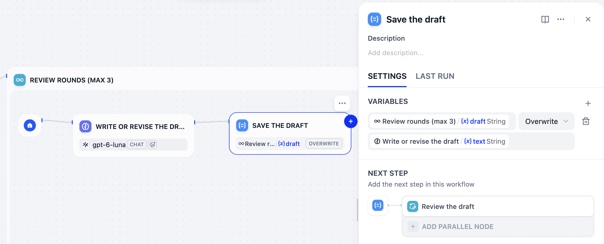
            </Frame>

          - At the end of the **Request changes** branch, add *Save the feedback* to overwrite `feedback` with what the reviewer typed, so the next round's LLM sees it.

            <Frame caption="Save the Feedback Assigner">
              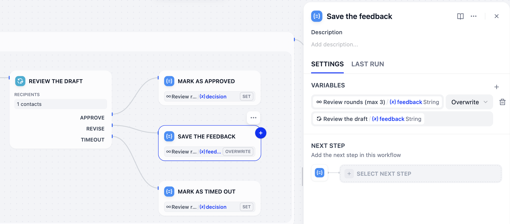
            </Frame>

          Give the LLM the brief from Start, `draft`, and `feedback` in its prompt. Tell it to write a first draft while `draft` is empty, and after that to revise only what the feedback asks.

          <Frame caption="Prompts in Write or Revise the Draft">
            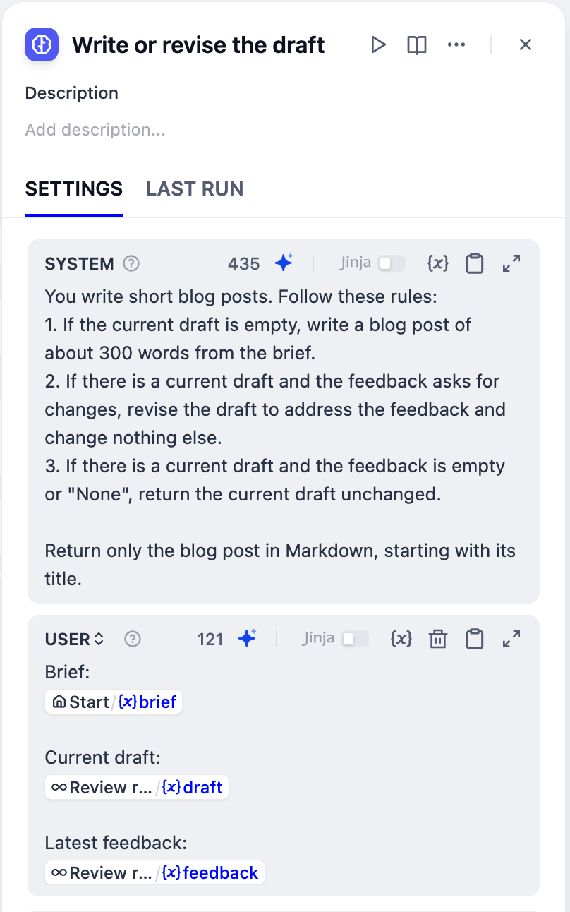
          </Frame>
        </Step>
        <Step title="The review stops when the reviewer approves, no one responds, or three rounds are up">
          To let the Loop know when to stop, record how each round ended:

          1. In **Loop Variables**, add a third, `decision`, that starts as `pending`.

          2. End the **Approve** branch with a Variable Assigner (*Mark as approved*) that sets it to `approved`.

              <Frame caption="Mark as Approved Assigner">
                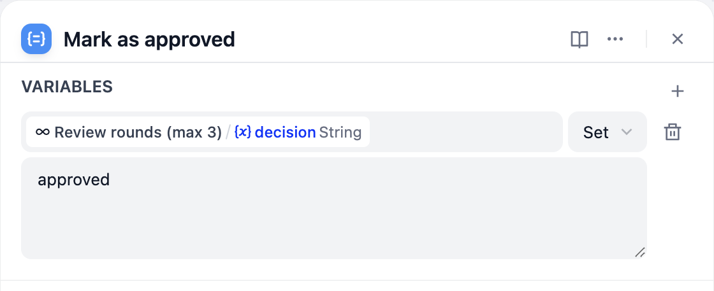
              </Frame>

          3. End the **Timeout** branch with another (*Mark as timed out*) that sets it to `timed_out`.

          Then tell the Loop when to stop:

          1. Set the Loop's **Loop Termination Condition** to `decision` is `approved` OR `decision` is `timed_out`.

              <Frame caption="Loop Termination Condition">
                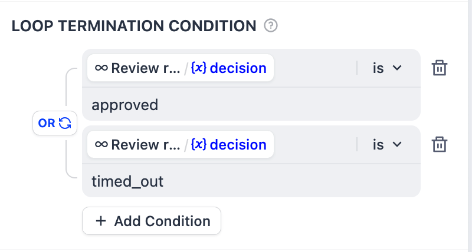
              </Frame>

          2. Set **Maximum Loop Count** to 3. The loop then stops with the third draft, and the reviewer's last feedback isn't applied.

              <Frame caption="Maximum Loop Count">
                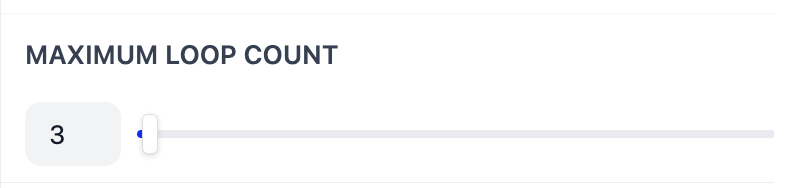
              </Frame>
        </Step>
        <Step title="The result shows how the review ended">
          After the loop, an Output node (*Final draft*) returns the draft, `decision`, and `feedback`.

          <Frame caption="Final Draft Output Variables">
            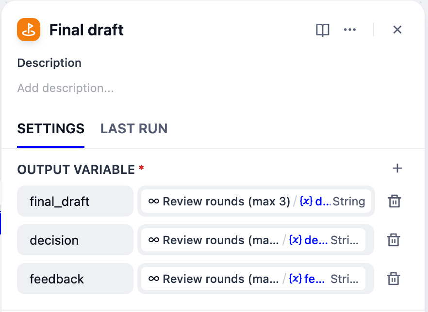
          </Frame>

          `decision` already says whether the reviewer approved or didn't respond. To also mark a review that ran out of rounds, go back to *Save the feedback* and add a second variable that sets `decision` to `changes_requested`.

          <Frame caption="Save the Feedback Assigner with Two Variables">
            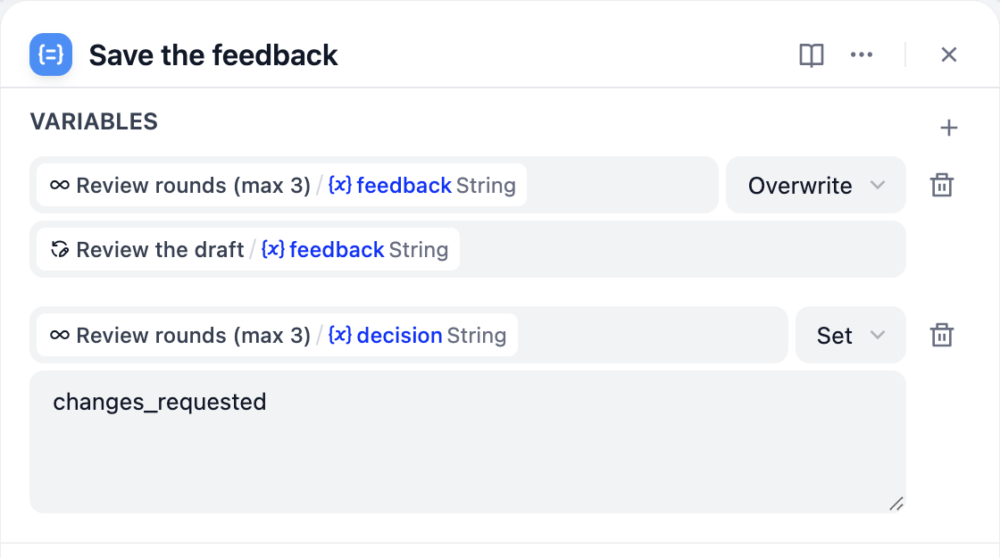
          </Frame>

          In that case, `feedback` holds the reviewer's last request, which no round got to apply. Whoever finishes the draft can start from there.
        </Step>
      </Steps>

    </Tab>
  </Tabs>

  <a id="migrate-from-the-old-node"></a>

  ## Migrate from the Old Node

  Upgrading to a version with the new node doesn't change existing workflows. Their old nodes keep running, and requests already waiting on an old form can still be answered.

  A workflow can't mix old and new Human Input nodes. To add a new one to a workflow that still has old ones, migrate them first: click **Migrate now** at the top of the canvas to convert every old node in the draft at once. The published version doesn't change until you publish again, so you can review the converted nodes first.

  Here's what carries over:

  | Old node | New node |
  |:---------|:---------|
  | Web app delivery | **Initiator** |
  | Members picked by name, and external email addresses | Email addresses |
  | All workspace members | Your workspace, which covers every member |
  | Email subject and body | **Message template**, unchanged |

  Everything else stays as it was: form content, input fields, buttons, the timeout, the node's connections, and the output variables that downstream nodes reference.

  <Note>
  Workspace members you picked by name become plain email addresses: they get email only and enter an emailed code instead of signing in.

  To reach them in IM, replace each address with the member's contact.
  </Note>

  If any node can't be migrated, nothing changes. Common reasons:

  | Reason | What to do |
  |:-------|:-----------|
  | a disabled delivery method still contains configuration | An email method you turned off still has recipients or text. Clear it, or turn it back on if you want those recipients included. |
  | a workspace member cannot be resolved to a contact or verified email | A member you picked has left the workspace. Remove them. |
  | an enabled email method is incomplete | Fill in the email's subject and body. |
  | a recipient email is invalid | Correct or remove the address. |

  To go back to the old nodes after migrating, restore an earlier published version from version history.

  </Tab>

  <Tab title="Old Human Input" id="old-human-input">

  With the old Human Input node, the request shows up in the web app for whoever is running it, or goes out as an email link, and anyone with the link can respond.

  <Tip>
    For a workflow design example, see [Example: Content Review Workflow](#example-content-review-workflow).
  </Tip>

  ## Configuration

  Configure the following to define how the node requests and processes human input:

  - **Delivery method**: How the request form reaches recipients.

  - **Form content**: What information recipients will see and what they can interact with.

  - **User action**: What decisions recipients can make and how the workflow proceeds accordingly.

  - **Timeout**: How long to wait and what happens if no recipient responds.

  ### Delivery Method

  Choose the channel through which the request is delivered. Currently available methods:

  - **Webapp**: Displays the request form to the web app end user. Not available in workflows started by a Trigger.

    <Info>
      External clients can drive the web app form lifecycle through the Service API. See [API Integration Flow](/en/api-reference/guides/human-input-flow).
    </Info>

  - **Email**: Sends a request link via email to specific workspace members, external email addresses, or every member of the workspace. Anyone with the link can respond, no Dify account required.

  <Note>
      The request closes after the first response regardless of delivery method.
  </Note>

  ### Form Content

  Customize the form recipients see and interact with:

  - **Format and structure with Markdown**

    Use headings, lists, bold text, links, and other Markdown elements to present information clearly.

  - **Display dynamic data with variables**

    Reference workflow variables to show dynamic content, such as AI-generated text for review or a file someone uploaded at an upstream Human Input node for approval.

    In web app delivery, the form itself displays to end users. Any variables you reference render their values directly in the form, so **no Answer or Output node is needed before the Human Input node**.

      <Tip>
          Reasoning models emit their thinking process alongside the final answer. Referencing the `text` output variable shows both by default.

          To show only the answer, toggle on **Enable reasoning tag separation** for the corresponding LLM node.
      </Tip>

  - **Collect input with form fields**

    Add fields into the request form to capture different types of input from recipients. Each field becomes a variable for downstream use.

    For example, in a blog review workflow, you can pass recipient feedback to a downstream LLM node for content revision.

    | Field Type | Description |
    |:-----------|:------------|
    | Paragraph | Text input. Can start empty, or pre-filled with variables (e.g., LLM output to refine) or static text (examples or default values). <br></br><br></br>No maximum length, but very long inputs may exceed downstream LLM context windows. |
    | Select | Single-choice selection from a list of options. Define options manually, or reference an `array[string]` variable to use its items as options. |
    | Single File / File List | Single or multiple file uploads. <Info>File upload limits are tunable via environment variables: <ul><li>`UPLOAD_FILE_SIZE_LIMIT`, `UPLOAD_IMAGE_FILE_SIZE_LIMIT`, `UPLOAD_VIDEO_FILE_SIZE_LIMIT`, and `UPLOAD_AUDIO_FILE_SIZE_LIMIT` cap per-file size by extension.</li><li>`WORKFLOW_FILE_UPLOAD_LIMIT` caps the max files a File List field can be configured to accept.</li></ul>See [Environment Variables](/en/self-host/deploy/configuration/environments) for defaults.</Info> |

    <Note>Only Paragraph is optional; Select, Single File, and File List are mandatory. The form's action buttons stay disabled until all mandatory fields are filled.</Note>

  After the recipient responds, the form content with all values filled in is available downstream as the `__rendered_content` variable. File field values render as plain-text placeholders: `[file]` for Single File and `[N files]` for File List.

  ### User Action

  Define the decision buttons that recipients can click, each routing the workflow to a different execution path.

  For example, a `Post` branch might lead to nodes that trigger content publishing, while a `Regenerate` branch might loop back to an LLM node to revise the content.

  Each button has a display title and an action ID. When a button is clicked, its ID is exposed downstream as `__action_id` and its title (button text) as `__action_value`.

  <Frame>
    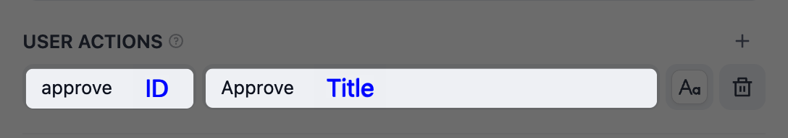
  </Frame>

  <Tip>
      Use preset button styles to visually distinguish actions.

      For example, use a prominent style for key actions like `Approve` and a subtler one for secondary options.
  </Tip>

  ### Timeout Strategy

  Configure how long the request stays open before it expires. The default is 3 days.

  If no recipient responds before the timeout, the workflow follows the timeout branch from the node. Wire this branch to a fallback path, such as a notification or a retry loop.

  If no timeout branch is connected, the workflow ends.

  ## Example: Content Review Workflow

  <Columns cols={2}>
    <Frame caption="Workflow Example">
      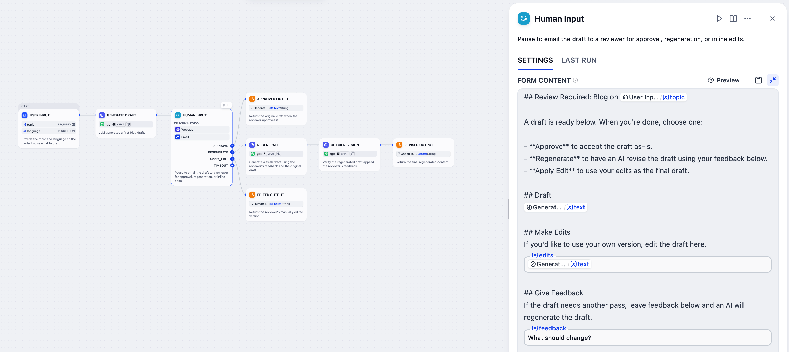
    </Frame>
    <Frame caption="Request Form Example">
      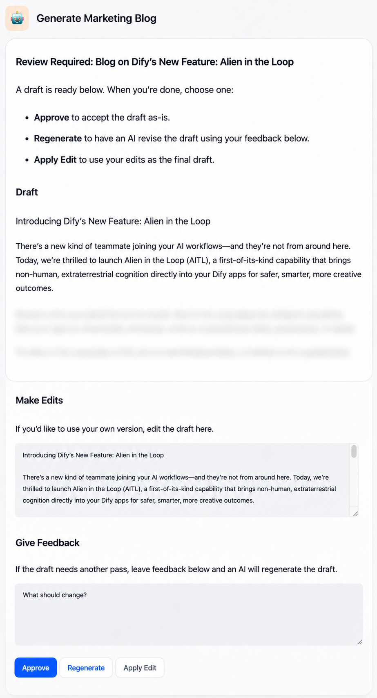
    </Frame>
  </Columns>

  This workflow drafts a blog post from the `topic` and `language` that a workflow initiator inputs, emails the draft to a reviewer, and finalizes the output based on the reviewer's choice.

  It is designed around three things the reviewer should be able to do:

  1. **See the AI-generated draft**: Reference the upstream LLM node's `text` variable in the form so the rendered form displays the draft directly.

  2. **Edit the draft directly if needed**: Add a Paragraph field named `edits` in the form, pre-filled with the same `text` variable, so the reviewer sees the draft as starting content and can edit in place.

     Because blog posts are long, the form's Markdown display (point 1) reads better than a Paragraph field on its own. For shorter content, the pre-filled Paragraph field alone can handle both reading and editing.

  3. **Provide feedback for an AI revision**:

      1. Add a Paragraph field named `feedback` in the form for the reviewer's feedback.
      2. Connect two downstream LLM nodes in sequence:
          1. A Regenerate node that takes the original draft `text` and the reviewer's `feedback` to produce a revised draft.
          2. A Check Revision node that takes `feedback` and the revised draft to verify whether the revision addresses the feedback. The verified result is what flows downstream.

  On the received request form, the reviewer fills the relevant Paragraph fields (or leaves them blank) based on their judgment, then clicks the matching action button. Each action wires to a different output:

  - **Approve**: the original draft from the upstream LLM
  - **Apply Edit**: the reviewer's edited content from the `edits` field
  - **Regenerate**: the revised draft from the downstream LLM pipeline

  <Accordion
    title="LLM Node Prompts for Reference"
  ><Tabs>
    <Tab title="Generate Draft">
      **System**

      ```text wrap
      Write a marketing blog post around the given topic in the specified language.
      ```

      **User**

      ```text
      Topic: {{#user_input.topic#}}
      Language: {{#user_input.language#}}
      ```

    </Tab>
    <Tab title="Regenerate">
      **System**

      ```text wrap
      Regenerate the draft based on user feedback.
      ```

      **User**

      ```text
      Draft: {{#generate_draft.text#}}
      User Feedback: {{#human_input.feedback#}}
      ```

    </Tab>
    <Tab title="Check Revision">
      **System**

      ```text wrap
      Check whether the draft below addresses the user's feedback. Return the draft unchanged if it does; revise it to address the feedback if it doesn't.
      ```

      **User**

      ```text
      User Feedback: {{#human_input.feedback#}}
      Regenerated Draft: {{#regenerate.text#}}
      ```

    </Tab>
  </Tabs>

  </Accordion>

  </Tab>
</Tabs>
