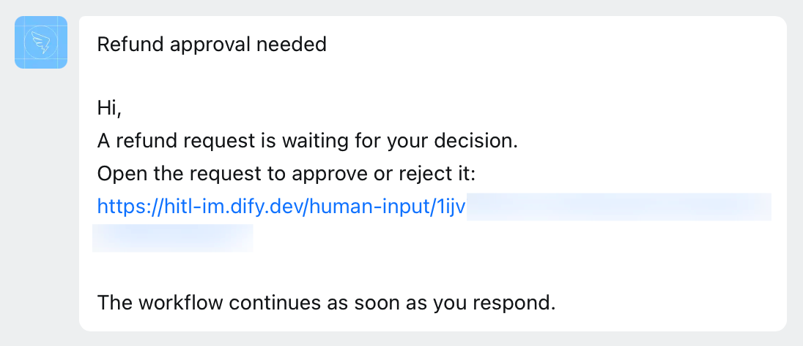

Dify works through an internal app that you create in your DingTalk organization. The app:

- Sends requests to members through its bot, each as a message with a link to the form in Dify.
- Lets Dify read the member directory and match each person to a workspace member by email.

## Before You Start

Make sure that:

- You can create internal apps in your DingTalk organization's Developer Console.
- [`CONSOLE_WEB_URL`](/en/self-host/deploy/configuration/environments#console_web_url) is set to an address members can open, since every request links there.

## Create the App

In the [DingTalk Developer Console](https://open-dev.dingtalk.com/), go to **App Development** > **DingTalk App** and click **Create App**. Give the app a name and a description, and click **Save**. Then:

1. In the app, open **Add App Capability** and click **Add** on the **Bot** card.

2. On the **Bots** page, turn on **Bot Configuration**, fill in the required fields, then click **Publish**.

    - In **Bot name**, give the bot a name members will recognize, such as *Dify*: requests arrive from a bot with this name.

    - Leave **Message receiving mode** as **Stream mode**.

3. In **Manage permissions**, set **Contacts API permission scope** to **All employees**. Then search for each of these permission codes and enable it:

    - `qyapi_robot_sendmsg`
    - `qyapi_get_department_list`
    - `qyapi_get_department_member`
    - `qyapi_get_member`
    - `fieldEmail`

4. In **Version Management and Release**, click **Create New Version**, set **Available scope** to **All employees**, and click **Save**.

   If you're not a DingTalk admin, your admin may need to approve it first. Wait until it's published before you connect next.

## Connect It in Dify

1. In **Settings** > **Channels**, find DingTalk and click **Connect**.

   <Info>
   If another IM (instant messaging app) is already connected, click **Replace** instead. Check [what replacing clears](/en/self-host/use-dify/workspace/channels/overview#replace-or-remove-your-im) first.
   </Info>

2. Enter the values from DingTalk:

    - **Corp ID**: the **CorpId** on the Developer Console's home page.
    - **Client ID** and **Client Secret**: on your app's **Credentials and Basic Information** page.

   <Note>
   Whenever you change one of these values in DingTalk, update it in Dify too.
   </Note>

3. Click **Connect**. Dify checks the connection before saving.

## Sync and Test

1. In **Channels**, click **Sync now** to bind members' IM identities. See [Sync Members](/en/self-host/use-dify/workspace/channels/overview#sync-members) for what each result means.

2. With your own IM identity bound, send yourself a test request:

    - For a quick check that messages reach you, use **Test message** in a Human Input node's **Message template**: pick DingTalk as the **Test channel** and click **Save and test**. It sends you the message without running the workflow.
    - To check the whole flow, turn on Debug Mode in the node, pick DingTalk, and test-run the workflow. When the message arrives in your chat with the bot, open the link, sign in, respond, and check that the run continues.

   If the test fails or nothing arrives, see [Troubleshooting](#troubleshooting).

## What Members See

Each request arrives in the member's one-on-one chat with the bot. It's a text message built from the node's [message template](/en/self-host/use-dify/nodes/human-input#write-the-notification): the subject, then the body with the link.

<Frame caption="Request as a DingTalk Message">
  
</Frame>

The subject is what members read first, so make it say what they're deciding, such as *Approve refund for order 1042*.

Members open the link and respond in Dify, signed in with the account the request was sent to. A forwarded link doesn't work for anyone else, so add everyone who should respond as a recipient.

## Troubleshooting

<AccordionGroup>
  <Accordion title="Connecting says the provider connection could not be established">
    Depending on how the message ends:

    - It ends there, with no HTTP status or error code: Dify can't read your whole DingTalk directory, because **Contacts API permission scope** isn't **All employees**. Change it in **Manage permissions**.
    - It ends with `API error code: 88` or `60011`: the app lacks `qyapi_get_department_list`. Enable it in **Manage permissions**.
    - It ends with `HTTP status: 500. API error code: unknownError.`: the Corp ID is wrong. Copy it again from the Developer Console's home page.

    Then click **Connect** again.
  </Accordion>
  <Accordion title="A sync says the provider directory could not be read">
    Usually the app lacks `qyapi_get_department_member`. Enable it in **Manage permissions** and sync again.
  </Accordion>
  <Accordion title="Members stay Not matched after a sync">
    Dify found no matching email for them. Depending on who's affected:

    - Every member: the app lacks `fieldEmail`. Enable it in **Manage permissions** and sync again.
    - Some members: Dify reads the email on each member's DingTalk profile, not their DingTalk enterprise mailbox. For members who have only an enterprise mailbox, add an email to their profile and sync again, or [bind them by hand](/en/self-host/use-dify/workspace/contacts#bind-by-hand).
  </Accordion>
  <Accordion title="A test request fails">
    Something stops Dify from sending: **Test message** shows "Test failed. Check the channel configuration and try again.", or a Debug Mode run fails with "No one can approve this step."

    Check that:

    - The app has `qyapi_robot_sendmsg` enabled.
    - The bot is published, and you published an app version after it.
    - Your own IM identity is bound.
  </Accordion>
</AccordionGroup>
