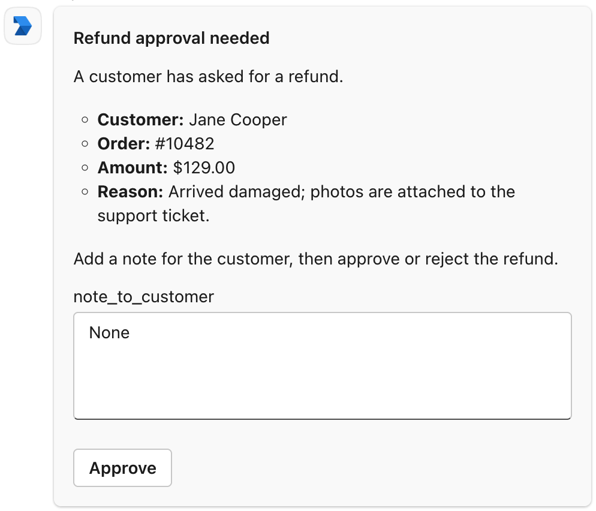
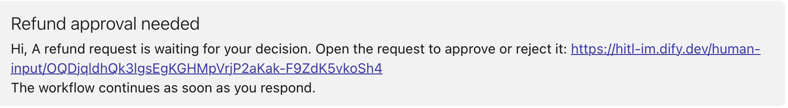

Dify works through a bot that you register in Azure and a Teams app that brings it into your organization. Together they:

- Send requests to members in a personal chat with the bot.
- Let Dify read your organization's user list and match each person to a member of your Dify workspace by email.
- Send members' responses back to Dify when they click a button on a request.

## Before You Start

Setting this up takes three kinds of Microsoft admin rights, often held by different people. Make sure you have, or can bring in:

- **For the bot**: an Azure subscription where you can create resources.
- **For the bot's permissions**: someone with the Privileged Role Administrator or Global Administrator role in Microsoft Entra ID, to grant admin consent.
- **For the Teams app**: someone with the Teams Administrator or Global Administrator role, to approve and install the app in the Teams admin center.

On the Dify side, make sure that:

- [`TRIGGER_URL`](/en/self-host/deploy/configuration/environments#trigger_url) is set to an HTTPS address Microsoft Teams can reach over the internet, so clicks on card buttons get back to Dify.
- [`CONSOLE_WEB_URL`](/en/self-host/deploy/configuration/environments#console_web_url) is set to an address members can open, since a request that arrives as a link message links there.

## Create the Bot

<Steps>
  <Step title="Create the Azure Bot">
    1. In the Azure portal, [create an Azure Bot](https://portal.azure.com/#create/Microsoft.AzureBot). Fill in the **Basics** tab as you like, except for these:

        - **Data residency**: **Global**.
        - **Pricing tier**: **Free** is enough.
        - **Type of App**: **Single Tenant**.
        - **Creation type**: **Create new Microsoft App ID**.

    2. Click **Review + create** > **Create**.
  </Step>
  <Step title="Add the Teams channel">
    1. When the deployment finishes, click **Go to resource** to open the bot.
    2. In **Settings** > **Channels**, under **Available Channels**, click **Microsoft Teams**.
    3. On the **Messaging** tab, choose **Microsoft Teams Commercial (most common)** and click **Apply**.
  </Step>
  <Step title="Note the bot's IDs">
    Open **Settings** > **Configuration** and note the **Microsoft App ID** and **App Tenant ID**. You'll enter them in the Teams app and in Dify later.

    You can get back to the bot anytime from your [Azure Bot list](https://portal.azure.com/#browse/Microsoft.BotService%2FbotServices).
  </Step>
</Steps>

## Grant Permissions and Create a Secret

<Steps>
  <Step title="Open the bot's app registration">
    In Microsoft Entra ID, open [App registrations](https://portal.azure.com/#view/Microsoft_AAD_RegisteredApps/ApplicationsListBlade) and select the one with the bot's name.
  </Step>
  <Step title="Grant the permissions">
    1. In **API permissions**, click **Add a permission** > **Microsoft Graph** > **Application permissions**, select `User.Read.All` and `Organization.Read.All`, and click **Add permissions**.
    2. Click **Grant admin consent for …** and confirm.

    These let Dify read your organization and its users, with their emails and profile photos.
  </Step>
  <Step title="Create a client secret">
    1. In **Certificates & secrets** > **Client secrets**, click **New client secret**, choose when it expires, and click **Add**.
    2. Copy the new secret's **Value** before you leave the page. Microsoft won't show it again. Make sure it's the **Value** and not the **Secret ID**.
  </Step>
</Steps>

<Note>
Mark the secret's expiry date. Once it expires, Dify can no longer send requests to Teams or sync members.

Create the next secret before then and [enter it in Dify](#requests-stopped-arriving-though-channels-still-shows-connected).
</Note>

## Create the Teams App

<Steps>
  <Step title="Create the app">
    In the [Teams Developer Portal](https://dev.teams.microsoft.com/apps), click **New app**, give it a name, and click **Create**.
  </Step>
  <Step title="Fill in its basic information">
    1. In **Configure** > **Basic information**, fill in the required fields, and in **Application (client) ID**, enter the **Microsoft App ID** you noted in [Create the Bot](#create-the-bot).
    2. Click **Save**.

    <Info>
    The **App ID** higher up on the page is the Teams app's own ID. Leave it as it is.
    </Info>
  </Step>
  <Step title="Add the bot">
    1. In **Configure** > **App features**, click **Bot**.
    2. Under **Identify your bot**, choose **Enter a bot ID** and enter the bot's **Microsoft App ID** again.
    3. Under **Select the scopes where people can use your bot**, select **Personal**, and click **Save**.
  </Step>
  <Step title="Submit it for approval">
    Click **Distribute** > **Publish to your organisation** > **Get started**.
  </Step>
</Steps>

The app now waits for a Teams admin's approval. While it waits, you can [connect it in Dify](#connect-it-in-dify) and [set up callbacks](#set-up-callbacks); only the test at the end needs the app installed.

## Approve and Install the App

<Steps>
  <Step title="Approve the app">
    1. In the Teams admin center, open [Manage apps](https://admin.teams.microsoft.com/policies/manage-apps), search for the app by its name, and open it.
    2. Click **Publish** and confirm.
  </Step>
  <Step title="Install it for members">
    1. On the **Users and groups** tab, with **Installs** selected, click **Install app**.
    2. Set **Install to** to **Everyone**, or to **Specific users or groups** that cover everyone who should get requests, and click **Apply**.

    Installing the app here lets members get requests without adding it themselves. Anyone who doesn't have the app gets nothing from Dify in Teams.
  </Step>
</Steps>

## Connect It in Dify

1. In Dify, go to **Settings** > **Channels**, find Microsoft Teams, and click **Connect**.

   <Info>
   If another IM (instant messaging app) is already connected, click **Replace** instead. Check [what replacing clears](/en/self-host/use-dify/workspace/channels/overview#replace-or-remove-your-im) first.
   </Info>

2. In **App credentials**, enter the IDs you noted in [Create the Bot](#create-the-bot) and the secret you copied:

    - **Tenant ID**: the bot's **App Tenant ID**.
    - **Client ID**: the bot's **Microsoft App ID**.
    - **Client Secret**: the secret's **Value**.

3. Click **Save and continue**. Dify checks the connection before saving. If the check fails, see [what its error means](#saving-in-dify-fails).

4. In **Configure callbacks**, copy the **Callback URL**.

## Set Up Callbacks

1. In your [Azure Bot list](https://portal.azure.com/#browse/Microsoft.BotService%2FbotServices), open the bot and go to **Settings** > **Configuration**.

2. Paste the Callback URL copied from Dify into **Messaging endpoint** and click **Apply**.

<Info>
If [`TRIGGER_URL`](/en/self-host/deploy/configuration/environments#trigger_url) changes later, the Callback URL changes with it.

Open the Microsoft Teams settings in **Channels** to get the new one, and update the bot's **Messaging endpoint**.
</Info>

## Sync and Test

1. In **Channels**, click **Sync now** to bind members' IM identities. See [Sync Members](/en/self-host/use-dify/workspace/channels/overview#sync-members) for what each result means.

   Dify matches people by the email address on their Microsoft Entra ID account. Anyone with no email there lands in **Not matched**. [Bind them by hand](/en/self-host/use-dify/workspace/contacts#bind-by-hand) in Contacts.

2. Send yourself a test request. With your own IM identity bound, turn on Debug Mode in a workflow's Human Input node, pick Microsoft Teams, and test-run the workflow.

   Use Debug Mode rather than **Test message**: a test message always arrives as a link message, so it can't show whether cards and clicks work.

The card arrives in a personal chat with the bot. Click a button and check that the run continues.

<Info>

  - If a link message arrives instead, the form has something [a card can't show](#what-members-see).
  - If nothing arrives or the run doesn't continue, see [Troubleshooting](#troubleshooting).

</Info>

## What Members See

<Columns cols={2}>
  <Frame caption="Request as a Teams Card">
    
  </Frame>
  <Frame caption="Request as a Link Message">
    
  </Frame>
</Columns>

Keep these in mind when building forms:

- The card is headed by the node's title. Give the node a title recipients will understand, such as *Approve refund* rather than *Human Input 2*.

- Members must fill in every field before they can submit the card.

Some forms arrive as a link message instead of a card, when the form has:

- A file field.
- Very long content, such as a long report inserted from a variable.

## Troubleshooting

<AccordionGroup>
  <Accordion title="Saving in Dify fails" id="saving-in-dify-fails">
    The error in the message points to the cause:

    - **AADSTS7000215**: the Client Secret is wrong, often because the **Secret ID** was pasted instead of the **Value**. Enter the secret's **Value**; if you no longer have it, create a new secret.
    - **AADSTS700016**: the Client ID isn't an app in the Tenant ID's organization. Copy both IDs again from the bot's **Configuration** page; the **App ID** from the Teams Developer Portal won't work.
    - **Internal Server Error**: the Tenant ID matches no organization, often because the two IDs were swapped. Copy the **App Tenant ID** again.
    - **HTTP status: 403**: Dify isn't allowed to read your user list. Check that the admin consent [has been granted](#grant-permissions-and-create-a-secret).
  </Accordion>
  <Accordion title="A test request fails">
    Something stops Dify from sending: **Test message** shows "Test failed. Check the channel configuration and try again.", or a Debug Mode run fails with "No one can approve this step."

    Check that:

    - Your own IM identity is bound.
    - The Teams app has reached you. If it isn't installed for everyone in the Teams admin center, add it yourself in Teams from **Apps** > **Built for your org**.
    - The bot's Microsoft Teams channel is on, under **Settings** > **Channels** in Azure.
  </Accordion>
  <Accordion title="Buttons on every card do nothing">
    Clicks aren't getting through to Dify. Check these in order:

    - The bot's **Messaging endpoint** is the current Callback URL from **Channels**.
    - [`TRIGGER_URL`](/en/self-host/deploy/configuration/environments#trigger_url) is set to an HTTPS address Microsoft Teams can reach over the internet.
  </Accordion>
  <Accordion title="A button on one card doesn't work">
    Depending on the cause:

    - A field on the card is empty: fill in every field and click again.
    - The request timed out, its run was stopped, or the member left your Dify workspace: start a new run if the decision is still needed.
    - The card was sent before the member's IM binding changed, or before the IM was replaced or deleted: the member can still respond from the email if the deployment's [mail configuration](/en/self-host/deploy/configuration/environments#mail-configuration) is set up. Otherwise, start a new run.
  </Accordion>
  <Accordion title="A member gets nothing in Teams">
    Check in **Contacts** that their IM identity is bound. If it isn't, sync again or [bind them by hand](/en/self-host/use-dify/workspace/contacts#bind-by-hand).

    If it is, the Teams app may not have reached them yet. They can add it themselves in Teams: **Apps** > **Built for your org**, then the app's **Add**.

    Meanwhile, they still get the request by email if the deployment's [mail configuration](/en/self-host/deploy/configuration/environments#mail-configuration) is set up.
  </Accordion>
  <Accordion title="Requests stopped arriving, though Channels still shows Connected" id="requests-stopped-arriving-though-channels-still-shows-connected">
    The client secret has probably expired. To check, open the Microsoft Teams settings in **Channels**, go back to **App credentials**, and click **Test connection**. An expired secret fails with AADSTS7000222.

    [Create a new client secret](#grant-permissions-and-create-a-secret) and enter it under **App credentials** in the same settings. Members' bindings and the Callback URL stay as they are, so there's no need to sync again or update the **Messaging endpoint**.
  </Accordion>
</AccordionGroup>
