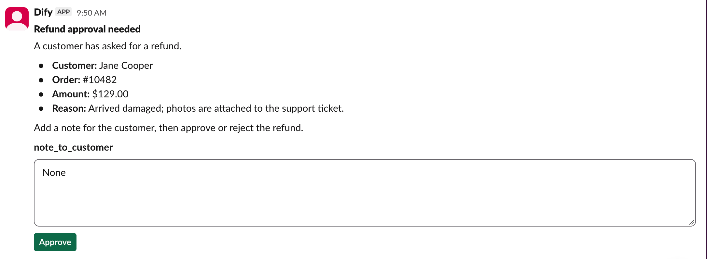
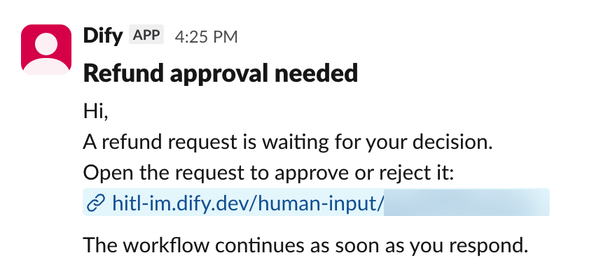

Dify works through a Slack app that you create in your Slack workspace. The app:

- Sends requests to members through its bot.
- Lets Dify read your Slack workspace's member list and match each person to a member of your Dify workspace by email.
- Sends members' responses back to Dify when they click a button on a request.

## Before You Start

Make sure that:

- You can install apps in your Slack workspace, or a Slack admin can approve the install.
- [`TRIGGER_URL`](/en/self-host/deploy/configuration/environments#trigger_url) is set to an address Slack can reach over the internet, so clicks on card buttons get back to Dify.
- [`CONSOLE_WEB_URL`](/en/self-host/deploy/configuration/environments#console_web_url) is set to an address members can open, since a request that arrives as a link message links there.

## Create the App

In the [Slack Developer Console](https://api.slack.com/apps), click **Create an App**. Under **From scratch**, choose **Pick features** and click **Continue**. Then:

1. Give the app a name members will recognize, such as *Dify*: requests arrive from an app with this name. In **Workspace**, pick the Slack workspace your team works in.

2. Under **Bot scopes**, click **Add Bot Scopes** and add `chat:write`, `im:write`, `users:read`, and `users:read.email`.

   The scopes let the app start direct messages with members, send cards and update them after someone responds, and read the member list with each member's email.

3. On the events step, add nothing and click **Continue**.

4. Click **Create and Install**, then click **Allow** in Slack's permission window.

5. In the app's settings, open **Socket Mode** and turn off **Enable Socket Mode**. While it's on, button clicks never reach Dify.

## Connect in Dify

1. In **Settings** > **Channels**, find Slack and click **Connect**.

   <Info>
   If another IM (instant messaging app) is already connected, click **Replace** instead. Check [what replacing clears](/en/self-host/use-dify/workspace/channels/overview#replace-or-remove-your-im) first.
   </Info>

2. In **App credentials**, enter the values from your Slack app:

    - **Client ID**, **Client Secret**, and **Signing Secret**: on the app's **Basic Information** page, under **App Credentials**.
    - **Bot Token**: the **Bot User OAuth Token** under **OAuth & Permissions** > **OAuth Tokens**.

   <Note>
   Whenever you change one of these values in Slack, such as regenerating the Signing Secret, update it in Dify too.
   </Note>

3. Click **Save and continue**. Dify checks the connection before saving.

4. In **Configure callbacks**, copy the **Callback URL**.

## Set Up Callbacks

1. In your Slack app, open **Interactivity & Shortcuts** and turn on **Interactivity**.

2. Paste the Callback URL copied from Dify into **Request URL** and click **Save Changes**.

<Info>
If [`TRIGGER_URL`](/en/self-host/deploy/configuration/environments#trigger_url) changes later, the Callback URL changes with it.

Open the Slack settings in **Channels** to get the new one, and update it in your Slack app.
</Info>

## Sync and Test

1. In **Channels**, click **Sync now** to bind members' IM identities. See [Sync Members](/en/self-host/use-dify/workspace/channels/overview#sync-members) for what each result means.

2. Send yourself a test request. With your own IM identity bound, turn on Debug Mode in a workflow's Human Input node, pick Slack, and test-run the workflow.

   Use Debug Mode rather than **Test message**: a test message always arrives as a link message, so it can't show whether cards and clicks work.

The card arrives in a direct message from the app. Click a button and check that the run continues.

<Info>

  - If a link message arrives instead, the form has something [a card can't show](#what-members-see).
  - If nothing arrives or the run doesn't continue, see [Troubleshooting](#troubleshooting).

</Info>

## What Members See

<Columns cols={2}>
  <Frame caption="Request as a Slack Card">
    
  </Frame>
  <Frame caption="Request as a Link Message">
    
  </Frame>
</Columns>

Keep these in mind when building forms:

- The card is headed by the node's title. Give the node a title recipients will understand, such as *Approve refund* rather than *Human Input 2*.

- Members must fill in every field before they can submit the card.

Some forms arrive as a link message instead of a card, when the form has:

- A file field.
- Very long content, such as a long report inserted from a variable.
- A Select field with more than 100 options or an option over 75 characters.

## Troubleshooting

<AccordionGroup>
  <Accordion title="A test request fails">
    Something stops Dify from sending: **Test message** shows "Test failed. Check the channel configuration and try again.", or a Debug Mode run fails with "No one can approve this step."

    Check that:

    - The app is still installed in your Slack workspace, and Dify has its current Bot Token.
    - Your own IM identity is bound.
  </Accordion>
  <Accordion title="Buttons on every card do nothing, or Slack shows an error">
    Clicks aren't getting through to Dify. Check these in order:

    - **Socket Mode** is off in your Slack app.
    - **Interactivity** is on, and its **Request URL** is the current Callback URL from **Channels**.
    - The Signing Secret in Dify matches the one under **Basic Information** > **App Credentials**.
    - [`TRIGGER_URL`](/en/self-host/deploy/configuration/environments#trigger_url) is set to an address Slack can reach over the internet.
  </Accordion>
  <Accordion title="A button on one card doesn't work">
    Depending on the cause:

    - A field on the card is empty: fill in every field and click again.
    - The request timed out, its run was stopped, or the member left your Dify workspace: start a new run if the decision is still needed.
    - The card was sent before the member's IM binding changed, or before the IM was replaced or deleted: the member can still respond from the email if the deployment's [mail configuration](/en/self-host/deploy/configuration/environments#mail-configuration) is set up. Otherwise, start a new run.
  </Accordion>
</AccordionGroup>
