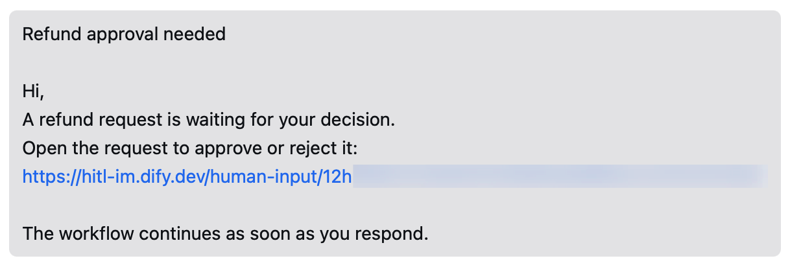

Dify works through a self-built app that you create in your WeCom organization's admin console. The app:

- Sends requests to members, each as a text message with a link to the form in Dify.
- Lets Dify read the members allowed to use the app.

## Before You Start

WeCom takes calls only from IP addresses you've added to the app. Before you can add one, WeCom asks you to verify a domain your company owns. Make sure that:

- You're an admin of your WeCom organization, or can work with one.
- You know the public IP address your Dify server uses for outgoing requests. That's the address WeCom sees, and it may differ from the address your Dify domain points to. Running `curl ifconfig.me` on the server shows it.
- You have a domain your company owns, with its ICP filing under your company or a related one, and you can put a file at the root of its website.
- [`CONSOLE_WEB_URL`](/en/self-host/deploy/configuration/environments#console_web_url) is set to an address members can open, since the link in each message points there.

## Create the App

In the [WeCom admin console](https://work.weixin.qq.com/wework_admin/frame), go to **App Management** > **Apps**, and under **Self-built**, click **Create an app**. Then:

1. Upload an **App Logo** and give the app an **App Name** members will recognize, such as *Dify*: requests arrive from an app with this name.

2. Under **Allowed users**, click **Select departments/members** and pick everyone who should get requests. Then click **Create an app**.

## Trust the Dify Server's IP {#trust-the-dify-server-ip}

1. On the app's page, find **Company's Trusted IP** and click **Settings**.

2. In the dialog, click **Set trusted domain name**. Then:

    1. Enter your company's domain in the first **Trustable Domain Names** box.
    2. At the bottom, click **Domain name to be verified**. Download the verification file and put it at the root of that domain's website.
    3. Click **OK**.

3. Back in **Company's Trusted IP** > **Settings**, enter the Dify server's public IP address and save.

   Wait about a minute for the change to apply before you connect in Dify.

## Connect It in Dify

1. In **Settings** > **Channels**, find WeCom and click **Connect**.

   <Info>
   If another IM (instant messaging app) is already connected, click **Replace** instead. Check [what replacing clears](/en/self-host/use-dify/workspace/channels/overview#replace-or-remove-your-im) first.
   </Info>

2. Enter the values from WeCom:

    - **Corp ID**: the **Company ID** at the bottom of the admin console's **My Company** page.
    - **Agent ID**: the **AgentId** on the app's page.
    - **Secret**: on the app's page, click **View** next to **Secret**, then **Send**. WeCom sends it to you in a message from **WeCom Team**; open the message in WeCom and click **View Now**.

   <Note>
   Whenever you change one of these values in WeCom, update it in Dify too.
   </Note>

3. Click **Connect**. Dify checks the connection before saving.

## Sync and Bind Members

1. In **Channels**, click **Sync now**. Every member it finds lands in **Not matched**.

   <Info>
   Dify doesn't match WeCom members automatically yet.
   </Info>

2. [Bind each member by hand](/en/self-host/use-dify/workspace/contacts#bind-by-hand) in **Contacts**, starting with yourself so you can test. If two members share a name, tell them apart by the WeCom user ID shown under each.

Dify can sync and reach only members in the app's **Allowed users**. When someone new should get requests, add them there if they aren't already, then sync again and bind them.

Later syncs keep the bindings you've made, except for anyone you take out of **Allowed users**, whose binding is removed.

## Send a Test Request

With your own IM identity bound, send yourself a test request:

- For a quick check that messages reach you, use **Test message** in a Human Input node's **Message template**: pick WeCom as the **Test channel** and click **Save and test**. It sends you the message without running the workflow.
- To check the whole flow, turn on Debug Mode in the node, pick WeCom, and test-run the workflow. When the message arrives, open the link, sign in, respond, and check that the run continues.

If the test fails or nothing arrives, see [Troubleshooting](#troubleshooting).

## What Members See

Each request arrives as a text message from the app, built from the node's [message template](/en/self-host/use-dify/nodes/human-input#write-the-notification): the subject, then the body with the link.

<Frame caption="Request as a WeCom Message">
  
</Frame>

The subject is what members read first, so make it say what they're deciding, such as *Approve refund for order 1042*.

WeCom cuts off text messages longer than 2,048 bytes, so a long message template can lose its link. Keep the template short, or put the Request URL near the top of the body.

Members open the link and respond in Dify, signed in with the account the request was sent to. A forwarded link doesn't work for anyone else, so add everyone who should respond as a recipient.

## Troubleshooting

<AccordionGroup>
  <Accordion title="Connecting fails with API error code 60020">
    WeCom doesn't accept requests from the Dify server's IP address. [Add the server's public IP](#trust-the-dify-server-ip) in **Company's Trusted IP**, wait about a minute, and click **Connect** again.

    If you've already added an address, check that it's the one your Dify server uses for outgoing requests.
  </Accordion>
  <Accordion title="Connecting says the credentials are invalid, or fails with another error code">
    One of the three values is wrong, or they come from different apps. Copy the **Company ID** from **My Company**, and the **AgentId** and Secret from the same app.
  </Accordion>
  <Accordion title="A test request fails">
    Something stops Dify from sending: **Test message** shows "Test failed. Check the channel configuration and try again.", or a Debug Mode run fails with "No one can approve this step."

    Check that:

    - Your own IM identity is bound.
    - You're in the app's **Allowed users**.
    - The Dify server's current public IP is in **Company's Trusted IP**.
  </Accordion>
  <Accordion title="A sync fails, or messages stop arriving after setup worked">
    Often the Dify server's public IP has changed, and WeCom no longer accepts its requests. To check, open the WeCom settings in **Channels** and click **Test connection**. If the code is 60020, add the new IP in **Company's Trusted IP**.
  </Accordion>
</AccordionGroup>
