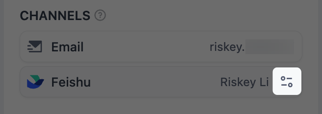

Contacts lists the people app builders can pick as recipients in a [Human Input](/en/self-host/use-dify/nodes/human-input#choose-who-responds) node. Everyone in it gets requests by email, and members also get them in your team's IM (instant messaging app) once their IM identity is bound.

Only workspace owners and admins see **Contacts** in the main navigation, and only they can add, change, or bind people. Editors can still search contacts by name or email when they pick recipients in a node.

## Members Appear Automatically

Every active member of the workspace is a contact, whatever their role. Someone you've invited appears once they activate their account.

Members' names, emails, and avatars come from their Dify accounts. Members change them in their own [profile](/en/self-host/use-dify/workspace/personal-account-management#profile-management), and Contacts updates right away.

Members leave Contacts only when they're removed from the workspace. Before you remove anyone, see [what that changes](#before-you-remove-someone) for requests and workflows.

## Add External Contacts

For partners, clients, and anyone else outside your workspace, click **Add external contact**.

External contacts get requests by email only. To respond, they enter a code sent to that address, so they don't need a Dify account.

<Info>
    For a colleague who should get requests in your team's IM, [invite them to the workspace](/en/self-host/use-dify/workspace/team-members-management) instead; any role works.

    If they're already an external contact, they're listed twice once they join. Nodes that picked the external contact keep sending to their email only, so let builders know to pick the member instead.
</Info>

## Bind Members' IM Identities {#bind-im-identities}

Members get requests in your team's IM only after their IM identity is bound to their contact. A sync binds them by email, and you bind anyone it misses by hand.

### Sync with Your IM

After you connect your team's IM in [Channels](/en/self-host/use-dify/workspace/channels/overview), click **Sync now** there. Dify reads the IM's directory and binds each IM identity to the workspace member with the same email, ignoring capitalization.

A sync runs only when you click **Sync now**, so sync again after new people join or someone's email changes.

IM identities that a sync couldn't pair with a workspace member show as **Not matched** in the sync results in **Channels**. That happens when:

- The IM identity has no email, or no member has that email. Everyone on your IM who isn't in the workspace ends up here.
- The member with that email is already bound to another IM identity that's still in the directory.

To pair someone, correct the email in your IM or in their Dify account and sync again, or [bind them by hand](#bind-by-hand).

### Bind by Hand

You can only pick IM identities a sync has read. If the person joined your IM after the last sync, sync again first.

In **Contacts**, click the member. In the details that open, find your team's IM under **Channels**, click **Bind**, and pick their IM identity.

<Note>
Picking an IM identity that's already bound to another member moves it to this one without a warning. The other member stops getting requests in the IM, and [cards already sent to them stop working](#when-details-change).
</Note>

To replace a binding, click the change icon instead of **Bind**.

<Frame>

</Frame>

Later syncs keep a binding you made by hand, as long as that IM identity is still in the directory.

Replacing or removing your team's IM in [Channels](/en/self-host/use-dify/workspace/channels/overview) clears every IM binding, including the ones you made by hand. After you connect a new one, sync again and redo your manual bindings.

## When People Change

New requests always follow a person's current details. A change can break requests already sent, and workflows that name someone who's gone.

### Before You Remove Someone

When a member is removed from the workspace or an external contact is removed from **Contacts**:

- They can't answer requests already sent to them: their links and IM cards stop working.
- Published workflows keep running and skip them.
- A workflow that names them can't be published again until a builder takes them out of the node.

Before you remove someone, have them respond to any requests still waiting on them, and tell the builders who send them requests.

Removing an external contact can't be undone: adding the same person again creates a new contact, which builders have to pick again. To change their details, edit the contact instead.

### When Details Change

What happens to requests already sent depends on what changed:

- **A member changes their Dify email**: links already sent still work, because members sign in with their account.
- **You edit an external contact's email**: links sent to the old address stop working.
- **A member's IM binding is removed, moved to someone else, or replaced with another identity**: cards sent through it stop working, even if the same identity is bound to them again. Links in emails and link messages keep working.
