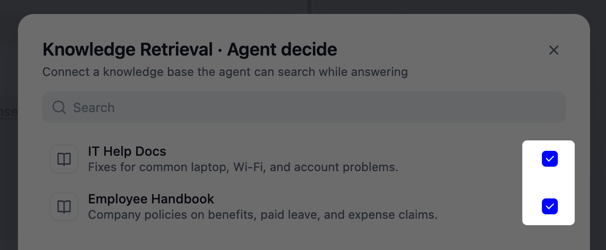
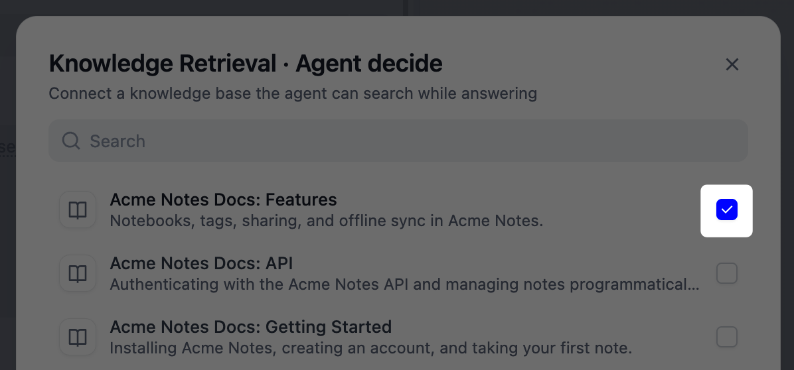
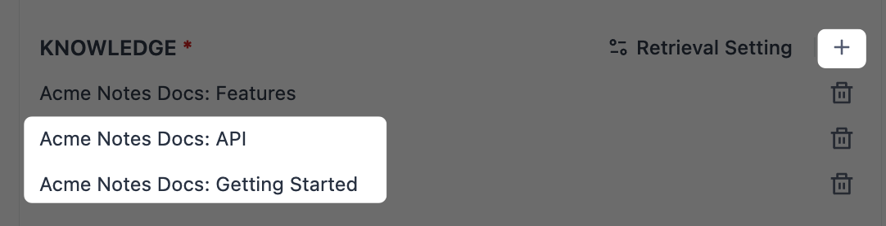

> このドキュメントは AI によって自動翻訳されています。不正確な部分がある場合は、[英語版](/en/cloud/use-dify/build/new-agent/build) を参照してください。

<Info>
新しい Agent はベータ機能です。
</Info>

## Agent の作成

**Agents** ページで **作成** > **最初から作成** をクリックし、Agent に名前を付けます。必要に応じて、「リサーチアシスタント」のようなロールや説明も入力します。残りはすべて **設定** で形づくります。

用意された Agent をベースに始めるには、代わりに **テンプレートから作成** を選択します。使う前に試すには、テンプレートの **詳細** > **お試し** を開きます。お試しでは、ワークスペースの AI クレジットや API キーは使われません。

アプリパッケージ（`.ifpkg`）または DSL ファイル（`.yml` または `.yaml`）から Agent を作成するには、**作成** > **アプリをインポート** をクリックします。DSL ファイルにはスキルとファイルが含まれないため、インポート後に手動で追加してください。

<Info>
Agent の作成と管理には、エディター以上のロールが必要です。
</Info>

## 能力の設定

各能力を手動で設定することも、[ビルドモード](#build-by-chatting) で実現したいことをチャットで伝えながら構築することもできます。

**設定** で指定した内容はすべて Agent の能力として保存され、以後のあらゆるタスクで使われます。これとは別に、Agent は 20 GB のストレージを備えた専用の「サンドボックス」の中で動作し、作業を進めながらコマンドの実行やファイルの操作を行います。

Agent の能力を変更できるのはここだけです。公開済みの Agent にエンドユーザーがプロンプト、スキル、ツールの変更を求めても、Agent は応じません。

### モデル

Agent の実行に使うチャットモデルを選びます。推論に強く、ツール呼び出しをネイティブにサポートするモデルがおすすめです。Agent は、いつ行動するか、どのツールが適しているか、結果をどう読み取るかを自分で判断する必要があるためです。

<Note>
Agent の出来はモデルしだいで大きく変わります。できるだけ新しいモデルを選んでください。

古いモデルはサンドボックスを使いこなせないことが多く、必要な場面でもコマンド実行やツールのインストールを行わないのが典型的な症状です。
</Note>

### プロンプト {#prompt}

プロンプトでは、Agent のロールと仕事の進め方を定めます。どのように推論するか、いつツールに頼るか、何を避けるかを具体的に書いてください。

押さえておきたい項目：

- **ペルソナと目標**：Agent が演じる役割と、達成を目指すゴール。
- **進め方**：典型的なタスクで期待する手順や順序。
- **ツールとファイルの使い方**：それぞれを使う場面（名前を挙げて明示）。
- **出力**：望む形式、長さ、トーン。

特定のスキル、ファイル、ツール、ナレッジ検索を Agent に指定することも、どれを使うかを Agent に任せることもできます：

- **プロンプト内で参照する**：`/` で参照を挿入すると、使ってほしいまさにその箇所で、Agent をその対象へ直接導けます。特定のステップが特定の対象に依存する場合に向いています。
- **セクションに追加するだけ**：いつ使うかは Agent 自身に判断させます。一手一手を指示するより、Agent の判断を信頼したい場合に向いています。

### スキル {#skills}

スキルは、Agent が特定のタスクで従う手順です。プロンプトが Agent の全体的なロールを定めるのに対し、スキルはそのタスクだけを扱います。

たとえば、サポート担当の Agent では、プロンプトであらゆる問い合わせに対応する役割を設定できます。`refund-requests` スキルでは、返金だけを扱います。注文を確認し、30 日以内に限って返金し、最後にヘルプセンターへのリンクを案内します。

**追加** をクリックして、スキルパッケージをアップロードします。`SKILL.md` を含む `.zip` または `.skill` ファイルで、サイズは最大 50 MB です。スキルパッケージのフォーマットについては、[Agent Skills](https://agentskills.io/home) を参照してください。

[ビルドモード](#build-by-chatting) では、Agent にスキルを作成させることもできます。

<Tip>
Dify ツールやファイルを Agent 自身の能力の一部にするには、スキルパッケージに入れるのではなく、Agent に直接追加してください。
</Tip>

### ファイル {#files}

ファイルは、仕様書、テンプレート、ガイドラインなど、Agent が作業中に参照できるドキュメントです。スキルと違い、実行する手順ではなく、読むための資料です。

サイズ上限はファイルタイプごとに異なります。

| ファイルタイプ | 上限 |
|:---------------|:-----|
| ドキュメント | 15 MB |
| 画像 | 10 MB |
| 動画 | 100 MB |
| 音声 | 50 MB |

[ビルドモード](#build-by-chatting) では、Agent にファイルを作成させ、ここに保存させることもできます。Agent が作成して保存するファイルは、1 ファイルあたり最大 50 MB です。

### ツール {#tools}

[ツール](/ja/cloud/use-dify/workspace/tools) を持たせると、Agent はチャットの外でも行動できるようになります。ワークスペースにあるプラグイン、カスタム API、ワークフロー、MCP サーバーを利用できます。一部のツールは使用前に認証が必要です。人間の入力ノードを含むワークフローツールは、Agent では使用できません。

<Tip>
ここで追加する Dify ツールのほかにも、Agent は必要になれば、サンドボックス内で自らコマンドラインツールをインストールして実行できます。これらのツールはツール一覧には表示されません。

Agent が [ビルドモード](#build-by-chatting) でインストールしたツールは、公開後も残しておけます。一方、公開後の実行中にインストールされたものは一時的です。
</Tip>

### ナレッジ検索 {#knowledge-retrieval}

Agent は [Agent ナレッジベース](/ja/cloud/use-dify/knowledge-base/overview) と [従来型ナレッジベース](/ja/cloud/use-dify/knowledge/readme) のどちらも検索でき、1 つの Agent で両方を併用することもできます。

<Tabs>
  <Tab title="Agent ナレッジベース" id="agent-knowledge-base">
    Agent は、各ナレッジベースの名前と説明をもとに、いつ使うかを判断します。そのうえでドキュメントを読み、意味とキーワードで検索します。ビジョン対応のモデルなら、検索で見つかった画像も確認できます。

    <Tip>
      回答が参照したナレッジベースを引用として示すには、**チャット機能** で [**引用と帰属**](/ja/cloud/use-dify/build/additional-features#引用と帰属) をオンにしてください。
    </Tip>

    #### 各ナレッジベースを使う場面の指定

    **詳細設定** では、この Agent にだけ適用される別の名前と説明を、ナレッジベースごとに設定できます：

    - ナレッジベース本来の名前では中身が Agent に伝わらない場合は、**Agent に表示する名前** を変更します。同じ Agent 内で名前が重複しないようにしてください。

    - 説明には、内容の要約ではなく、そのナレッジベースを使う場面の指針を書きます。どの質問やタスクにはここから回答し、どれには使わないかを示してください。例：

      ```text wrap
      従業員の福利厚生、休暇、経費精算ポリシーに関する質問に使用します。IT やセキュリティに関する質問には使用しないでください。
      ```

    #### Agent が調べた内容の確認

    [ビルドチャット](#build-by-chatting) で、ナレッジベースで答えられる質問を Agent にしてから、**コマンドを実行しました** のステップを展開してください。このうち `dify-agent knowledge` を実行しているステップがナレッジベースの検索で、それぞれに返ってきた結果が表示されます。

    Agent がナレッジベースを調べなかった場合や、違うナレッジベースを調べた場合は、その [名前と説明](#各ナレッジベースを使う場面の指定) を見直すか、プロンプトで [`/`](#prompt) を使って参照してください。

    ナレッジベースにある内容が回答から漏れていて、Agent の検索でもそれが返ってこなかった場合：

    1. ドキュメントのステータスを確認します。新しいドキュメントが検索で見つかるのは、**準備完了** と表示されてからです。

    2. Agent の **コマンドを実行しました** ステップから、クエリ（`--query` に続くテキスト）をコピーします。ナレッジベースの [**検索テスト**](/ja/cloud/use-dify/knowledge-base/test-and-tune#検索のテスト) ページで、**高速** を選んでそのクエリを実行すると、Agent が受け取ったのと同じチャンクが返ります。

    3. 適切なチャンクが返るまで [ナレッジベースを調整](/ja/cloud/use-dify/knowledge-base/test-and-tune) します。Agent は常に「高速」で検索するため、[検索の深度](/ja/cloud/use-dify/knowledge-base/retrieval-settings#retrieval-depth) を上げても効果はありません。

    <Note>
    ナレッジベースの **設定** で **API アクセス** をオフにすると、公開済みの Agent はそのナレッジベースを検索できなくなります。[ビルドモード](#build-by-chatting) と [プレビュー](#プレビュー) からは引き続き検索できるため、そこでのテストではこの問題に気づけません。
    </Note>
  </Tab>
  <Tab title="従来型ナレッジベース">
    従来型ナレッジベースから Agent が受け取るのは、クエリに対して検索された該当箇所だけです。そのため、製品ドキュメント一式のような大量の資料には、従来型ナレッジベースが適しています。

    <Tip>
      テンプレートやスタイルガイドのように、Agent に全文を読ませたい少数のドキュメントには、代わりに [ファイル](#files) を使ってください。
    </Tip>

    #### ナレッジベースの個別検索と横断検索

    チェックした従来型ナレッジベースは、それぞれ 1 つの「ナレッジ検索」として追加され、個別の名前、説明、設定を持ちます。1 つのナレッジ検索に複数のナレッジベースをまとめることもできるため、どうまとめるかを決めてください：

    - **ナレッジベースごとに 1 つのナレッジ検索**：各ナレッジベースを個別に検索します。

      ナレッジベースごとに扱うテーマが異なる場合に向いています。たとえば従業員ハンドブックと IT ヘルプドキュメントなら、休暇の質問はハンドブックへ、ノート PC のトラブルは IT ドキュメントへ振り分けられます。

      一覧で各ナレッジベースをチェックします。デフォルトでは、Agent はそれぞれの名前と説明をもとに使い分けます。

      <Frame>
        
      </Frame>

    - **複数のナレッジベースを 1 つのナレッジ検索に**：1 回の検索ですべてを対象とします。どのナレッジベースにあるかにかかわらず、最もよく一致する結果が返ります。

      答えがどのナレッジベースにあるか分からない場合は、こちらが適しています。たとえば、製品ドキュメントを複数のナレッジベースに分けている場合です。

      ナレッジベースを 1 つチェックしてから、一覧の下にある **詳細設定** を展開し、**ナレッジ** の横の **+** で残りを追加します。

      <Frame caption="ナレッジベースを 1 つチェック">
        
      </Frame>

      <Frame caption="「ナレッジ」で残りを追加">
        
      </Frame>

    #### クエリ方式の選択

    **詳細設定** で、各ナレッジ検索の **クエリ** を設定します：

    - **エージェントが決定**：検索するかどうかを Agent が判断し、会話から自分でクエリを作成します。

      質問の内容がさまざまで、何を調べるかを Agent に判断させたい場合に向いています。たとえば、ユーザーに聞かれたことを何でも検索するドキュメントアシスタントです。

    - **カスタムクエリ**：固定のクエリを自分で書きます。検索は Agent が動き出す前に実行され、Agent は返ってきた結果をもとに作業します。

      ある情報源を常に同じ方法で検索したい場合に向いています。たとえば返品対応のアシスタントなら、質問の言い回しにかかわらず、常に返品ポリシーから情報を取り出します。

    #### Agent が適切なナレッジ検索を選ぶための設定

    **エージェントが決定** では、Agent は各ナレッジ検索の名前と説明を手がかりに、どれを使うかを選びます。この Agent だけに適用される名前と説明を、別途設定できます：

    - デフォルトの名前ではナレッジ検索の中身が Agent に伝わらない場合は、**ナレッジ検索の名前** を変更します。

    - **ナレッジベースの説明** には、内容の要約ではなく、いつ検索すべきかの指針を書きます。ここから答えるべき質問と、そうでない質問を示します。例：

      ```text wrap
      従業員の福利厚生、休暇、経費精算ポリシーに関する質問に使用します。IT やセキュリティに関する質問には使用しないでください。
      ```

    #### 検索結果の調整

    **検索設定** で、残す結果の件数と、どの程度一致している必要があるかを設定します：

    - **トップ K**：残す結果の最大件数です。回答に必要な箇所が多いときは上げ、Agent の焦点を絞りたいときは下げます。

    - **スコア閾値**：各結果はクエリとの一致度でスコア付けされ、このスコアを下回る結果は除外されます。高くするほど厳しく、低くするほど幅広く拾います。経済的インデックスのナレッジベースが 1 つだけの場合、この設定は効果がありません。

    1 つのナレッジ検索に複数のナレッジベースが含まれる場合は、それぞれの結果を 1 つのランキングにどう統合するかも、**Rerank 設定** で選びます：

    - **Rerank モデル**：別のモデルが、各結果とクエリの関連度をスコア付けします。

    - **ウェイト設定**：意味的な近さと、キーワードの完全一致とのバランスを取ります。

      <Info>
      **ウェイト設定** は、ナレッジ検索内のナレッジベースがすべて高品質インデックスで、同じプロバイダーの同じ埋め込みモデルを使っている場合にのみ表示されます。外部ナレッジベースが 1 つでも含まれる場合は表示されません。
      </Info>

    特定の [メタデータ](/ja/cloud/use-dify/knowledge/metadata) を持つドキュメントだけを検索するには、**メタデータフィルタ** を設定します：

    - フィルタが毎回同じ場合（特定の製品ラインに絞るなど）は、**手動設定** を選んで条件を追加します。
    - 質問によってフィルタが変わる場合は、**自動生成** を選びます。選択したモデルが、検索のたびに条件を設定します。

    #### Agent が見つけた内容の確認

    [ビルドチャット](#build-by-chatting) で、ナレッジベースで答えられる質問を Agent にしてみてください。**エージェントが決定** の検索は、それぞれ `knowledge_base_search` ステップとして表示されます。展開すると、Agent が書いたクエリと、返ってきた該当箇所を確認できます。**カスタムクエリ** の検索は Agent が動き出す前に実行されるため、ステップは表示されません。

    Agent が検索しなかった場合や、違うナレッジ検索を使った場合は、そのナレッジ検索の [名前と説明](#agent-が適切なナレッジ検索を選ぶための設定) を見直すか、プロンプトで [`/`](#prompt) を使って参照してください。

    ナレッジベースにある内容が回答から漏れている場合：

    - ドキュメントのインデックス作成が完了し、有効になっているかを確認します。
    - チャンクの長さを確認します。各結果は 2,000 文字で切り詰められてから Agent に渡るため、長いチャンク（親子モードの親チャンクなど）は末尾が失われます。全体を残すには、[チャンク](/ja/cloud/use-dify/knowledge/create-knowledge/chunking-and-cleaning-text) を短くします。チャンクの設定は、そのナレッジベースを検索するすべてのアプリに適用されます。
    - **トップ K** を確認します。1 回の検索で得た結果は、合計 12,000 文字で切り詰められます。そのため **トップ K** が大きいと、後ろのほうの結果が途中で切れたり除外されたりすることがあります。収まるように値を下げます。
    - ワークスペースが [ナレッジベースのリクエストレート制限](/ja/cloud/use-dify/knowledge/knowledge-request-rate-limit) に達していないかを確認します。検索は 1 回ごとに制限の対象としてカウントされます。上限に達しても Agent は失敗せず、検索結果なしで作業を続けます。

    <Info>
    **引用と帰属** をオンにしていても、回答には従来型ナレッジベースの引用は表示されません。
    </Info>
  </Tab>
</Tabs>

### 環境変数 {#environment-variables}

**詳細設定** では、環境変数を追加できます。環境変数は、Agent が作業中にサンドボックス内で読み取れるキーと値のペアです。

たとえば、Agent の複数のスキルが同じ注文システムを使うとします。在庫を確認するスキル、注文を出すスキル、レポートを取得するスキルなどです。システムのアドレスを `ORDER_API_URL` としてここに保存すれば、どのスクリプトも同じ名前で読み取ります。テスト用システムから本番システムへ切り替えるときも、ここで値を 1 つ更新するだけで、すべてのスキルが切り替わります。

`.env` ファイルをインポートすれば、複数の変数を一度に追加できます。[ビルドモード](#build-by-chatting) で Agent に設定させることもできます。

## チャットによるビルド {#build-by-chatting}

すべてを手動で設定する代わりに、Agent にさせたいことを言葉で伝えて構築できます。チャットを進めると、Agent が自らプロンプト、スキル、ファイル、環境変数を設定していきます。

たとえば、最初のメッセージは次のように書けます。

```text wrap
会議の生メモを、出席者、決定事項、アクションアイテムを含む構造化された議事録に整理する Agent を作ってください。
```

会話の相手は実際に動いている Agent です。作りながら試し、振る舞いを確かめ、同じビルドチャットの中で磨き込めます。

Agent は作業しながら、パネルの設定を直接変更していきます。**適用** をクリックすると変更を保持し、**破棄** をクリックすると変更を取り消します。どちらの場合もビルドモードを終了し、会話はクリアされます。

<Note>
**破棄** を選ぶと、このビルドチャットの内容はすべて失われます。設定の変更も、[**ファイルシステム**](#ファイルシステム) の永続ファイルへの変更も対象です。
</Note>

ビルドモード中、設定パネルは読み取り専用です。変えたいことは、そのまま Agent に伝えてください。ただし、モデルとツールは Agent では変更できないため、ビルドモードを終了してから自分で設定してください。

### ファイルシステム

ビルドモードでは、Agent はサンドボックス内で実際のファイルを扱います。生成した成果物や自らインストールしたプログラムなど、作業に関わるあらゆるものです。ビルドチャット中は、右上の **ファイルシステム** をクリックすると閲覧できます。

ビルドチャットは Agent そのものを形づくる場です。そのため、Agent が追加したもの（作成したテンプレートやインストールしたツールなど）はデフォルトで **永続ファイル** になり、以後のすべての会話とワークフロー実行のために保持されます。実質的に、これらのファイルはプロンプトやスキルと同じく、Agent のセットアップの一部です。

テスト用ファイルや一度しか使わない変換ツールのような一回限りの作業には、チャットで「このファイルは一時扱いにして」のように伝えてください。そうしたファイルは **一時ファイル** に入り、このビルドチャットが終わると消去されます。

公開後の実行では、Agent が追加するものは常に一時的です。そのため、実行中に何が起きても Agent 自体が変わることはありません。

### ビルドノート {#the-build-note}

ビルドチャットの中で、Agent は設定した内容を「ビルドノート」（`build_note.md`）に記録します。このファイルは、最初に **適用** した時点で **ファイル** に表示されます。

ビルドノートは Agent のセットアップと一緒に保存されます。Agent は新しい会話を始めるたびにこのノートを読み込み、**プロンプト** と組み合わせて自らの指示とします。

適用したら、ビルドノートを開いて Agent が記録した内容を確認してください。

  - 望んだ内容が揃っていれば、それで完了です。

  - 記載を変えたい場合は、ビルドモードで Agent に修正させます。

    <Info>
    Agent が更新するのは、自動生成されたビルドノートだけです。ダウンロードして再アップロードした複製は通常のファイルとして扱われ、次のビルドチャットでは新しいノートが別途生成されます。
    </Info>

  - 足りない内容があれば、**プロンプト** に追記します。

  - 記録をいちからやり直したい場合は、**ファイル** でノートを削除します。

このノートは、ビルドチャットをまたいで Agent の記憶のように機能します。たとえば、あるチャットで議事録 Agent の形式を決めたとします。後日、アクションアイテムの担当者を追加するチャットを始めると、決めた形式や方針が引き継がれます。

## プレビュー

右側のパネルを **ビルド** から **プレビュー** に切り替えると、公開後にエンドユーザーが目にする形で Agent を試せます。返信は整った表示になり、チャット機能が有効です。

プレビューでの対話が Agent の設定を変えることはありません。公開前の最終確認に使ってください。

## 公開 {#publish}

編集内容はドラフトとして自動保存されます。Agent の準備ができたら公開して、そのバージョンを本番にします。バージョン履歴はいつでも開けるので、以前のバージョンを確認したり、復元したりできます（復元は <Badge color="blue">Professional</Badge> と <Badge color="blue">Team</Badge> で利用可能）。

<Info>
バージョンを復元すると、Agent のサンドボックス内の永続ファイルも、そのバージョンの状態に戻ります。
</Info>

<Tip>
チャット体験を仕上げるには、**チャット機能** でオープニングメッセージ、提案質問、音声などを追加できます。詳細は [アプリツールキット](/ja/cloud/use-dify/build/additional-features) を参照してください。
</Tip>

**アクセスポイント** タブでは、共有可能なリンクで Web アプリとして公開したり、自分のサイトに埋め込んだり、[サービス API](/ja/api-reference/guides/agent) 経由でコードから呼び出したりできます。

ワークフローの [Agent ノード](/ja/cloud/use-dify/nodes/agent#new-agent) に Agent を招いて、1 ステップを任せることもできます。

Agent をワークスペース間で共有するには、Agent のメニューから **エージェントをエクスポート** をクリックします。エクスポートされるのは現在のドラフトで、未公開の変更も含まれます。公開済みのバージョンを共有する場合は、そのバージョンのメニューからエクスポートしてください（<Badge color="blue">Professional</Badge> と <Badge color="blue">Team</Badge> で利用可能）。

### 実行の制限

- **実行時間**

    どのアクセスポイントから開始しても（Web アプリ、サービス API、ワークフロー）、1 回の実行は 1 時間後に停止され、未完成の返信は破棄されます。

    実行が打ち切られた場合は、もう一度試すか、タスクを小さく分割してください。

- **モデルリクエスト数**

    Agent がモデルを呼び出すたびに、1 回の実行につき 500 回の上限を消費します。推論が重く、ツールを多く使うほど早く達します。

    タスクを小さく分割して、各実行を上限内に収めてみてください。

- **返信ファイル**

    Agent が返信で送り返すファイルは、1 ファイルあたり最大 50 MB で、それを超えるファイルは届きません。

## トラブルシューティング

<AccordionGroup>
  <Accordion title="OpenAI 互換モデルで Agent がエラーになる、またはツールを使わない">
    OpenAI 互換エンドポイント経由のモデル（vLLM など）には、ネイティブなツール呼び出しに完全対応していないことがよくあります。Agent はビルドチャットでも公開後の実行でも、この機能を前提としています。

    ツール呼び出しをネイティブにサポートするモデルを選んでください。互換モデルでもエラーになる場合は、プロバイダーのモデル設定にある **Token parameter name** を確認してください。新しいモデルの一部は `max_completion_tokens` を必要とし、自動判定が誤ることがあります。

    一部の OpenAI 公式モデルは、推論を有効にすると Chat Completions プロトコルではツールを呼び出せません。その場合は、プロバイダー資格情報の **API Protocol** を Responses API に変更してください。
  </Accordion>
  <Accordion title="アップロードした画像を Agent が認識できない">
    **チャット機能** の **ファイル アップロード** は、Agent がどのモデルを使っていても画像を受け付けます。ただし、画像を認識できるのはビジョンに対応したモデルだけです。

    Agent のモデルを、**Vision** タグの付いたモデルに切り替えてください。モデルのタグは、モデル一覧でモデルにカーソルを合わせると確認できます。
  </Accordion>
  <Accordion title="Agent が社内ネットワークのファイルやページを取得できない">
    Agent のサンドボックスはクラウド上で動作するため、プライベートネットワーク内のホストには到達できません。公開 URL へのアクセスは可能です。社内の資料は Agent の [ファイル](#files) に追加してください。
  </Accordion>
</AccordionGroup>
