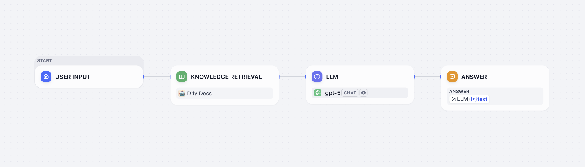

> このドキュメントは AI によって自動翻訳されています。不正確な部分がある場合は、[英語版](/en/cloud/use-dify/nodes/knowledge-retrieval) を参照してください。

<Info>
このノードは [従来型ナレッジベース](/ja/cloud/use-dify/knowledge/readme) を検索します。Agent ナレッジベースを検索するには、代わりに [Agent ナレッジ検索ノード](/ja/cloud/use-dify/nodes/knowledge-retrieval-v2) を使用してください。
</Info>

知識検索ノードを使用すると、既存のナレッジベースを Chatflow や Workflow に統合できます。このノードは指定されたナレッジからクエリに関連する情報を検索し、その結果を下流ノード（例：LLM）で利用できるコンテキスト情報として出力します。

以下は Chatflow における知識検索ノードの利用例です：

1. **ユーザー入力** ノードがユーザーの質問を収集します。

2. **知識検索** ノードが選択されたナレッジベースからユーザーの質問に関連するコンテンツを検索し、検索結果を出力します。

3. **LLM** ノードがユーザーの質問と検索されたナレッジの両方をもとに回答を生成します。

4. **回答** ノードが LLM の応答をユーザーへ返します。

<Frame>
  
</Frame>

知識検索ノードを使用する前に、少なくとも 1 つのナレッジベースが利用可能であることを確認してください。ナレッジベースの作成方法については、[ナレッジ](/ja/cloud/use-dify/knowledge/readme#set-up) を参照してください。

<Info>
    知識検索の操作には、契約プランごとに異なる 1 分あたりのレート制限が適用されます。プランごとの上限は [ナレッジベースのリクエストレート制限](/ja/cloud/use-dify/knowledge/knowledge-request-rate-limit) を参照してください。
</Info>

## 設定

知識検索ノードを正常に機能させるには、次の点を指定する必要があります：

- **何を** 検索するか（クエリ）

- **どこを** 検索するか（ナレッジベース）

- **どのように** 検索結果を処理するか（ノードレベルの検索設定）

また、ドキュメントのメタデータを利用してフィルタベースの検索を有効化し、検索精度をさらに向上させることもできます。

### クエリの指定

選択したナレッジベースでノードに検索させるクエリを指定します。

- **クエリテキスト**：テキスト変数を選択します。たとえば、Chatflow では`userinput.query`を使用してユーザー入力を参照したり、Workflow ではカスタムのテキスト型ユーザー入力変数を使用したりできます。

- **クエリ画像**：画像変数を選択します。例えば、ユーザー入力ノードを通じてユーザーがアップロードした画像を使用して画像検索を行います。各画像は 2 MB 以下である必要があります。

    <Info>
        **クエリ画像** オプションは、少なくとも 1 つのマルチモーダルナレッジベースが追加されている場合のみ利用できます。

        こうしたナレッジベースには、マルチモーダル埋め込みモデルを使用していることを示す **Vision** タグが付いています。
    </Info>

### 検索対象ナレッジベースの選択

既存のナレッジベースを 1 つ以上追加します。ノードは、追加したナレッジベースからクエリに関連するコンテンツを検索します。

複数のナレッジベースを追加した場合、まずすべてのナレッジベースから同時に検索を行い、その後[ノードレベルの検索設定](#ノードレベルの検索設定)に従って結果を統合・処理します。

<Info>
   **Vision** タグが付いたナレッジベースはクロスモーダル検索をサポートしており、セマンティックな関連性に基づいてテキストと画像の両方を検索できます。
</Info>

追加したナレッジベースの横にある **編集** アイコンをクリックすると、その [設定](/ja/cloud/use-dify/knowledge/manage-knowledge/introduction) を変更できます。

### ノードレベルの検索設定

ナレッジベースから取得した検索結果をノードでどう処理するかを細かく調整するには、**検索設定** をクリックします。

<Info>
    検索設定には、ナレッジベースレベルと知識検索ノードレベルという 2 つのレイヤーがあります。
    
    この 2 つは、順に働くフィルターです。まずナレッジベースの設定で検索結果の候補が決まり、ノードの設定がそれをさらに絞り込みます。ノードが 2 つ以上のナレッジベースを検索する場合は、その前に結果を再ランク付けします。
</Info>

- **Rerank 設定**

    ノードが 2 つ以上のナレッジベースを検索する場合にのみ適用されます。1 つだけの場合は、そのナレッジベース自体の検索設定で順位が決まります。

    - **ウェイト設定**

        再ランク付け時におけるセマンティック類似度とキーワード一致の相対的な比重です。セマンティックの比重を高くすると意味的関連性を重視し、キーワードの比重を高くすると正確な一致を重視します。

        ウェイト設定は、追加したナレッジベースがすべて **高品質** モードでインデックスされている場合にのみ利用できます。

    - **Rerank モデル**

        クエリとの関連度に基づいてすべての結果を再スコアリング・並べ替えるリランクモデルです。

        <Note>
            マルチモーダルナレッジベースを追加している場合は、マルチモーダル対応のリランクモデル（**Vision** タグ付き）も選択してください。選択しないと、検索された画像は再ランク付けの対象外となり、最終出力にも含まれません。
        </Note>

- **トップ K**

    再ランク後に返す結果の最大件数です。

    リランクモデルを選択している場合、この値はモデルの最大入力容量（モデルが一度に処理できるテキスト量）に応じて自動的に調整されます。

- **スコア閾値**

    返される結果の最低類似度スコアです。この閾値未満の結果は除外されます。関連性を厳しく判定するには高めに、より幅広い結果を含めるには低めに設定します。

### メタデータフィルタの有効化

デフォルトでは、ナレッジベース全体を検索します。特定のドキュメントに絞って検索するには、手動または自動のメタデータフィルタを有効にします。

これにより検索精度が上がります。ナレッジベースが大きい場合や、用途の異なるコンテンツが混在している場合に特に効果的です。

ドキュメントメタデータの作成と管理については、[メタデータ](/ja/cloud/use-dify/knowledge/metadata) を参照してください。

## 出力

知識検索ノードの出力は`result`という変数として返されます。この変数は検索されたドキュメントチャンクの配列で、各チャンクにはコンテンツ、メタデータ、タイトル、その他の属性が含まれます。

検索結果に画像添付が含まれる場合、`result`変数には画像メタデータを含む`files`というフィールドも含まれます。

## LLM ノードとの連携

LLM ノードで検索結果をコンテキストとして使うには、次のように設定します。

1. **コンテキスト** フィールドで、知識検索ノードの`result`変数を選択します。

2. システムインストラクションで `Context` 変数を参照します。

3. （任意）LLM がビジョンに対応している場合は、**ビジョン** を有効にして、検索結果に含まれる画像添付を処理できるようにします。

    <Info>
        検索結果をビジョン入力として指定する必要はありません。**ビジョン** を有効にすると、LLM は検索された画像を自動的に参照します。
    </Info>

Chatflow では、ナレッジを参照する応答にデフォルトで引用が表示されます。オフにするには、キャンバス右上の **機能** で **[引用と帰属](/ja/cloud/use-dify/build/additional-features#引用と帰属)** を無効にします。
