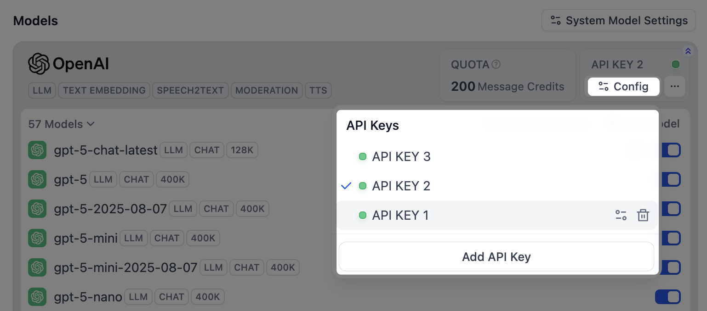
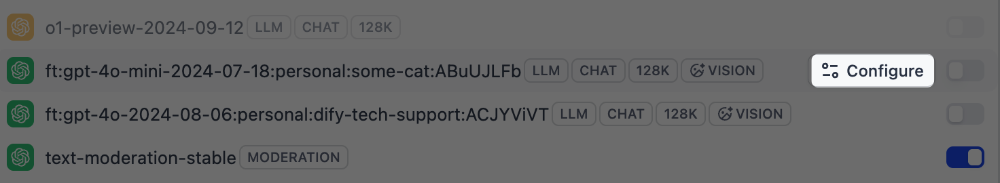
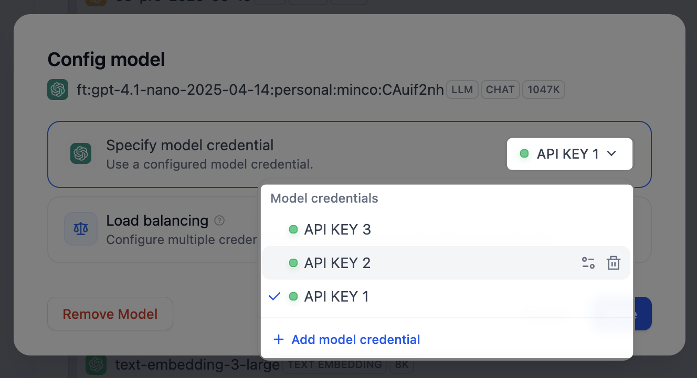
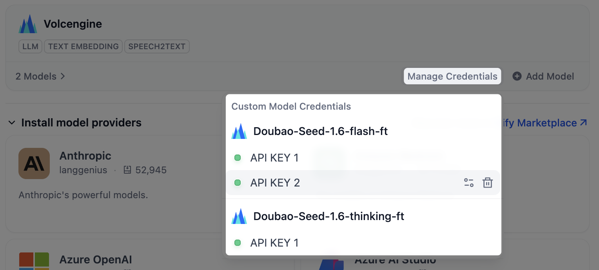
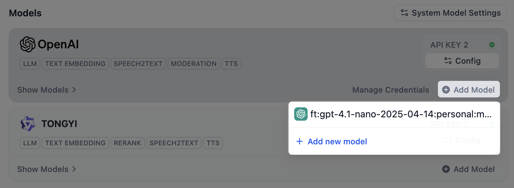
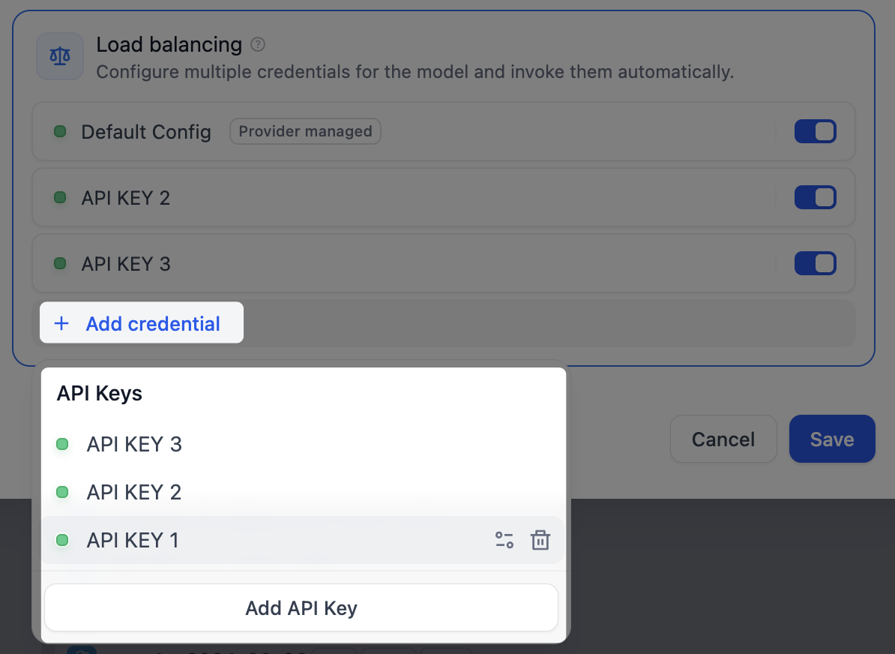

> このドキュメントは AI によって自動翻訳されています。不正確な部分がある場合は、[英語版](/en/cloud/use-dify/workspace/model-providers) を参照してください。

構築するすべての AI アプリはモデル上で動作します。Dify Cloud には人気のモデルが用意されており、さらに必要な場合は、独自のプロバイダーアカウントを接続できます。

モデルはワークスペース全体で共有されるため、チーム全員が同じモデルを使用します。

<Warning>
プロバイダーを管理できるのは、ワークスペースのオーナーと管理者のみです。追加したキーはワークスペース全体で有効になり、そのプロバイダーの自分のアカウントに請求されます。
</Warning>

## AI クレジットでのモデル利用

Dify Cloud はプランの AI クレジットで一連の人気プロバイダーのモデルを使えるため、自分の API キーがなくても始められます。

これらのプロバイダーのいずれかを **連携** > **モデルプロバイダー**（または [マーケットプレイス](https://marketplace.dify.ai/)）からインストールすると、そのモデルをすぐに使えます。AI の応答ごとに AI クレジットを消費します。

AI の応答とは 1 回のモデル呼び出し（1 回の入力と 1 回の出力）であり、消費する token 数に関係なく 1 回の応答としてカウントされます。1 回の応答に必要なクレジット数はモデルによって異なり、大きいモデルほど多く消費します。

どのプロバイダーが AI クレジットに対応しているか、および各モデルのクレジット消費量は、[Dify 料金ページ](https://dify.ai/pricing) を参照してください。

## 対応プロバイダーでの独自アカウント利用

より高いレート制限が必要な場合や、料金を自分のプロバイダーアカウントで支払いたい場合は、対応プロバイダーに自分の API キーを追加します。

1. **連携** > **モデルプロバイダー** で、まだインストールしていない場合はプロバイダーをインストールします。

2. そのカードの **API キーを追加** をクリックし、API キーとその他の必要な情報を入力します。Dify はキーを検証してから、プロバイダーを利用可能にします。

キーと AI クレジットは併用できます。クレジットを先に使い切ってからキーに切り替えたい場合は、**使用優先順位** を **AI クレジット** に設定します。設定はプロバイダーカードの **コンフィグ** から開けます。

## AI クレジット非対応プロバイダーの接続

AI クレジット非対応のプロバイダーを使うには、まずインストールし、自分のアカウントで実行します。AI クレジットはこれらのプロバイダーには適用されません。

1. **連携** > **モデルプロバイダー** で **モデルプロバイダーをインストール** セクションを開きます。全一覧は [マーケットプレイス](https://marketplace.dify.ai/) で確認できます。

2. プロバイダーをインストールし、**API キーを追加** をクリックして、キーとその他の必要な情報を入力します。

## カスタムモデルの追加

プロバイダーを接続すると、そのモデルはすぐに使えます。手動で追加するのは、リリースされたばかりのモデルやファインチューニング済みモデルなど、必要なモデルが一覧にない場合だけです。

プロバイダーカードの **モデルを追加** をクリックし、モデル名と認証情報を指定します。提供するモデルが決まっているプロバイダーには、このオプションがありません。

<Info>
追加したモデルの名前とタイプが既存のものと同じ場合、Dify は新しく作らずに、既存のモデルへキーを追加します。
</Info>

## キーの管理

開発環境と本番環境を分けたい場合や、複数のアカウントに使用量を分散させたい場合は、1 つのプロバイダーに複数のキーを追加します。

- プロバイダー独自のモデルでは、プロバイダーカードの **コンフィグ** をクリックすると、これらのモデルに共通するキーを管理できます。
  <Frame>
  
  </Frame>
- 追加したカスタムモデルでは、そのモデルの **コンフィグ** をクリックすると、モデル固有のキーを管理できます。
    <Columns cols={2}>
      <Frame>
      
      </Frame>
      <Frame>
      
      </Frame>
    </Columns>

    <Warning>
    カスタムモデルが使うのは、そのモデル固有のキーだけです。キーが 1 つしかない状態でそれを削除すると、モデルも削除されます。
    </Warning>

    すべてのカスタムモデルのキーを 1 か所で確認するには、プロバイダーカードの **認証情報を管理** をクリックします。

    <Frame>
      
    </Frame>

    モデルを削除してもキーはここに残るため、再入力せずにモデルを後で追加し直せます。

    <Frame>
      
    </Frame>

## アプリが使うデフォルトモデルの選択

モデルを指定しないアプリやノードは、ワークスペースのデフォルトにフォールバックします。右上の **システムモデル設定** をクリックし、タスクごとにモデルを設定します。

- **システム推論モデル**：一般的な LLM タスクのデフォルトです。
- **埋め込みモデル**：ナレッジベースの内容をインデックス化し、検索します。
- **Rerank モデル**：検索結果を関連度で並べ替えます。
- **音声からテキストへの変換モデル**：音声をテキストに変換します。
- **テキストから音声への変換モデル**：テキストを音声に変換します。

デフォルトモデルが未設定だと、そのモデルを使う機能は動作しません。たとえば、テキストから音声への変換モデルを設定していないと、アプリで **テキストから音声へ** を使えません。

## 負荷分散による複数キーへのリクエスト分散 <Badge color="blue">Professional</Badge> <Badge color="blue">Team</Badge>

1 つのキーが多数のリクエストを同時に処理すると、プロバイダーのレート制限に達し、失敗し始めることがあります。

負荷分散を使うと、同じモデルへのリクエストを複数のキーに分散でき、どの単一キーもボトルネックになりません。Dify はキーを順番にローテーションし、制限に達したキーは 1 分間休ませてから再試行します。

1. 一覧で対象のモデルを探し、**コンフィグ** をクリックして **負荷分散** を選択します。

2. **認証情報を追加** をクリックし、キーをプールに追加します。

    <Tip>
    クォータが多いキーや速いキーを複数回追加すると、より多くのトラフィックをそのキーに送れます。
    </Tip>

    <Frame>
    
    </Frame>

3. 少なくとも 2 つのキーを有効にし、**保存** をクリックします。負荷分散を使うモデルには、一覧にマークが表示されます。

<Info>
いつでも単一のキーに戻せます。負荷分散の設定は、後で使えるように保持されます。
</Info>
