> このドキュメントは AI によって自動翻訳されています。不正確な部分がある場合は、[英語版](/en/self-host/use-dify/nodes/human-input) を参照してください。

人間の入力ノードは、ワークフローを重要な箇所で一時停止し、カスタマイズ可能なリクエストフォームを届けます。受信者はこのフォームで情報を確認して必要な内容を入力し、あらかじめ用意された選択肢から判断を選びます。選ばれた判断によって、ワークフローの進み方が決まります。

人間の判断が必要な場面に直接組み込むことで、**自動化の効率と人間による監督を両立** できます。

<Info>
人間の入力ノードには新旧 2 つのバージョンがあります。ワークフローを旧バージョンから新バージョンに移す方法は、[旧ノードからの移行](#migrate-from-the-old-node) を参照してください。
</Info>

<Tabs>
  <Tab title="新しい人間の入力" id="new-human-input">

  新しい人間の入力ノードを使うと、リクエストは普段使っているツールに届きます。全員がメールで受け取れるほか、ワークスペースのメンバーはチームの IM（インスタントメッセージングアプリ）でも受け取れます。応答できるのは、リクエストの送信先に指定された人だけです。

  <Note>
  新しい人間の入力ノードがリクエストを受信者に届けるには、次の設定が必要です。

  - [`CONSOLE_WEB_URL`](/ja/self-host/deploy/configuration/environments#console_web_url) と [`APP_WEB_URL`](/ja/self-host/deploy/configuration/environments#app_web_url) = 受信者がアクセスできるアドレス
  - [リクエストをカードで表示する](/ja/self-host/use-dify/workspace/channels/overview#im-の接続) IM では、[`TRIGGER_URL`](/ja/self-host/deploy/configuration/environments#trigger_url) = IM からインターネット経由でアクセスできるアドレス（カードのボタン操作を Dify に届けるため）

  メールでリクエストを送るには、デプロイの [メール設定](/ja/self-host/deploy/configuration/environments#メール設定) も必要です。
  </Note>

  <a id="choose-who-responds"></a>

  ## 応答者の選択

  **受信者** に追加した人は誰でも応答でき、最初の応答で結果が決まります。その時点で、ほかの人へのリクエストはクローズされます。判断を任せてよい人だけを追加してください。

  リクエストの届き方は、受信者の追加方法によって変わります。

  | 受信者 | 使う場面 | リクエストの届き方 |
  |:--|:--|:--|
  | 連絡先 | 普段一緒に仕事をしている人。ワークスペースの [Contacts](/ja/self-host/use-dify/workspace/contacts) から選択します。<br/><br/>相手のメールアドレスが変わった場合も、ワークフローはそのままで、以降のリクエストは新しいアドレスに届きます。<Info>チームの誰が判断してもよい場合は、代わりにワークスペース全体を選択します。外部連絡先は含まれません。</Info> | <ul><li>ワークスペースのメンバー：メールで届きます。IM アカウントが [Contacts でバインド](/ja/self-host/use-dify/workspace/contacts#bind-im-identities) されていれば、チームの IM にも届きます。<br/><br/></li><li>外部連絡先：メールでのみ届きます。応答に Dify アカウントは必要ありません。</li></ul> |
  | メールアドレス | 一度だけ依頼する相手など、Contacts に登録しておく必要のない人。アドレスを入力します。 | メールで届きます。 |
  | 変数 | 応答者が実行時に決まる場合。たとえば、前のノードで収集したアドレスを指定できます。<br/><br/>変数にはアドレスを 1 つだけ格納する必要があります。値が空または無効の場合はスキップされます。 | メールでのみ届きます。アドレスがワークスペースのメンバーのものでも同じです。 |
  | 開始者 | アプリを実行している本人にこのステップを確認してもらう場合。<br/><br/>トリガーで開始するワークフローでは使用できません。 | <ul><li>Web アプリでは、フォームがアプリ内に直接表示されます。<br/><br/></li><li>[Service API](/ja/api-reference/guides/human-input-flow) 経由の場合は、API を呼び出しているシステム側で応答します。</li></ul> |

  どの受信者にも届けられない場合、実行はこのノードで失敗します。変数が空のままになるなど、実行時に受信者が欠ける可能性がある場合は、確実に届く受信者をもう 1 人追加してください。

  <a id="write-the-notification"></a>

  ## 通知の作成

  メッセージテンプレートは、受信者をフォームへ誘導する通知です。メールと IM のメッセージとして送信されます。

  **メッセージテンプレート** に、何の判断を求めているかが伝わる件名と本文を書きます。**リクエスト URL を挿入** をクリックすると、フォームへのリンクが追加されます。件名と本文には変数を使用でき、本文では Markdown も使えます。

  <Columns cols={2}>
    <Frame caption="メッセージテンプレート">
      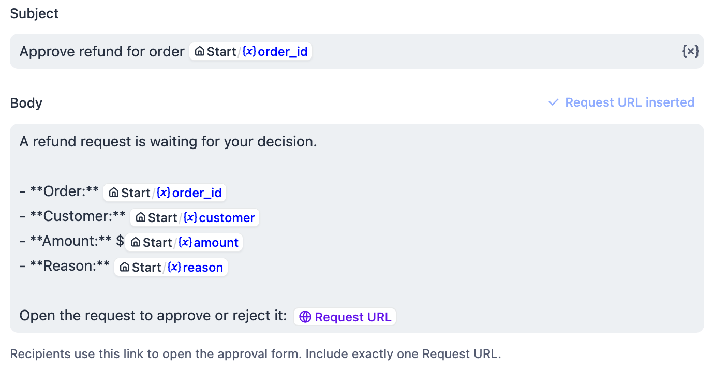
    </Frame>
    <Frame caption="リンクメッセージとして届いたリクエスト">
      
    </Frame>
  </Columns>

  <Info>
    [リクエストをカードで表示する](/ja/self-host/use-dify/workspace/channels/overview#im-の接続) IM では、受信者にはリンクではなくフォームそのものが届き、IM 内で直接応答できます。カードの見出しにはノードのタイトルが使われるため、リクエストの内容がわかるタイトルをノードに付けてください。

  <Frame caption="IM カードとして届いたリクエスト">
    
  </Frame>
  </Info>

  文面を確認するには、**メッセージをテスト** を使います。**テストチャネル** で IM を選び、**保存してテスト** をクリックすると、自分宛てに送信されます。この方法では、常にリンクメッセージとして届きます。受信者に届くカードを確認するには、[デバッグモードをオンにしてテスト実行](#test-without-notifying-recipients) してください。

  <a id="design-the-form"></a>

  ## フォームの設計

  フォームは 2 つの部分で構成されます。受信者が読んで入力するコンテンツと、判断を下すためにクリックするボタンです。

  <a id="card-or-link"></a>

  <Info>
  メンバーが IM 内で直接応答できるようにするには、ファイルフィールドを使わないでください。カードを表示する IM でも、ファイルフィールドを含むフォームはリンクメッセージとして届きます。
  </Info>

  ### フォームコンテンツ

  受信者が判断に必要とする情報を、Markdown で整えて記述します。変数を参照すると、上流の LLM が書いた草稿などの値を表示できます。

  <Info>
    推論モデルは最終回答とともに思考プロセスも出力するため、LLM ノードの `text` 変数を参照すると両方が表示されます。回答のみを表示するには、その LLM ノードで **推論タグの分離を有効にする** をオンにします。
  </Info>

  受信者に入力してもらう箇所には、入力フィールドを挿入します。**レスポンスを次の名前で保存** に指定した名前が、下流で使う変数名になります。

  | フィールドタイプ | 受信者の操作 |
  |:-----------------|:-------------|
  | 段落 | テキストを入力します。フィールドは空のままにすることも、変数（手直ししてもらう LLM 出力など）や静的テキストで事前入力しておくこともできます。<br></br><br></br>最大長の制限はありませんが、入力が非常に長いと、下流の LLM のコンテキストウィンドウを超える可能性があります。<Tip>入力が任意の場合は、「None」などの静的テキストを事前入力しておくと、受信者は何も入力せずに送信できます。</Tip> |
  | 選択 | 選択肢から 1 つを選びます。選択肢は自分で列挙するか、`array[string]` 変数から取得します。 |
  | 単一ファイル / ファイルリスト | ファイルを 1 つ、または複数アップロードします。<Info>ファイルアップロードの上限は環境変数で調整できます。<ul><li>`UPLOAD_FILE_SIZE_LIMIT`、`UPLOAD_IMAGE_FILE_SIZE_LIMIT`、`UPLOAD_VIDEO_FILE_SIZE_LIMIT`、`UPLOAD_AUDIO_FILE_SIZE_LIMIT` は、拡張子ごとに 1 ファイルあたりのサイズ上限を設定します。</li><li>`WORKFLOW_FILE_UPLOAD_LIMIT` は、ファイルリストフィールドで受け付けるよう設定できるファイル数の上限です。</li></ul>デフォルト値については [環境変数](/ja/self-host/deploy/configuration/environments) を参照してください。</Info> |

  <Tip>
  承認や却下など、ワークフローの次の進み先を決める判断には、選択フィールドではなく **ユーザーアクション** のボタンを使ってください。選択フィールドは回答を記録するだけで、ワークフローを分岐させません。
  </Tip>

  ### ユーザーアクション

  受信者が選ぶボタンを追加します。ボタンごとにノードから専用のブランチが出るので、それぞれをその判断の後に実行する処理につなげます。

  <a id="use-the-response"></a>

  ## 応答の利用

  誰かが応答すると、下流のノードで次の値を使用できます。

  - 各入力フィールドの値
  - `__action_id`：クリックされたボタンに **ユーザーアクション** で設定したアクション ID
  - `__action_value`：そのボタンのテキスト
  - `__rendered_content`：送信された値を埋め込んだフォームコンテンツ。記入済みフォームの記録を残したり、後続の処理に渡したりする場合に使います。

    ファイルフィールドは、プレーンテキストのプレースホルダーとして表示されます。単一ファイルは `[file]`、ファイルリストは `[N files]` です。

  **タイムアウト** ブランチでは、`__action_id` と `__action_value` は空になり、`__rendered_content` には値が入っていないフォームコンテンツが格納されます。

  <a id="set-a-timeout"></a>

  ## タイムアウトの設定

  **タイムアウト** には、判断をどれだけ待てるかを設定します。応答がないまま時間切れになると、実行はノードの **タイムアウト** ブランチに進みます。このブランチは、誰かへの通知やデフォルトの判断の適用といったフォールバックにつなげてください。接続しなかった場合、実行はそこで終了します。

  各実行には、実行開始時点から数える全体の制限時間もあり、デフォルトは 7 日です。この制限に達すると、応答待ちのリクエストはすべて期限切れになり、実行はどのブランチにも進まずに停止します。そのため、実行の後半にある人間の入力ノードでは、残り時間がそのノード自身のタイムアウトより短くなることがあります。

  たとえば、人間の入力ノードが 2 つ連続するワークフローで、1 つ目のリクエストへの応答が送信から 5 日後だったとします。実行が 2 つ目のノードに到達した時点で、残りは 2 日しかありません。2 つ目のノードのタイムアウトが 3 日なら、実行は 2 日後に停止し、そのノードの **タイムアウト** ブランチは実行されません。

  後続ノードのフォールバックを確実に実行させるには、そのノードのタイムアウトを実行の残り時間より短く設定します。または、[`HUMAN_INPUT_GLOBAL_TIMEOUT_SECONDS`](/ja/self-host/deploy/configuration/environments#human_input_global_timeout_seconds) で全体の制限時間を延ばします。この設定は、デプロイ上のすべての実行に適用されます。

  <a id="test-without-notifying-recipients"></a>

  ## 受信者に通知しないテスト

  エディターからテスト実行すると、受信者に実際のリクエストが送信されます。ほかの人に届けずにテストする方法は 2 つあります。

  - IM が接続され、自分の IM アカウントが [自分の連絡先にバインド](/ja/self-host/use-dify/workspace/contacts#bind-im-identities) されていれば、**デバッグモード** をオンにしてテスト実行できます。フロー全体が実行されますが、リクエストはチームの IM で自分にだけ届きます。届き方は、受信者が受け取る場合と同じです。

  - **このステップ実行** は、エディター内にフォームだけを表示し、誰にも何も送信しません。

  <a id="what-recipients-see"></a>

  ## 受信者の応答方法

  - リクエストが IM カードとして届いた場合、ワークスペースのメンバーはカード上で直接応答できます。リンクから開いた場合は、リクエストの送信先のアカウントで Dify にサインインします。

    アプリ自体へのアクセス権は必要ありません。

    <Columns cols={2}>
      <Frame caption="IM カードとして届いたリクエスト">
        
      </Frame>
      <Frame caption="リンクメッセージとして届いたリクエスト">
        
      </Frame>
    </Columns>

  - 外部連絡先と、メールアドレスまたは変数で追加された人は、リンクを開き、そのアドレスに送られたコードを入力してから応答します。

  誰かが応答すると、ほかの人は応答できなくなります。

  <a id="examples"></a>

  ## 使用例

  <Tabs>
    <Tab title="返金の承認">

      <Frame caption="返金承認ワークフロー">
        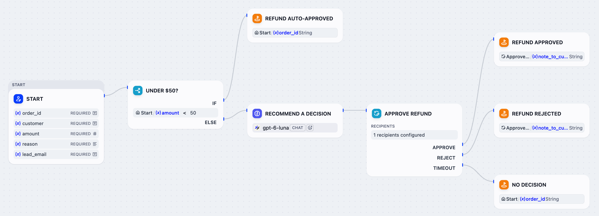
      </Frame>

      このワークフローは、オンラインストアの返金申請を処理します。少額の返金は自動で承認されます。金額が大きい場合は、LLM が申請内容を返金ポリシーと照らし合わせて判断を提案し、サポートリーダーが承認または却下します。

      <Tip>
      このワークフローを自分のワークスペースで試すには、[Dify マーケットプレイス](https://marketplace.dify.ai) からテンプレートを入手してください。
      </Tip>

      このワークフローは、次の目標に沿って設計されています。

      <Steps>
        <Step title="判断が必要な返金だけがリーダーに届く">
          1. 開始ノードの直後に If-Else ノードを置き、数値入力の `amount` が 50 未満かどうかを判定します。
              <Frame caption="If-Else の条件">
                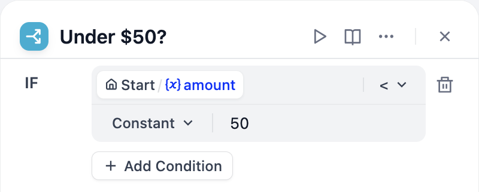
              </Frame>
          2. 50 未満の返金のブランチは出力ノード（「Refund auto-approved」）に直接つなぎ、もう一方のブランチは LLM につなぎます。

        </Step>
        <Step title="リーダーが AI の提案とその理由を確認できる">
          1. LLM ノード（「Recommend a decision」）で、次のように設定します。

              - システムプロンプトに返金ポリシーを、ユーザープロンプトに注文内容を入れます。注文内容は ID、顧客、金額、理由で、いずれも開始ノードから取得します。

              - 1 行目に判定（「Approve」または「Reject」）を出し、続けて 1〜2 文でポリシーを引用するよう指示します。

              <Frame caption="「Recommend a decision」のプロンプト">
                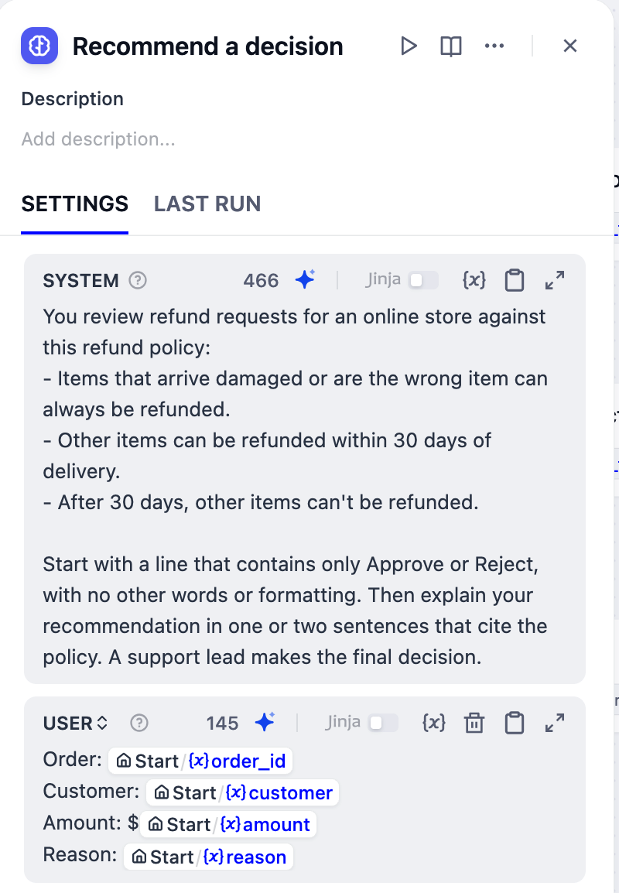
              </Frame>

          2. 人間の入力ノードの **フォームコンテンツ** に、注文の詳細を表示します。その下に太字の「AI recommendation」ラベルを付けて、LLM の `text` 出力を表示します。

              理由が目の前にあれば、リーダーは誤った提案に気づけます。

              <Frame caption="AI の提案を含むフォームコンテンツ">
                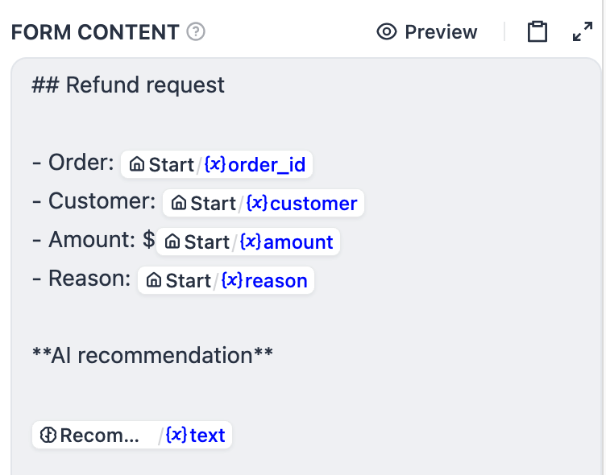
              </Frame>
        </Step>
        <Step title="リーダーはワンクリックで応答でき、メモも任意で添えられる">
          1. **受信者** にサポートリーダーを追加します。**ユーザーアクション** には、**Approve** と **Reject** の 2 つのボタンを追加します。

          2. メモ用に `note_to_customer` という段落フィールドを 1 つ追加し、静的テキスト「None」を事前入力します。こうすると、リーダーは何も入力せずに承認または却下できます。

          <Columns cols={2}>
            <Frame caption="「None」を事前入力したメモフィールド">
              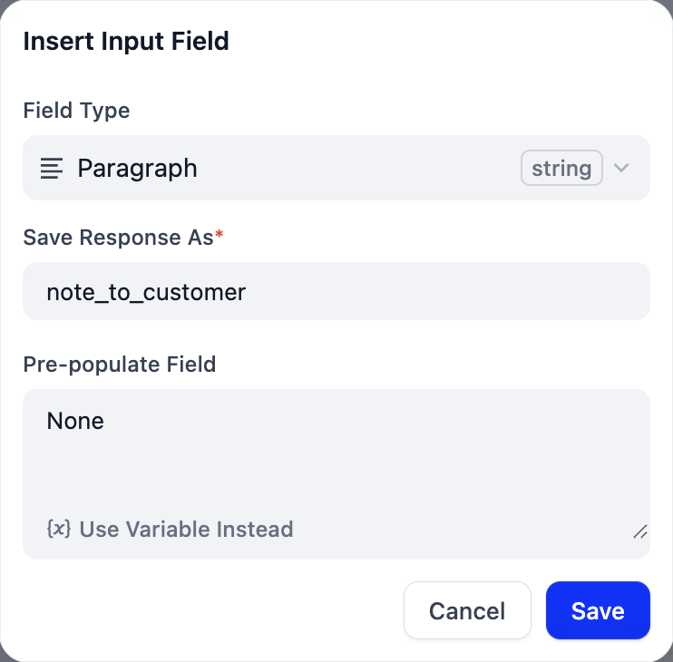
            </Frame>
            <Frame caption="返金リクエスト">
              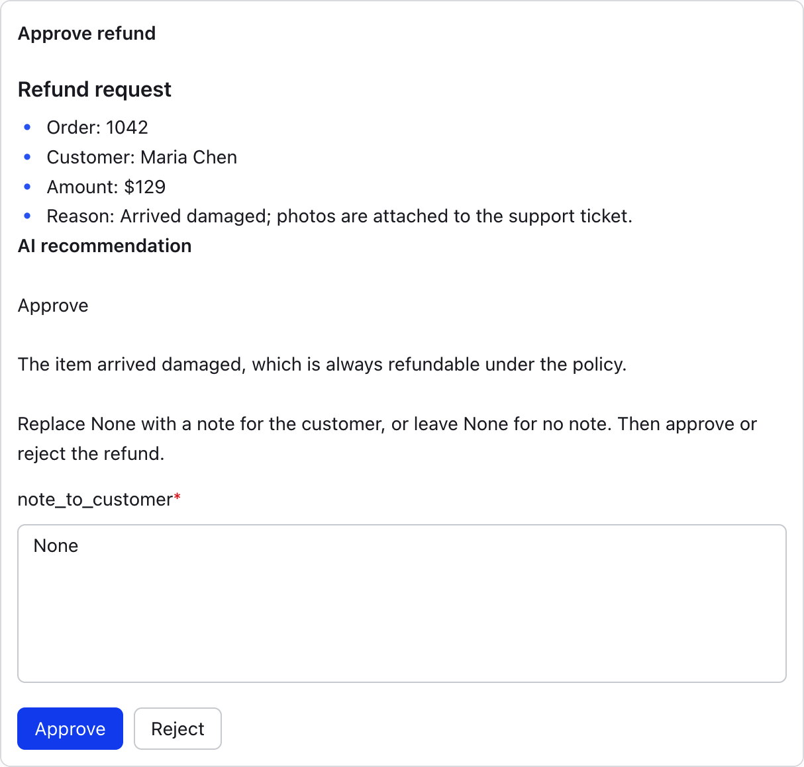
            </Frame>
          </Columns>
        </Step>
        <Step title="承認・却下・未判断のどれになったかが結果でわかる">
          1. **Approve** と **Reject** は、それぞれ専用の出力ノードにつなぎます。ノード名は「Refund approved」と「Refund rejected」で、どちらもメモを返します。

          2. **タイムアウト** ブランチは 3 つ目の出力ノード（「No decision」）につなぎます。こうすると、誰も判断しなかった返金が、承認や却下として扱われることはありません。
        </Step>
      </Steps>

    </Tab>
    <Tab title="承認されるまで草稿を修正">

      <Frame caption="草稿修正ワークフロー">
        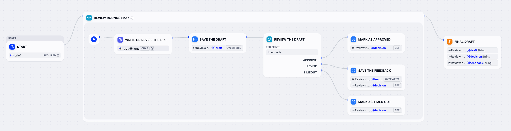
      </Frame>

      このワークフローでは、LLM が概要をもとに短いブログ記事を書き、レビュアーが草稿を承認するか、フィードバックを付けて差し戻します。差し戻された草稿は LLM が修正します。このやり取りは最大 3 回まで繰り返せます。

      最後に、ワークフローは最終的な草稿とレビューの結果を返します。結果は、承認、タイムアウト、3 回を終えても未承認のいずれかです。

      <Tip>
      このワークフローを自分のワークスペースで試すには、[Dify マーケットプレイス](https://marketplace.dify.ai) からテンプレートを入手してください。
      </Tip>

      このワークフローは、次の目標に沿って設計されています。

      <Steps>
        <Step title="レビュアーと複数回やり取りできる">
          1. LLM ノード（「Write or revise the draft」）と人間の入力ノードを [ループ](/ja/self-host/use-dify/nodes/loop) の中に置きます。こうすると、毎回その回の草稿を載せた新しいリクエストがレビュアーに届きます。

              どの回も手順は同じで、LLM が草稿を書くか修正し、それをレビュアーが確認します。ループは停止条件を満たすまでこの 2 つを繰り返すので、ノードは 1 回分だけ作れば済み、回ごとにコピーする必要はありません。

          2. 人間の入力ノードの **受信者** にレビュアーを追加します。**ユーザーアクション** には、**Approve** と **Request changes** の 2 つのボタンを追加します。

          <Frame caption="ループの内部">
            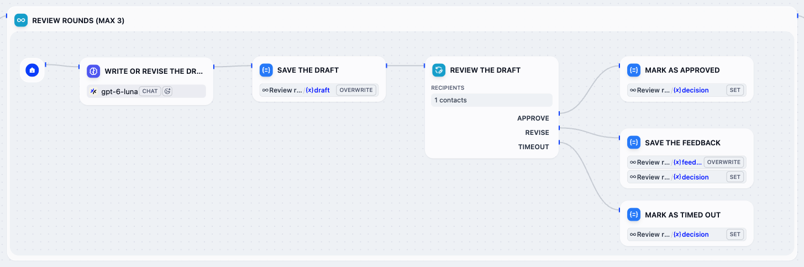
          </Frame>
        </Step>
        <Step title="レビュアーがフィードバックを付けて草稿を差し戻せる">
          人間の入力ノードの **フォームコンテンツ** に草稿を表示し、続けて `feedback` という段落フィールドを追加します。このフィールドに「None」を事前入力しておくと、レビュアーは何も入力せずに承認できます。

          <Columns cols={2}>
            <Frame caption="フィードバックフィールドを含むフォームコンテンツ">
              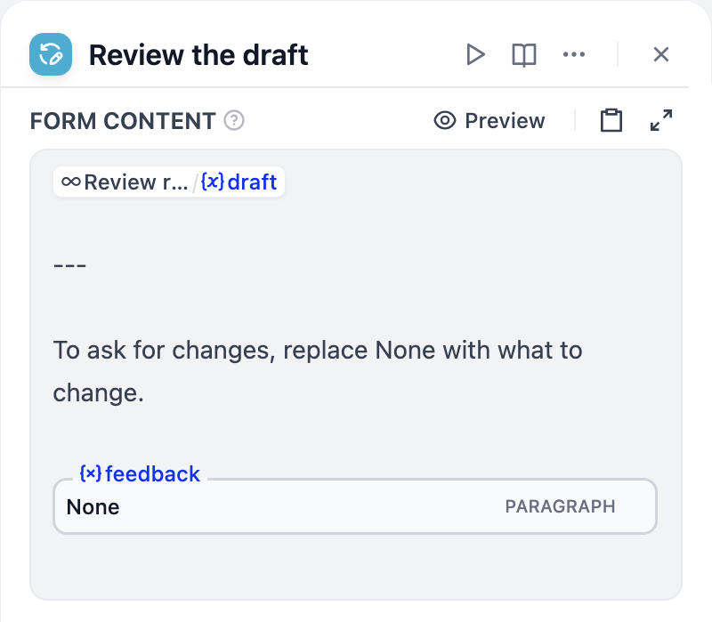
            </Frame>
            <Frame caption="レビューリクエスト">
              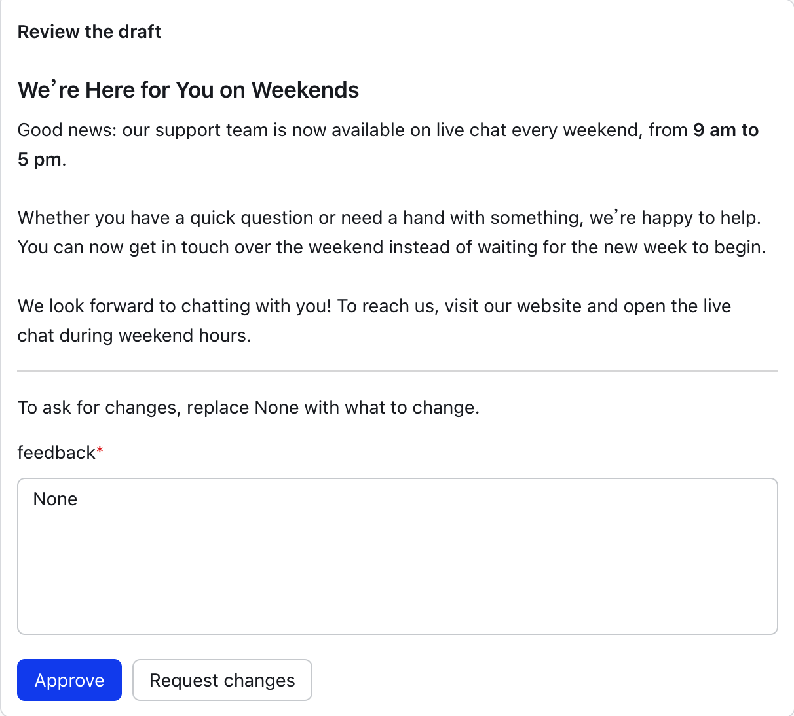
            </Frame>
          </Columns>
        </Step>
        <Step title="毎回、一からやり直さずに前回の草稿を修正する">
          新しい回が始まると、前回の各ノードの出力は消えます。2 回目では、1 回目に LLM が書いた草稿も、レビュアーが入力したフィードバックも読み取れません。次の回に引き継がれるのは、ループ変数と、概要などのワークフロー自体の入力だけです。

          そこで、ループの **ループ変数** に `draft` と `feedback` を追加します。どちらも初期値が空の文字列です。

          <Frame caption="ループ変数">
            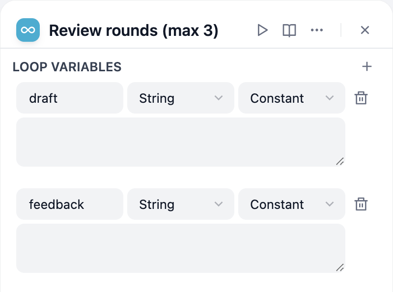
          </Frame>

          ループ変数に値を保存するには、変数代入ノードを使います。変数ごとに 1 つずつ追加します。

          - LLM の直後に「Save the draft」を追加し、LLM の出力で `draft` を上書きします。次の回では、この草稿を修正します。

            <Frame caption="変数代入ノード「Save the draft」">
              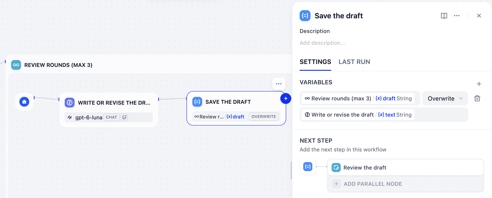
            </Frame>

          - **Request changes** ブランチの末尾に「Save the feedback」を追加し、レビュアーが入力した内容で `feedback` を上書きします。こうすると、次の回の LLM がフィードバックを参照できます。

            <Frame caption="変数代入ノード「Save the feedback」">
              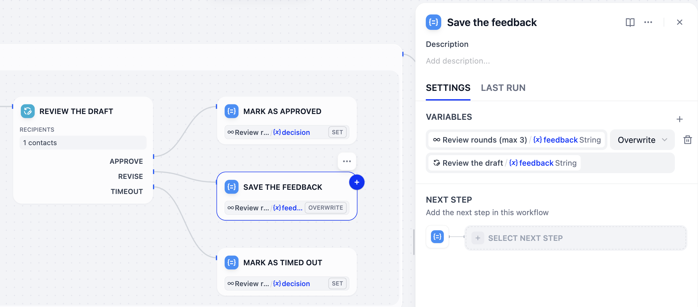
            </Frame>

          LLM のプロンプトには、開始ノードの概要、`draft`、`feedback` を渡します。`draft` が空のうちは初稿を書き、その後はフィードバックで求められた箇所だけを修正するよう指示します。

          <Frame caption="「Write or revise the draft」のプロンプト">
            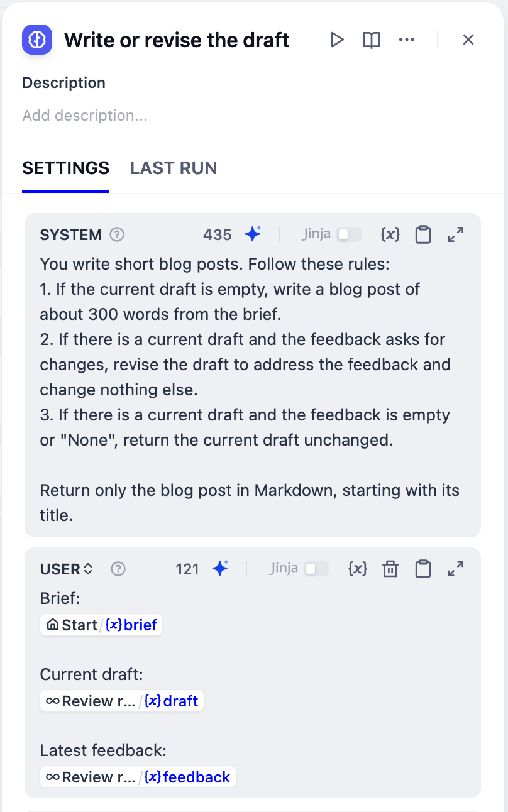
          </Frame>
        </Step>
        <Step title="承認されるか、応答がないか、3 回を終えるとレビューが終わる">
          ループが停止のタイミングを判断できるように、各回の終わり方を記録します。

          1. **ループ変数** に 3 つ目の変数 `decision` を追加し、初期値を `pending` にします。

          2. **Approve** ブランチの末尾に変数代入ノード（「Mark as approved」）を置き、`decision` を `approved` に設定します。

              <Frame caption="変数代入ノード「Mark as approved」">
                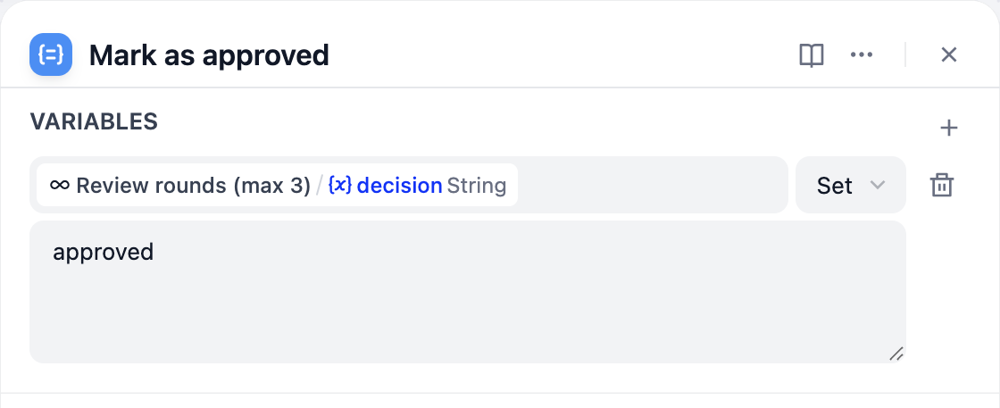
              </Frame>

          3. **タイムアウト** ブランチの末尾にも変数代入ノード（「Mark as timed out」）を置き、`decision` を `timed_out` に設定します。

          次に、ループの停止条件を設定します。

          1. ループの **ループ終了条件** を、「`decision` が `approved`」OR「`decision` が `timed_out`」に設定します。

              <Frame caption="ループ終了条件">
                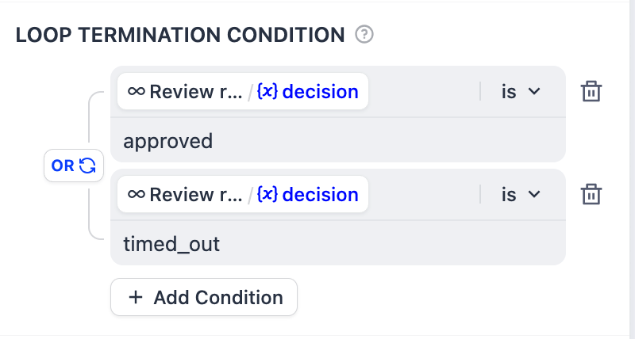
              </Frame>

          2. **最大ループ回数** を 3 に設定します。ループは 3 回目の草稿で止まり、レビュアーの最後のフィードバックは反映されません。

              <Frame caption="最大ループ回数">
                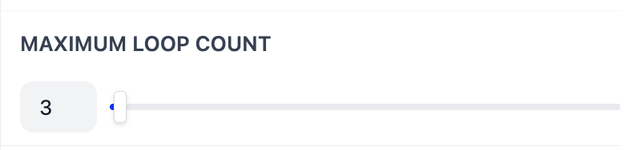
              </Frame>
        </Step>
        <Step title="レビューの終わり方が結果でわかる">
          ループの後の出力ノード（「Final draft」）が、草稿、`decision`、`feedback` を返します。

          <Frame caption="「Final draft」の出力変数">
            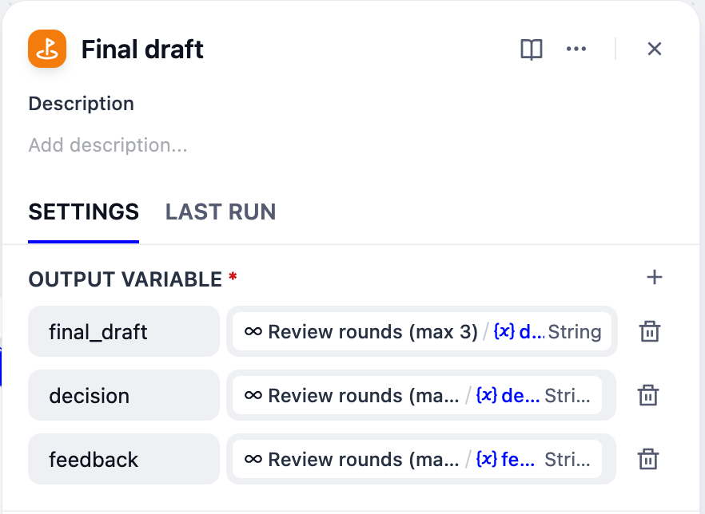
          </Frame>

          `decision` を見れば、レビュアーが承認したか、応答しなかったかはすでにわかります。回数を使い切ったレビューも区別できるように、「Save the feedback」に戻って 2 つ目の変数を追加し、`decision` を `changes_requested` に設定します。

          <Frame caption="2 つの変数を設定した変数代入ノード「Save the feedback」">
            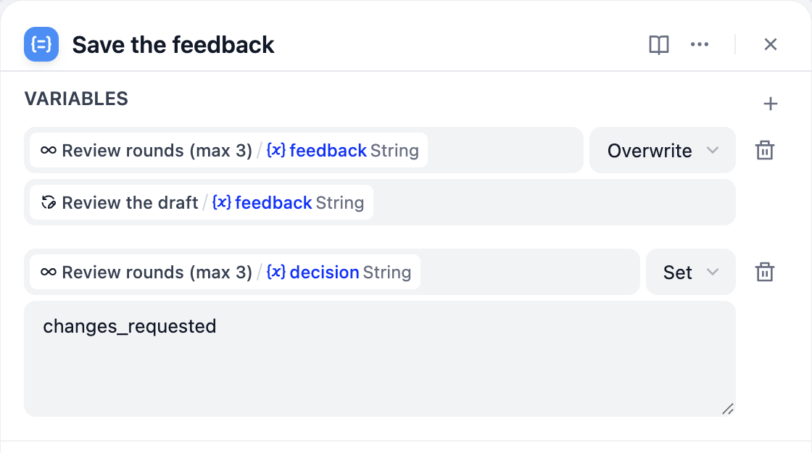
          </Frame>

          この場合、`feedback` にはレビュアーの最後の修正依頼が入っています。この依頼はどの回でも反映されていないため、草稿を仕上げる人はここから作業を始められます。
        </Step>
      </Steps>

    </Tab>
  </Tabs>

  <a id="migrate-from-the-old-node"></a>

  ## 旧ノードからの移行

  新しいノードを含むバージョンにアップグレードしても、既存のワークフローは変わりません。旧ノードはそのまま動作し続け、旧フォームで応答待ちになっているリクエストにも引き続き応答できます。

  1 つのワークフローで新旧の人間の入力ノードを混在させることはできません。旧ノードが残っているワークフローに新しいノードを追加するには、先に旧ノードを移行します。キャンバス上部の **今すぐ移行** をクリックすると、ドラフト内の旧ノードがすべて一度に変換されます。公開済みのバージョンは再度公開するまで変わらないため、変換後のノードを先に確認できます。

  引き継がれる設定は次のとおりです。

  | 旧ノード | 新ノード |
  |:---------|:---------|
  | Web アプリ配信 | 開始者 |
  | 名前で選択したメンバー | そのメンバーの連絡先 |
  | 外部のメールアドレス | メールアドレス |
  | ワークスペースの全メンバー | ワークスペース全体（すべてのメンバーが対象） |
  | メールの件名と本文 | メッセージテンプレート（内容はそのまま） |

  それ以外の設定はそのまま維持されます。対象は、フォームコンテンツ、入力フィールド、ボタン、タイムアウト、ノードの接続、下流のノードが参照する出力変数です。

  移行できないノードが 1 つでもあると、何も変更されません。主な原因は次のとおりです。

  | 原因 | 対処方法 |
  |:-----|:---------|
  | 無効な配信方法に設定が残っています | 無効にしたメール配信方法に、受信者や本文が残っています。その設定を消去するか、その受信者を含めたい場合は配信方法を再び有効にしてください。 |
  | ワークスペースのメンバーを連絡先または確認済みメールアドレスに対応付けられません | 選択したメンバーがワークスペースから外れています。そのメンバーをノードから削除してください。 |
  | 有効なメール配信方法の設定が不完全です | メールの件名と本文を入力してください。 |
  | 受信者のメールアドレスが無効です | アドレスを修正するか、削除してください。 |

  移行後に旧ノードに戻すには、バージョン履歴から以前の公開バージョンを復元します。

  </Tab>

  <Tab title="旧バージョンの人間の入力" id="old-human-input">

  旧バージョンの人間の入力ノードでは、リクエストはアプリを実行しているユーザーに Web アプリ上で表示されるか、リンクとしてメールで送信されます。リンクを知っている人は誰でも応答できます。

  <Tip>
    ワークフロー設計の例は、[例：コンテンツレビューワークフロー](#例：コンテンツレビューワークフロー) を参照してください。
  </Tip>

  ## 設定

  次の項目で、ノードが人間の入力をどう求め、どう処理するかを設定します。

  - **配信方法**：リクエストフォームがどのように受信者に届くか。

  - **フォーム内容**：受信者に表示される情報と、操作できる内容。

  - **ユーザーアクション**：受信者が行える決定と、それに応じたワークフローの進行方法。

  - **タイムアウト**：待機時間と、受信者が応答しなかった場合の処理。

  ### 配信方法

  リクエストを配信するチャネルを選択します。現在利用可能な方法は次のとおりです。

  - **Webアプリ**：Web アプリのエンドユーザーにリクエストフォームを表示します。トリガーで開始されたワークフローでは利用できません。

    <Info>
      外部クライアントは Service API を使って、Web アプリのフォームを取得から送信まで扱えます。詳細は [API 連携フロー](/ja/api-reference/guides/human-input-flow) を参照してください。
    </Info>

  - **メール**：特定のワークスペースメンバー、外部のメールアドレス、またはワークスペース全員にリクエストリンクをメールで送信します。リンクを持っている人は誰でも応答でき、Dify アカウントは不要です。

  <Note>
      配信方法に関わらず、最初の応答があった時点でリクエストはクローズされます。
  </Note>

  ### フォーム内容

  受信者が見て操作するフォームをカスタマイズします：

  - **Markdown によるフォーマットと構造化**

    見出し、リスト、太字、リンクなどの Markdown 要素を使用して、情報を明確に提示します。

  - **変数による動的データの表示**

    ワークフロー変数を参照して、動的なコンテンツを表示します。たとえば、レビュー対象の AI 生成テキストや、上流の人間の入力ノードで誰かがアップロードした承認対象のファイルです。

    Web アプリ配信方法では、フォーム自体がエンドユーザーに直接表示されます。参照した変数はフォーム内にそのまま値として描画されるため、 **人間の入力ノードの前に回答や出力ノードを追加する必要はありません**。

      <Tip>
          推論モデルは最終回答とともに思考プロセスも出力します。`text` 出力変数を参照するとデフォルトで両方が表示されます。

          回答のみを表示するには、対応する LLM ノードで **推論タグの分離を有効にする** をオンにします。
      </Tip>

  - **フォームフィールドによる入力の収集**

    リクエストフォームにフィールドを追加して、受信者からのさまざまなタイプの入力を取得します。各フィールドは下流で使用できる変数になります。

    たとえば、ブログレビューワークフローでは、受信者のフィードバックを下流の LLM ノードに渡してコンテンツの修正に使用できます。

    | フィールドタイプ | 説明 |
    |:----------------|:-----|
    | 段落 | テキスト入力。空のまま開始することも、変数（例：修正対象の LLM 出力）や静的テキスト（例やデフォルト値）で事前入力することもできます。<br></br><br></br>最大長の制限はありませんが、非常に長い入力は下流の LLM のコンテキストウィンドウを超える可能性があります。 |
    | 選択 | 選択肢のリストから 1 つを選びます。選択肢を手動で定義するか、`array[string]` 変数を参照してその項目を選択肢として使用します。 |
    | 単一ファイル / ファイルリスト | 単一または複数のファイルアップロード。<Info>ファイルアップロードの上限を環境変数で調整できます。<ul><li>`UPLOAD_FILE_SIZE_LIMIT`、`UPLOAD_IMAGE_FILE_SIZE_LIMIT`、`UPLOAD_VIDEO_FILE_SIZE_LIMIT`、`UPLOAD_AUDIO_FILE_SIZE_LIMIT` は拡張子ごとの 1 ファイルのサイズ上限を設定します。</li><li>`WORKFLOW_FILE_UPLOAD_LIMIT` は、ファイルリストフィールドで受け付けるよう設定できるファイル数の上限です。</li></ul>デフォルト値については [環境変数](/ja/self-host/deploy/configuration/environments) を参照してください。</Info> |

    <Note>段落のみ任意で、選択、単一ファイル、ファイルリストは必須です。すべての必須フィールドが入力されるまで、フォームのアクションボタンは無効のままになります。</Note>

  受信者が応答すると、すべての値が入力されたフォーム内容は下流変数 `__rendered_content` として利用できます。ファイル系フィールドの値はプレーンテキストのプレースホルダーとして表示されます。単一ファイルは `[file]`、ファイルリストは `[N files]` です。

  ### ユーザーアクション

  受信者がクリックできる決定ボタンを定義します。各ボタンはワークフローを異なる実行パスにルーティングします。

  たとえば、`Post` ブランチはコンテンツの公開をトリガーするノードにつながり、`Regenerate` ブランチはコンテンツを修正するために LLM ノードへループバックします。

  各ボタンには表示タイトルとアクション ID があります。クリックされたボタンの ID は `__action_id`、タイトル（ボタンテキスト）は `__action_value` として、下流のノードで使用できます。

  <Frame>
    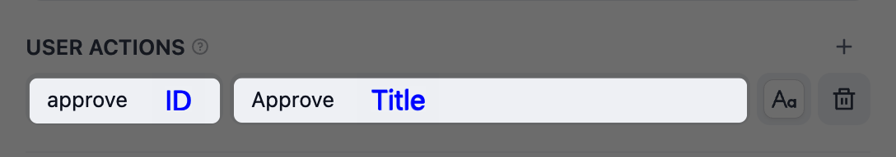
  </Frame>

  <Tip>
      プリセットのボタンスタイルを使用して、アクションを視覚的に区別します。

      たとえば、`Approve` のような重要なアクションには目立つスタイルを、二次的なオプションには控えめなスタイルを使用します。
  </Tip>

  ### タイムアウト戦略

  リクエストが期限切れになるまでの時間を設定します。デフォルトは 3 日です。

  タイムアウトまでに受信者が応答しなかった場合、ワークフローはノードのタイムアウトブランチに進みます。このブランチをフォールバックパス（通知の送信やリトライループなど）に接続してください。

  タイムアウトブランチが接続されていない場合、ワークフローは終了します。

  ## 例：コンテンツレビューワークフロー

  <Columns cols={2}>
    <Frame caption="ワークフローの例">
      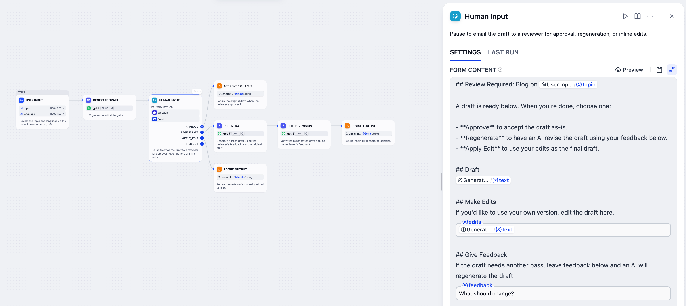
    </Frame>
    <Frame caption="リクエストフォームの例">
      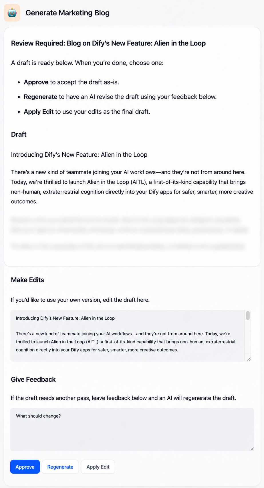
    </Frame>
  </Columns>

  このワークフローでは、ワークフローの起動者が入力した `topic` と `language` からブログ記事の草稿を作成します。その草稿をメールでレビュアーに送信し、レビュアーの選択に応じて最終出力を確定します。

  このワークフローは、レビュアーが次の 3 つを行えるように設計されています。

  1. **AI が生成した草稿を確認する**：フォームで上流の LLM ノードの `text` 変数を参照し、レンダリングされたフォームに草稿の本文をそのまま表示させます。

  2. **必要に応じて草稿を直接編集する**：フォームに `edits` という段落フィールドを追加し、同じ `text` 変数で事前入力します。これによりレビュアーは草稿を出発点として、その場で編集できます。

     ブログ記事は通常長いため、フォームの Markdown 表示（第 1 点）の方が、単独の段落フィールドよりも読みやすくなります。コンテンツが短い場合は、事前入力した段落フィールド 1 つで閲覧と編集の両方を兼ねられます。

  3. **AI による修正のためにフィードバックを提供する**：

      1. レビュアーのフィードバックを集めるため、フォームに `feedback` という段落フィールドを追加します。
      2. 下流の LLM ノードを 2 つ順に接続します。
          1. Regenerate ノード：元の草稿 `text` とレビュアーの `feedback` を受け取って修正された草稿を生成します。
          2. Check Revision ノード：`feedback` と修正された草稿を受け取り、修正がフィードバックに沿っているかを確認します。検証された結果が最終出力として下流に流れます。

  レビュアーは受け取ったリクエストフォームで、判断に応じて該当する段落フィールドに入力するか空のままにし、対応するアクションボタンをクリックします。各アクションは異なる出力に接続されます。

  - **Approve**：上流の LLM からの元の草稿
  - **Apply Edit**：`edits` フィールドでレビュアーが編集した内容
  - **Regenerate**：下流の LLM パイプラインからの修正草稿

  <Accordion
    title="LLM ノードのプロンプト（参考）"
  ><Tabs>
    <Tab title="Generate Draft">
      **System**

      ```text wrap
      指定された言語で、与えられたトピックについてマーケティング用のブログ記事を書いてください。
      ```

      **User**

      ```text
      トピック：{{#user_input.topic#}}
      言語：{{#user_input.language#}}
      ```

    </Tab>
    <Tab title="Regenerate">
      **System**

      ```text wrap
      ユーザーのフィードバックに基づいて、草稿を再生成してください。
      ```

      **User**

      ```text
      草稿：{{#generate_draft.text#}}
      ユーザーのフィードバック：{{#human_input.feedback#}}
      ```

    </Tab>
    <Tab title="Check Revision">
      **System**

      ```text wrap
      以下の草稿がユーザーのフィードバックに対応しているか確認してください。対応している場合は、草稿をそのまま返してください。対応していない場合は、フィードバックに沿って修正してください。
      ```

      **User**

      ```text
      ユーザーのフィードバック：{{#human_input.feedback#}}
      再生成された草稿：{{#regenerate.text#}}
      ```

    </Tab>
  </Tabs>

  </Accordion>

  </Tab>
</Tabs>
