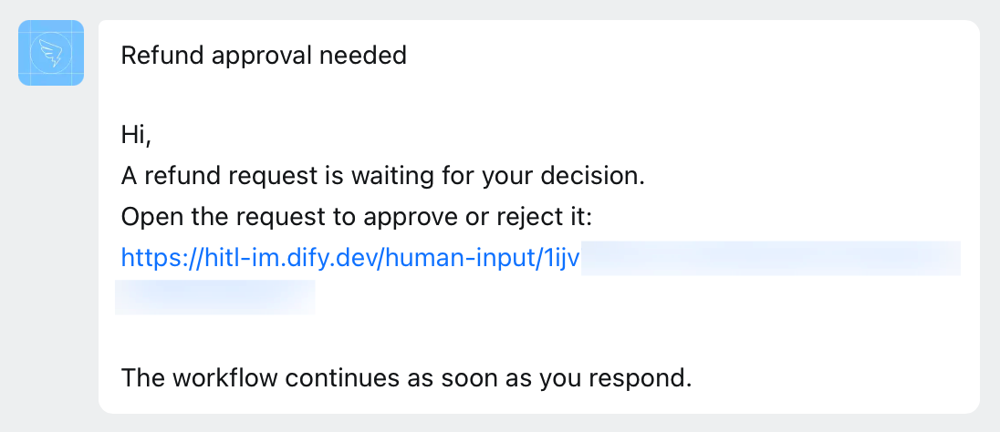

> このドキュメントは AI によって自動翻訳されています。不正確な部分がある場合は、[英語版](/en/self-host/use-dify/workspace/channels/dingtalk) を参照してください。

Dify は、DingTalk の組織に作成した社内アプリを通じて動作します。このアプリは次の役割を担います。

- ボットを通じてメンバーにリクエストを送信します。各リクエストは、Dify のフォームへのリンク付きのテキストメッセージとして届きます。
- Dify がメンバーディレクトリを読み取り、メールアドレスで各メンバーをワークスペースのメンバーと照合できるようにします。

## 始める前に

次の点を確認してください。

- DingTalk 組織の開発者コンソールで、社内アプリを作成できること。
- [`CONSOLE_WEB_URL`](/ja/self-host/deploy/configuration/environments#console_web_url) が、メンバーがアクセスできるアドレスに設定されていること。すべてのリクエストのリンク先はこのアドレスです。

## アプリの作成

[DingTalk 開発者コンソール](https://open-dev.dingtalk.com/) で **App Development** > **DingTalk App** に移動します。**Create App** をクリックし、アプリの名前と説明を入力して **Save** をクリックします。続いて、次の手順を実行します。

1. アプリで **Add App Capability** を開き、**Bot** カードの **Add** をクリックします。

2. **Bots** ページで **Bot Configuration** をオンにし、必須項目を入力して **Publish** をクリックします。

    - **Bot name** には、「Dify」のようにメンバーが見てわかる名前を付けます。リクエストはこの名前のボットから届きます。

    - **Message receiving mode** は **Stream mode** のままにします。

3. **Manage permissions** を開きます。**Contacts API permission scope** は **All employees** に設定します。続いて、次の権限コードをそれぞれ検索して有効にします。

    - `qyapi_robot_sendmsg`
    - `qyapi_get_department_list`
    - `qyapi_get_department_member`
    - `qyapi_get_member`
    - `fieldEmail`

4. **Version Management and Release** で **Create New Version** をクリックします。**Available scope** を **All employees** に設定し、**Save** をクリックします。

   DingTalk の管理者でない場合は、先に管理者の承認が必要になることがあります。公開が完了してから、Dify での接続に進んでください。

## Dify での接続

1. **設定** > **チャネル** で DingTalk を探し、**接続** をクリックします。

   <Info>
   すでに別の IM（インスタントメッセージングアプリ）を接続している場合は、代わりに **交換する** をクリックします。先に [置き換えで消去される内容](/ja/self-host/use-dify/workspace/channels/overview#im-の置き換えと削除) を確認してください。
   </Info>

2. DingTalk の値を入力します。

    - **企業 ID**：開発者コンソールのホームページにある **CorpId** です。
    - **クライアントID**、**クライアントシークレット**：アプリの **Credentials and Basic Information** にあります。

   <Note>
   DingTalk 側でこれらの値を変更した場合は、Dify 側も更新してください。
   </Note>

3. **接続** をクリックします。Dify は保存前に接続を確認します。

## 同期とテスト

1. **チャネル** で **今すぐ同期** をクリックし、メンバーの IM アカウントをバインドします。各結果の意味については、[メンバーの同期](/ja/self-host/use-dify/workspace/channels/overview#メンバーの同期) を参照してください。

2. 自分の IM アカウントをバインドした状態で、自分宛てにテストリクエストを送信します。

    - メッセージが届くかを手早く確認するには、人間の入力ノードの **メッセージテンプレート** にある **メッセージをテスト** を使います。**テストチャネル** で DingTalk を選択し、**保存してテスト** をクリックします。ワークフローを実行せずに、メッセージが自分宛てに送信されます。
    - フロー全体を確認するには、ノードで [デバッグモード](/ja/self-host/use-dify/nodes/human-input#test-without-notifying-recipients) をオンにし、DingTalk を選択してワークフローをテスト実行します。ボットとのチャットにメッセージが届いたら、リンクを開いてサインインし、応答して、実行が続行されることを確認します。

   テストが失敗した場合や何も届かない場合は、[トラブルシューティング](#トラブルシューティング) を参照してください。

## メンバー側の表示

各リクエストは、メンバーとボットの 1 対 1 のチャットに届きます。内容はノードの [メッセージテンプレート](/ja/self-host/use-dify/nodes/human-input#write-the-notification) から作成されるテキストメッセージで、件名の後に、リンクを含む本文が続きます。

<Frame caption="DingTalk メッセージとして届いたリクエスト">
  
</Frame>

メンバーが最初に目にするのは件名です。「注文 1042 の返金承認」のように、何を判断するのかがわかる件名にしてください。

メンバーはリンクを開き、リクエストの送信先のアカウントでサインインして、Dify で応答します。転送されたリンクはほかの人には機能しないため、応答する必要がある人は全員受信者に追加してください。

## トラブルシューティング

<AccordionGroup>
  <Accordion title="接続時に、DingTalk に接続できないと表示される">
    メッセージの末尾によって、原因が異なります。

    - 末尾に HTTP ステータスもエラーコードもない：原因は **Contacts API permission scope** です。**All employees** に設定されておらず、Dify が DingTalk のディレクトリ全体を読み取れません。**Manage permissions** で変更してください。
    - 末尾が `API error code: 88` または `60011`：アプリに `qyapi_get_department_list` 権限がありません。**Manage permissions** で有効にしてください。
    - 末尾が `HTTP status: 500. API error code: unknownError.`：企業 ID が間違っています。開発者コンソールのホームページから、もう一度コピーしてください。

    その後、もう一度 **接続** をクリックしてください。
  </Accordion>
  <Accordion title="同期時に、DingTalk のディレクトリを読み取れないと表示される">
    多くの場合、アプリに `qyapi_get_department_member` 権限がありません。**Manage permissions** で有効にしてから、もう一度同期してください。
  </Accordion>
  <Accordion title="同期後もメンバーが「一致なし」のままになる">
    Dify が、一致するメールアドレスを見つけられていません。影響を受けている範囲によって、原因が異なります。

    - すべてのメンバー：アプリに `fieldEmail` 権限がありません。**Manage permissions** で有効にしてから、もう一度同期してください。
    - 一部のメンバー：Dify が読み取るのは DingTalk プロフィールのメールアドレスで、企業メールボックスではありません。企業メールボックスしかないメンバーは、プロフィールにメールアドレスを追加してもう一度同期するか、[手動でバインド](/ja/self-host/use-dify/workspace/contacts#手動でのバインド) してください。
  </Accordion>
  <Accordion title="テストリクエストが失敗する">
    何らかの原因で、Dify が送信できていません。**メッセージをテスト** で「テストに失敗しました。チャネル設定を確認して、もう一度お試しください。」と表示されるか、デバッグモードでの実行が「No one can approve this step.」というエラーで失敗します。

    次の点を確認してください。

    - アプリで `qyapi_robot_sendmsg` が有効になっていること。
    - ボットが公開済みで、その後にアプリのバージョンを公開していること。
    - 自分の IM アカウントがバインドされていること。
  </Accordion>
</AccordionGroup>
