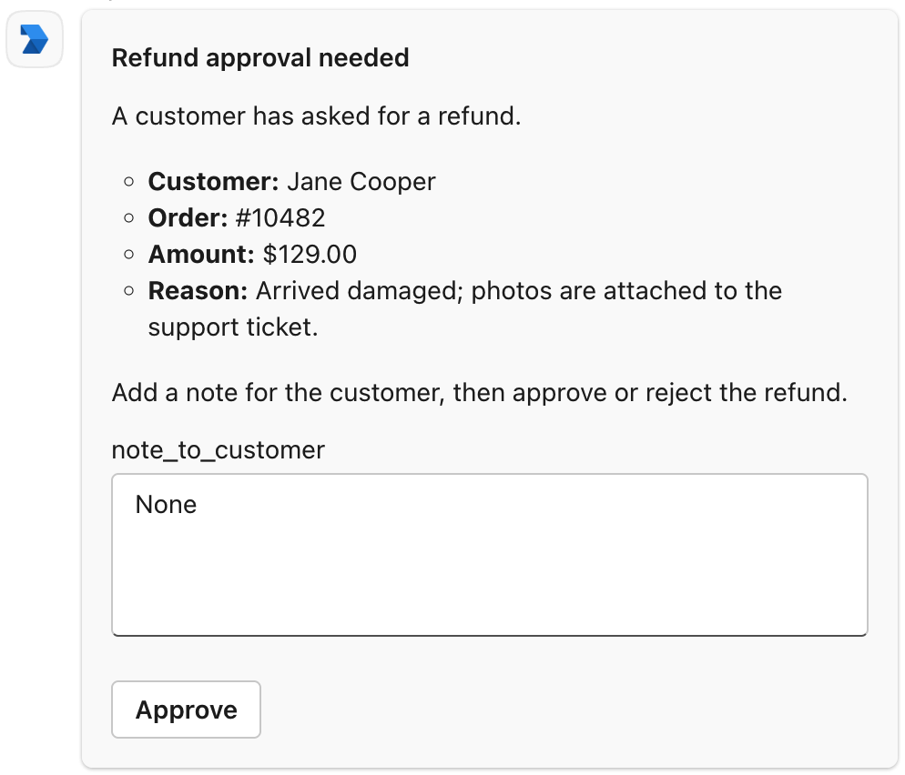
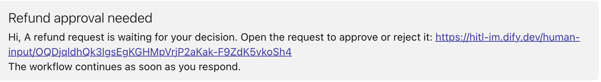

> このドキュメントは AI によって自動翻訳されています。不正確な部分がある場合は、[英語版](/en/self-host/use-dify/workspace/channels/ms-teams) を参照してください。

Dify は、Azure に登録したボットと、そのボットを組織に導入する Teams アプリを通じて動作します。この 2 つは次の役割を担います。

- ボットとの個人用チャットで、メンバーにリクエストを送信します。
- Dify が組織のユーザー一覧を読み取り、メールアドレスで各ユーザーを Dify ワークスペースのメンバーと照合できるようにします。
- メンバーがリクエストのボタンをクリックすると、その応答を Dify に送り返します。

## 始める前に

設定には、3 種類の Microsoft 管理者権限が必要です。それぞれを別の人が持っていることも少なくありません。次の項目について、自分が権限を持っているか、権限を持つ人の協力を得られることを確認してください。

- **ボットの作成**：リソースを作成できる Azure サブスクリプションが必要です。
- **ボットへの権限付与**：Microsoft Entra ID で管理者の同意を付与できる人が必要です。ロールは Privileged Role Administrator か Global Administrator です。
- **Teams アプリ**：Teams admin center でアプリを承認してインストールできる人が必要です。ロールは Teams Administrator か Global Administrator です。

Dify 側では、次の点を確認してください。

- [`TRIGGER_URL`](/ja/self-host/deploy/configuration/environments#trigger_url) が、Microsoft Teams からインターネット経由でアクセスできる HTTPS アドレスに設定されていること。カードのボタン操作を Dify に届けるために必要です。
- [`CONSOLE_WEB_URL`](/ja/self-host/deploy/configuration/environments#console_web_url) が、メンバーがアクセスできるアドレスに設定されていること。リンクメッセージとして届くリクエストのリンク先は、このアドレスです。

## ボットの作成

<Steps>
  <Step title="Azure Bot を作成">
    1. Azure portal で [Azure Bot を作成](https://portal.azure.com/#create/Microsoft.AzureBot) します。**Basics** タブは自由に入力してかまいませんが、次の項目だけは指定どおりに設定します。

        - **Data residency**：**Global**
        - **Pricing tier**：**Free**（これで十分です）
        - **Type of App**：**Single Tenant**
        - **Creation type**：**Create new Microsoft App ID**

    2. **Review + create** > **Create** をクリックします。
  </Step>
  <Step title="Teams チャネルを追加">
    1. デプロイが完了したら、**Go to resource** をクリックしてボットを開きます。
    2. **Settings** > **Channels** を開きます。**Available Channels** で **Microsoft Teams** をクリックします。
    3. **Messaging** タブで **Microsoft Teams Commercial (most common)** を選択します。続いて **Apply** をクリックします。
  </Step>
  <Step title="ボットの ID を記録">
    **Settings** > **Configuration** を開きます。**Microsoft App ID** と **App Tenant ID** の値を控えておきます。これらは後で Teams アプリと Dify に入力します。

    ボットには、[Azure Bot の一覧](https://portal.azure.com/#browse/Microsoft.BotService%2FbotServices) からいつでも戻れます。
  </Step>
</Steps>

## 権限の付与とシークレットの作成

<Steps>
  <Step title="ボットのアプリ登録を選択">
    Microsoft Entra ID で [App registrations](https://portal.azure.com/#view/Microsoft_AAD_RegisteredApps/ApplicationsListBlade) を開き、ボットと同じ名前のものを選択します。
  </Step>
  <Step title="権限を付与">
    1. **API permissions** を開き、**Add a permission** をクリックします。**Microsoft Graph** > **Application permissions** を選びます。`User.Read.All` と `Organization.Read.All` を選択し、**Add permissions** をクリックします。
    2. **Grant admin consent for …** をクリックし、確定します。

    これらの権限があると、Dify は組織の情報と、メールアドレスやプロフィール写真を含むユーザーの情報を読み取れます。
  </Step>
  <Step title="クライアントシークレットを作成">
    1. **Certificates & secrets** > **Client secrets** を開きます。**New client secret** をクリックし、有効期限を選んで **Add** をクリックします。
    2. ページを離れる前に、新しいシークレットの **Value** をコピーします。この値は二度と表示されません。コピーするのは **Secret ID** ではなく **Value** です。
  </Step>
</Steps>

<Note>
シークレットの有効期限を記録しておいてください。期限が切れると、Dify は Teams にリクエストを送信できず、メンバーの同期もできなくなります。

期限が切れる前に次のシークレットを作成し、[Dify に入力](#requests-stopped-arriving-though-channels-still-shows-connected) してください。
</Note>

## Teams アプリの作成

<Steps>
  <Step title="アプリを作成">
    [Teams Developer Portal](https://dev.teams.microsoft.com/apps) で **New app** をクリックし、名前を付けて **Create** をクリックします。
  </Step>
  <Step title="基本情報を入力">
    1. **Configure** > **Basic information** で必須項目を入力します。**Application (client) ID** には、[ボットの作成](#ボットの作成) で控えた **Microsoft App ID** を入力します。
    2. **Save** をクリックします。

    <Info>
    ページ上部にある **App ID** は、Teams アプリ自体の ID です。変更せず、そのままにしておきます。
    </Info>
  </Step>
  <Step title="ボットを追加">
    1. **Configure** > **App features** で **Bot** をクリックします。
    2. **Identify your bot** で **Enter a bot ID** を選択します。ボットの **Microsoft App ID** をもう一度入力します。
    3. **Select the scopes where people can use your bot** で **Personal** を選択します。続いて **Save** をクリックします。
  </Step>
  <Step title="承認を申請">
    **Distribute** > **Publish to your organisation** > **Get started** をクリックします。
  </Step>
</Steps>

これで、アプリは Teams 管理者の承認待ちになります。承認を待つ間に、[Dify での接続](#dify-での接続) と [コールバックの設定](#コールバックの設定) を進められます。アプリのインストールが必要なのは、最後のテストだけです。

## アプリの承認とインストール

<Steps>
  <Step title="アプリを承認">
    1. Teams admin center で [Manage apps](https://admin.teams.microsoft.com/policies/manage-apps) を開き、アプリ名で検索して開きます。
    2. **Publish** をクリックし、確定します。
  </Step>
  <Step title="メンバー向けにインストール">
    1. **Users and groups** タブで **Installs** を選択した状態で、**Install app** をクリックします。
    2. **Install to** を **Everyone** に設定します。**Specific users or groups** を選ぶ場合は、リクエストを受け取る全員が含まれるようにします。設定したら **Apply** をクリックします。

    ここでインストールしておくと、メンバーは自分でアプリを追加しなくてもリクエストを受け取れます。アプリがない人には、Teams で Dify から何も届きません。
  </Step>
</Steps>

## Dify での接続

1. Dify で **設定** > **チャネル** を開き、Microsoft Teams を探して **接続** をクリックします。

   <Info>
   すでに別の IM（インスタントメッセージングアプリ）を接続している場合は、代わりに **交換する** をクリックします。先に [置き換えで消去される内容](/ja/self-host/use-dify/workspace/channels/overview#im-の置き換えと削除) を確認してください。
   </Info>

2. **アプリの認証情報** に、[ボットの作成](#ボットの作成) で控えた ID と、コピーしたシークレットを入力します。

    - **テナント ID**：ボットの **App Tenant ID**
    - **クライアントID**：ボットの **Microsoft App ID**
    - **クライアントシークレット**：シークレットの **Value**

3. **保存して続行** をクリックします。Dify は保存前に接続を確認します。確認に失敗した場合は、[エラーの意味](#saving-in-dify-fails) を参照してください。

4. **コールバックを設定** で **コールバック URL** をコピーします。

## コールバックの設定

1. [Azure Bot の一覧](https://portal.azure.com/#browse/Microsoft.BotService%2FbotServices) でボットを開き、**Settings** > **Configuration** に移動します。

2. Dify からコピーしたコールバック URL を **Messaging endpoint** に貼り付け、**Apply** をクリックします。

<Info>
後で [`TRIGGER_URL`](/ja/self-host/deploy/configuration/environments#trigger_url) が変わると、コールバック URL も変わります。

**チャネル** で Microsoft Teams の設定を開き、新しい URL を取得します。その URL で、ボットの **Messaging endpoint** を更新してください。
</Info>

## 同期とテスト

1. **チャネル** で **今すぐ同期** をクリックし、メンバーの IM アカウントをバインドします。各結果の意味については、[メンバーの同期](/ja/self-host/use-dify/workspace/channels/overview#メンバーの同期) を参照してください。

   Dify は、Microsoft Entra ID アカウントのメールアドレスで照合します。そこにメールアドレスがない人は、**一致なし** に入ります。そうした人は、Contacts で [手動でバインド](/ja/self-host/use-dify/workspace/contacts#手動でのバインド) してください。

2. 自分宛てにテストリクエストを送信します。自分の IM アカウントをバインドした状態で、ワークフローを開き、人間の入力ノードでデバッグモードをオンにします。続いて Microsoft Teams を選択し、ワークフローをテスト実行します。

   **メッセージをテスト** ではなく、デバッグモードを使ってください。テストメッセージは常にリンクメッセージとして届くため、カードやボタンのクリックが機能するかを確認できません。

カードはボットとの個人用チャットに届きます。ボタンをクリックし、実行が続行されることを確認してください。

<Info>

  - 代わりにリンクメッセージが届いた場合は、フォームに [カードで表示できない要素](#メンバー側の表示) が含まれています。
  - 何も届かない場合や実行が続行されない場合は、[トラブルシューティング](#トラブルシューティング) を参照してください。

</Info>

## メンバー側の表示

<Columns cols={2}>
  <Frame caption="Teams カードとして届いたリクエスト">
    
  </Frame>
  <Frame caption="リンクメッセージとして届いたリクエスト">
    
  </Frame>
</Columns>

フォームを作成するときは、次の点に注意してください。

- カードの見出しにはノードのタイトルが使われます。「人間の入力 2」ではなく「返金の承認」のように、受信者が理解できるタイトルをノードに付けてください。

- メンバーは、すべてのフィールドを入力しないとカードを送信できません。

フォームに次のものが含まれる場合は、カードではなくリンクメッセージとして届きます。

- ファイルフィールド
- 変数から挿入した長いレポートなど、非常に長いコンテンツ

## トラブルシューティング

<AccordionGroup>
  <Accordion title="Dify での保存に失敗する" id="saving-in-dify-fails">
    エラーメッセージから原因がわかります。

    - **AADSTS7000215**：クライアントシークレットが間違っています。多くの場合、**Value** ではなく **Secret ID** を貼り付けたことが原因です。シークレットの **Value** を入力してください。手元に残っていない場合は、新しいシークレットを作成します。
    - **AADSTS700016**：クライアント ID が、テナント ID の組織に属するアプリではありません。ボットの **Configuration** ページから両方の ID をコピーし直してください。Teams Developer Portal の **App ID** は使えません。
    - **Internal Server Error**：テナント ID に一致する組織がありません。多くの場合、2 つの ID を取り違えて入力したことが原因です。**App Tenant ID** をコピーし直してください。
    - **HTTP status: 403**：Dify にユーザー一覧を読み取る権限がありません。管理者の同意が [付与されている](#権限の付与とシークレットの作成) ことを確認してください。
  </Accordion>
  <Accordion title="テストリクエストが失敗する">
    何らかの原因で、Dify が送信できていません。**メッセージをテスト** で「テストに失敗しました。チャネル設定を確認して、もう一度お試しください。」と表示されるか、デバッグモードでの実行が「No one can approve this step.」というエラーで失敗します。

    次の点を確認してください。

    - 自分の IM アカウントがバインドされていること。
    - Teams アプリが自分の Teams に追加されていること。Teams admin center で全員向けにインストールしていない場合は、自分で追加してください。Teams の **Apps** > **Built for your org** から追加できます。
    - Azure の **Settings** > **Channels** で、ボットの Microsoft Teams チャネルがオンになっていること。
  </Accordion>
  <Accordion title="どのカードのボタンも反応しない">
    クリックが Dify に届いていません。次の順に確認してください。

    - ボットの **Messaging endpoint** が、**チャネル** にある現在のコールバック URL と一致していること。
    - [`TRIGGER_URL`](/ja/self-host/deploy/configuration/environments#trigger_url) が、Microsoft Teams からインターネット経由でアクセスできる HTTPS アドレスに設定されていること。
  </Accordion>
  <Accordion title="一部のカードのボタンが機能しない">
    原因に応じて対処してください。

    - カードに空のフィールドがある：すべてのフィールドを入力してから、もう一度クリックします。
    - リクエストがタイムアウトした、実行が停止された、またはメンバーが Dify ワークスペースから外れた：判断がまだ必要なら、新しい実行を開始します。
    - カードの送信後に、メンバーの IM バインドが変わったか、IM が置き換えまたは削除された：デプロイの [メール設定](/ja/self-host/deploy/configuration/environments#メール設定) が済んでいれば、メールから応答できます。済んでいなければ、新しい実行を開始します。
  </Accordion>
  <Accordion title="特定のメンバーに Teams で何も届かない">
    **Contacts** で、そのメンバーの IM アカウントがバインドされているか確認します。バインドされていない場合は、もう一度同期するか、[手動でバインド](/ja/self-host/use-dify/workspace/contacts#手動でのバインド) してください。

    バインドされている場合は、Teams アプリがまだそのメンバーに届いていない可能性があります。メンバー自身が Teams の **Apps** > **Built for your org** でアプリを探し、**Add** をクリックすれば追加できます。

    デプロイの [メール設定](/ja/self-host/deploy/configuration/environments#メール設定) が済んでいれば、その間もリクエストはメールで届きます。
  </Accordion>
  <Accordion
    title="チャネルで接続済みと表示されたまま、リクエストが届かなくなった"
    id="requests-stopped-arriving-though-channels-still-shows-connected"
  >
    クライアントシークレットの有効期限が切れている可能性があります。確認するには、**チャネル** で Microsoft Teams の設定を開き、**アプリの認証情報** に戻って **接続をテスト** をクリックします。期限切れの場合は、AADSTS7000222 で失敗します。

    [新しいクライアントシークレットを作成](#権限の付与とシークレットの作成) し、同じ設定の **アプリの認証情報** に入力してください。メンバーのバインドとコールバック URL はそのまま維持されるため、再同期や **Messaging endpoint** の更新は必要ありません。
  </Accordion>
</AccordionGroup>
