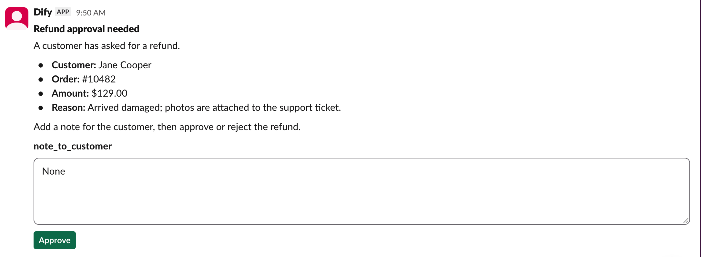
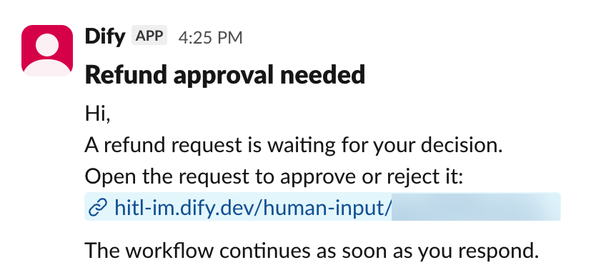

> このドキュメントは AI によって自動翻訳されています。不正確な部分がある場合は、[英語版](/en/self-host/use-dify/workspace/channels/slack) を参照してください。

Dify は、Slack ワークスペースに作成した Slack アプリを通じて動作します。このアプリは次の役割を担います。

- ボットを通じてメンバーにリクエストを送信します。
- Dify が Slack ワークスペースのメンバー一覧を読み取り、メールアドレスで各メンバーを Dify ワークスペースのメンバーと照合できるようにします。
- メンバーがリクエストのボタンをクリックすると、その応答を Dify に送り返します。

## 始める前に

次の点を確認してください。

- Slack ワークスペースにアプリをインストールできること。または、Slack の管理者にインストールを承認してもらえること。
- [`TRIGGER_URL`](/ja/self-host/deploy/configuration/environments#trigger_url) が、Slack からインターネット経由でアクセスできるアドレスに設定されていること。カードのボタン操作を Dify に届けるために必要です。
- [`CONSOLE_WEB_URL`](/ja/self-host/deploy/configuration/environments#console_web_url) が、メンバーがアクセスできるアドレスに設定されていること。リンクメッセージとして届くリクエストのリンク先は、このアドレスです。

## アプリの作成

[Slack 開発者コンソール](https://api.slack.com/apps) で **Create an App** をクリックします。**From scratch** で **Pick features** を選択し、**Continue** をクリックします。続いて、次の手順を実行します。

1. アプリには、「Dify」のようにメンバーが見てわかる名前を付けます。リクエストはこの名前のアプリから届きます。**Workspace** では、チームが使用している Slack ワークスペースを選択します。

2. **Bot scopes** で **Add Bot Scopes** をクリックし、`chat:write`、`im:write`、`users:read`、`users:read.email` を追加します。

   これらのスコープがあると、アプリはメンバーとのダイレクトメッセージを開始し、カードを送信できます。誰かが応答した後にカードを更新したり、メールアドレス付きのメンバー一覧を読み取ったりすることもできます。

3. イベントのステップでは何も追加せず、**Continue** をクリックします。

4. **Create and Install** をクリックし、Slack の権限確認画面で **Allow** をクリックします。

5. アプリの設定で **Socket Mode** を開き、**Enable Socket Mode** をオフにします。オンのままだと、ボタンのクリックが Dify に届きません。

## Dify での接続

1. **設定** > **チャネル** で Slack を探し、**接続** をクリックします。

   <Info>
   すでに別の IM（インスタントメッセージングアプリ）を接続している場合は、代わりに **交換する** をクリックします。先に [置き換えで消去される内容](/ja/self-host/use-dify/workspace/channels/overview#im-の置き換えと削除) を確認してください。
   </Info>

2. **アプリの認証情報** に、Slack アプリの値を入力します。

    - **クライアントID**、**クライアントシークレット**、**署名シークレット**：**Basic Information** ページにある値です。**App Credentials** の Client ID、Client Secret、Signing Secret を入力します。
    - **ボットトークン**：**Bot User OAuth Token** の値です。**OAuth & Permissions** > **OAuth Tokens** にあります。

   <Note>
   Slack 側で Signing Secret を再生成するなど、これらの値を変更した場合は、Dify 側も更新してください。
   </Note>

3. **保存して続行** をクリックします。Dify は保存前に接続を確認します。

4. **コールバックを設定** で **コールバック URL** をコピーします。

## コールバックの設定

1. Slack アプリで **Interactivity & Shortcuts** を開き、**Interactivity** をオンにします。

2. Dify からコピーしたコールバック URL を **Request URL** に貼り付け、**Save Changes** をクリックします。

<Info>
後で [`TRIGGER_URL`](/ja/self-host/deploy/configuration/environments#trigger_url) が変わると、コールバック URL も変わります。

**チャネル** で Slack の設定を開いて新しい URL を取得し、Slack アプリ側も更新してください。
</Info>

## 同期とテスト

1. **チャネル** で **今すぐ同期** をクリックし、メンバーの IM アカウントをバインドします。各結果の意味については、[メンバーの同期](/ja/self-host/use-dify/workspace/channels/overview#メンバーの同期) を参照してください。

2. 自分宛てにテストリクエストを送信します。自分の IM アカウントをバインドした状態で、ワークフローを開き、人間の入力ノードで [デバッグモード](/ja/self-host/use-dify/nodes/human-input#test-without-notifying-recipients) をオンにします。続いて Slack を選択し、ワークフローをテスト実行します。

   **メッセージをテスト** ではなく、デバッグモードを使ってください。テストメッセージは常にリンクメッセージとして届くため、カードやボタンのクリックが機能するかを確認できません。

カードはアプリからのダイレクトメッセージで届きます。ボタンをクリックし、実行が続行されることを確認してください。

<Info>

  - 代わりにリンクメッセージが届いた場合は、フォームに [カードで表示できない要素](#メンバー側の表示) が含まれています。
  - 何も届かない場合や実行が続行されない場合は、[トラブルシューティング](#トラブルシューティング) を参照してください。

</Info>

## メンバー側の表示

<Columns cols={2}>
  <Frame caption="Slack カードとして届いたリクエスト">
    
  </Frame>
  <Frame caption="リンクメッセージとして届いたリクエスト">
    
  </Frame>
</Columns>

フォームを作成するときは、次の点に注意してください。

- カードの見出しにはノードのタイトルが使われます。「人間の入力 2」ではなく「返金の承認」のように、受信者が理解できるタイトルをノードに付けてください。

- メンバーは、すべてのフィールドを入力しないとカードを送信できません。

フォームに次のものが含まれる場合は、カードではなくリンクメッセージとして届きます。

- ファイルフィールド
- 変数から挿入した長いレポートなど、非常に長いコンテンツ
- 選択肢が 100 個を超える、または 75 文字を超える選択肢がある選択フィールド

## トラブルシューティング

<AccordionGroup>
  <Accordion title="テストリクエストが失敗する">
    何らかの原因で、Dify が送信できていません。**メッセージをテスト** で「テストに失敗しました。チャネル設定を確認して、もう一度お試しください。」と表示されるか、デバッグモードでの実行が「No one can approve this step.」というエラーで失敗します。

    次の点を確認してください。

    - アプリが Slack ワークスペースにインストールされたままで、Dify に最新のボットトークンが設定されていること。
    - 自分の IM アカウントがバインドされていること。
  </Accordion>
  <Accordion title="どのカードのボタンも反応しない、または Slack にエラーが表示される">
    クリックが Dify に届いていません。次の順に確認してください。

    - Slack アプリで **Socket Mode** がオフになっていること。
    - **Interactivity** がオンになっていること。また、その **Request URL** が、**チャネル** にある現在のコールバック URL と一致していること。
    - Dify の署名シークレットが、Slack の Signing Secret と一致していること。Slack 側の値は **Basic Information** > **App Credentials** にあります。
    - [`TRIGGER_URL`](/ja/self-host/deploy/configuration/environments#trigger_url) が、Slack からインターネット経由でアクセスできるアドレスに設定されていること。
  </Accordion>
  <Accordion title="一部のカードのボタンが機能しない">
    原因に応じて対処してください。

    - カードに空のフィールドがある：すべてのフィールドを入力してから、もう一度クリックします。
    - リクエストがタイムアウトした、実行が停止された、またはメンバーが Dify ワークスペースから外れた：判断がまだ必要なら、新しい実行を開始します。
    - メンバーの IM バインドの変更前か、IM の置き換えや削除の前に送信されたカードである：デプロイの [メール設定](/ja/self-host/deploy/configuration/environments#メール設定) が済んでいれば、メールから応答できます。済んでいなければ、新しい実行を開始します。
  </Accordion>
</AccordionGroup>
