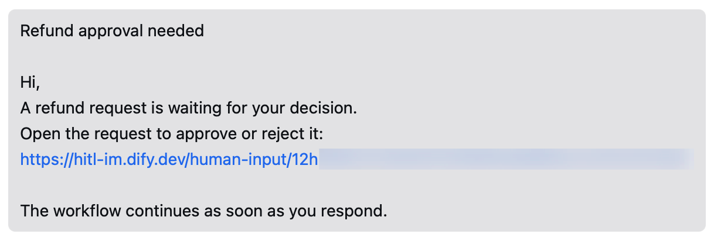

> このドキュメントは AI によって自動翻訳されています。不正確な部分がある場合は、[英語版](/en/self-host/use-dify/workspace/channels/wecom) を参照してください。

Dify は、WeCom 組織の管理コンソールで作成した自社開発アプリを通じて動作します。このアプリは次の役割を担います。

- 各リクエストを、Dify のフォームへのリンク付きのテキストメッセージとしてメンバーに送信します。
- アプリの利用を許可されたメンバーを、Dify が読み取れるようにします。

## 始める前に

WeCom は、アプリに登録した IP アドレスからの呼び出しだけを受け付けます。IP アドレスを登録するには、事前に自社が所有するドメインの検証が求められます。次の点を確認してください。

- WeCom 組織の管理者であるか、管理者の協力を得られること。
- Dify サーバーが外部へのリクエストに使うパブリック IP アドレスがわかっていること。WeCom から見えるのはこのアドレスで、Dify のドメインが指すアドレスとは異なる場合があります。サーバーで `curl ifconfig.me` を実行すると確認できます。
- 自社が所有するドメインがあり、その ICP 登録が自社または関連会社の名義であること。また、そのドメインの Web サイトのルートにファイルを配置できること。
- [`CONSOLE_WEB_URL`](/ja/self-host/deploy/configuration/environments#console_web_url) が、メンバーがアクセスできるアドレスに設定されていること。各メッセージのリンク先はこのアドレスです。

## アプリの作成

[WeCom 管理コンソール](https://work.weixin.qq.com/wework_admin/frame) で **App Management** > **Apps** に移動します。**Self-built** の **Create an app** をクリックし、次の手順を実行します。

1. **App Logo** をアップロードし、**App Name** には「Dify」のようにメンバーが見てわかる名前を付けます。リクエストはこの名前のアプリから届きます。

2. **Allowed users** で **Select departments/members** をクリックし、リクエストを受け取る人を全員選択します。その後、**Create an app** をクリックします。

## Dify サーバー IP の信頼設定 {#trust-the-dify-server-ip}

1. アプリのページで **Company's Trusted IP** を探し、**Settings** をクリックします。

2. ダイアログで **Set trusted domain name** をクリックし、次の操作を行います。

    1. 最初の **Trustable Domain Names** ボックスに、自社のドメインを入力します。
    2. 下部の **Domain name to be verified** をクリックします。検証ファイルをダウンロードし、そのドメインの Web サイトのルートに配置します。
    3. **OK** をクリックします。

3. **Company's Trusted IP** > **Settings** に戻り、Dify サーバーのパブリック IP アドレスを入力して保存します。

   変更が反映されるまで 1 分ほど待ってから、Dify で接続してください。

## Dify での接続

1. **設定** > **チャネル** で WeCom を探し、**接続** をクリックします。

   <Info>
   すでに別の IM（インスタントメッセージングアプリ）を接続している場合は、代わりに **交換する** をクリックします。先に [置き換えで消去される内容](/ja/self-host/use-dify/workspace/channels/overview#im-の置き換えと削除) を確認してください。
   </Info>

2. WeCom の値を入力します。

    - **企業 ID**：管理コンソールの **My Company** ページの下部にある **Company ID** です。
    - **エージェント ID**：アプリのページにある **AgentId** です。
    - **シークレット**：アプリのページで **Secret** の横にある **View** をクリックし、**Send** をクリックします。シークレットは **WeCom Team** からのメッセージで届くので、WeCom でそのメッセージを開き、**View Now** をクリックします。

   <Note>
   WeCom 側でこれらの値を変更した場合は、Dify 側も更新してください。
   </Note>

3. **接続** をクリックします。Dify は保存前に接続を確認します。

## メンバーの同期とバインド

1. **チャネル** で **今すぐ同期** をクリックします。見つかったメンバーは、すべて **一致なし** に表示されます。

   <Info>
   Dify は現在、WeCom のメンバーの自動照合に対応していません。
   </Info>

2. **Contacts** で [各メンバーを手動でバインド](/ja/self-host/use-dify/workspace/contacts#手動でのバインド) します。テストできるように、まず自分からバインドしてください。同じ名前のメンバーがいる場合は、各メンバーの下に表示される WeCom のユーザー ID で見分けます。

Dify が同期してリクエストを届けられるのは、アプリの **Allowed users** に含まれるメンバーだけです。新しくリクエストを受け取る人がいる場合は、まだ含まれていなければそこに追加し、もう一度同期してバインドしてください。

以降の同期でも、設定したバインドは維持されます。ただし、**Allowed users** から外した人のバインドは削除されます。

## テストリクエストの送信

自分の IM アカウントをバインドした状態で、自分宛てにテストリクエストを送信します。

- メッセージが届くかを手早く確認するには、人間の入力ノードの **メッセージテンプレート** にある **メッセージをテスト** を使います。**テストチャネル** で WeCom を選択し、**保存してテスト** をクリックします。ワークフローを実行せずに、メッセージが自分宛てに送信されます。
- フロー全体を確認するには、ノードでデバッグモードをオンにし、WeCom を選択してワークフローをテスト実行します。メッセージが届いたら、リンクを開いてサインインし、応答して、実行が続行されることを確認します。

テストが失敗した場合や何も届かない場合は、[トラブルシューティング](#トラブルシューティング) を参照してください。

## メンバー側の表示

各リクエストは、ノードの [メッセージテンプレート](/ja/self-host/use-dify/nodes/human-input#write-the-notification) から作成されるテキストメッセージとして、アプリから届きます。件名の後に、リンクを含む本文が続きます。

<Frame caption="WeCom メッセージとして届いたリクエスト">
  
</Frame>

メンバーが最初に目にするのは件名です。「注文 1042 の返金承認」のように、何を判断するのかがわかる件名にしてください。

WeCom は 2,048 バイトを超えるテキストメッセージを切り詰めるため、メッセージテンプレートが長いとリンクが失われることがあります。テンプレートを短くするか、リクエスト URL を本文の先頭近くに配置してください。

メンバーはリンクを開き、リクエストの送信先のアカウントでサインインして、Dify で応答します。転送されたリンクはほかの人には機能しないため、応答する必要がある人は全員受信者に追加してください。

## トラブルシューティング

<AccordionGroup>
  <Accordion title="接続が API エラーコード 60020 で失敗する">
    WeCom が、Dify サーバーの IP アドレスからのリクエストを受け付けていません。**Company's Trusted IP** に [サーバーのパブリック IP を追加](#trust-the-dify-server-ip) します。1 分ほど待ってから、もう一度 **接続** をクリックしてください。

    すでにアドレスを追加している場合は、Dify サーバーが外部へのリクエストに使うアドレスと一致しているか確認してください。
  </Accordion>
  <Accordion title="接続時に認証情報が無効だと表示される、または別のエラーコードで失敗する">
    3 つの値のいずれかが間違っているか、別々のアプリの値が混ざっています。**My Company** から **Company ID** を、同じアプリから **AgentId** と Secret をコピーしてください。
  </Accordion>
  <Accordion title="テストリクエストが失敗する">
    何らかの原因で、Dify が送信できていません。**メッセージをテスト** で「テストに失敗しました。チャネル設定を確認して、もう一度お試しください。」と表示されるか、デバッグモードでの実行が「No one can approve this step.」というエラーで失敗します。

    次の点を確認してください。

    - 自分の IM アカウントがバインドされていること。
    - 自分がアプリの **Allowed users** に含まれていること。
    - Dify サーバーの現在のパブリック IP が、**Company's Trusted IP** に登録されていること。
  </Accordion>
  <Accordion title="同期が失敗する、または設定後にメッセージが届かなくなった">
    多くの場合、Dify サーバーのパブリック IP が変わり、WeCom がそのリクエストを受け付けなくなっています。確認するには、**チャネル** で WeCom の設定を開き、**接続をテスト** をクリックします。エラーコードが 60020 の場合は、新しい IP を **Company's Trusted IP** に追加してください。
  </Accordion>
</AccordionGroup>
