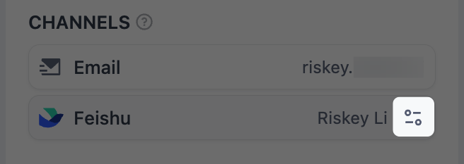

> このドキュメントは AI によって自動翻訳されています。不正確な部分がある場合は、[英語版](/en/self-host/use-dify/workspace/contacts) を参照してください。

Contacts には、アプリ作成者が [人間の入力](/ja/self-host/use-dify/nodes/human-input#choose-who-responds) ノードで受信者として選択できる人が一覧表示されます。ここに登録された全員に、リクエストがメールで届きます。メンバーは、IM アカウントがバインドされていれば、チームの IM（インスタントメッセージングアプリ）でも受け取れます。

メインナビゲーションに **Contacts** が表示されるのは、ワークスペースのオーナーと管理者だけです。連絡先の追加、変更、バインドができるのもこの 2 つのロールに限られます。エディターも、ノードで受信者を選択するときは、名前やメールアドレスで連絡先を検索できます。

## メンバーの自動登録

ワークスペースのアクティブなメンバーは、ロールに関係なく全員が連絡先になります。招待した人は、アカウントを有効化した時点で表示されます。

メンバーの名前、メールアドレス、アバターは、各自の Dify アカウントから取得されます。メンバーが自分の [プロフィール](/ja/self-host/use-dify/workspace/personal-account-management#プロフィール管理) で変更すると、Contacts にもすぐに反映されます。

メンバーが Contacts から外れるのは、ワークスペースから削除されたときだけです。メンバーを削除する前に、リクエストやワークフローへの [影響](#削除前の確認事項) を確認してください。

## 外部連絡先の追加

パートナーや顧客など、ワークスペース外の人を追加するには、**Add external contact** をクリックします。

外部連絡先には、リクエストがメールでのみ届きます。応答時にはそのアドレスに送られたコードを入力するため、Dify アカウントは必要ありません。

<Info>
    チームの IM でリクエストを受け取ってほしい同僚は、外部連絡先にせず [ワークスペースに招待](/ja/self-host/use-dify/workspace/team-members-management) してください。ロールは問いません。

    外部連絡先として登録済みの人がワークスペースに参加すると、Contacts には同じ人が 2 件表示されます。外部連絡先のほうを選択しているノードは、引き続きその人のメールにしか送信しません。メンバーのほうを選択し直すよう、アプリ作成者に伝えてください。
</Info>

## メンバーの IM アカウントのバインド {#bind-im-identities}

メンバーがチームの IM でリクエストを受け取れるのは、IM アカウントが連絡先にバインドされてからです。同期を実行するとメールアドレスをもとにバインドされ、同期で漏れた人は手動でバインドします。

### IM との同期

[チャネル](/ja/self-host/use-dify/workspace/channels/overview) でチームの IM を接続したら、同じ画面で **今すぐ同期** をクリックします。Dify は IM のディレクトリを読み込み、各 IM アカウントを同じメールアドレスのワークスペースメンバーにバインドします。メールアドレスの大文字と小文字は区別しません。

同期は **今すぐ同期** をクリックしたときにしか実行されません。新しい人が参加したときや、誰かのメールアドレスが変わったときは、もう一度同期してください。

同期でワークスペースメンバーと対応付けられなかった IM アカウントは、**チャネル** の同期結果に **一致なし** として表示されます。これは次のような場合に起こります。

- IM アカウントにメールアドレスがないか、そのメールアドレスを持つメンバーがいません。IM にいてワークスペースに参加していない人は、全員ここに含まれます。
- そのメールアドレスを持つメンバーが、ディレクトリに残っている別の IM アカウントにすでにバインドされています。

対応付けるには、IM 側またはその人の Dify アカウントのメールアドレスを修正して再度同期するか、[手動でバインド](#手動でのバインド) します。

### 手動でのバインド

選択できるのは、同期で読み込まれた IM アカウントだけです。前回の同期の後に IM に参加した人の場合は、先に同期し直してください。

**Contacts** でメンバーをクリックします。開いた詳細画面の **Channels** でチームの IM を探し、**Bind** をクリックして、その人の IM アカウントを選択します。

<Note>
別のメンバーにバインド済みの IM アカウントを選択すると、警告なしにこのメンバーへ移ります。元のメンバーは IM でリクエストを受け取れなくなり、[送信済みのカードも機能しなくなります](#情報の変更)。
</Note>

バインドを差し替えるには、**Bind** の代わりに変更アイコンをクリックします。

<Frame>

</Frame>

手動で設定したバインドは、その IM アカウントがディレクトリに残っている限り、以降の同期でも維持されます。

[チャネル](/ja/self-host/use-dify/workspace/channels/overview) でチームの IM を置き換えるか削除すると、手動で設定したものを含め、すべての IM バインドが解除されます。新しい IM を接続したら、もう一度同期し、手動のバインドを設定し直してください。

## 連絡先の変更による影響

新しいリクエストは、常にその人の最新の情報に基づいて送信されます。ただし変更によって、送信済みのリクエストや、いなくなった人を指定しているワークフローに不具合が出ることがあります。

### 削除前の確認事項

メンバーをワークスペースから削除したり、外部連絡先を **Contacts** から削除したりすると、次のようになります。

- その人は、送信済みのリクエストに応答できなくなります。リンクも IM カードも機能しません。
- 公開済みのワークフローは引き続き動作し、その人をスキップします。
- その人を指定しているワークフローは、アプリ作成者がノードからその人を外すまで再公開できません。

削除する前に、応答待ちのリクエストがあれば本人に応答してもらい、その人にリクエストを送っているアプリ作成者にも知らせてください。

外部連絡先の削除は元に戻せません。同じ人を再度追加すると新しい連絡先として作成されるため、アプリ作成者は選択し直す必要があります。情報を変えたいだけなら、削除せずに連絡先を編集してください。

### 情報の変更

送信済みのリクエストへの影響は、何が変わったかによって異なります。

- **メンバーが Dify のメールアドレスを変更した場合**：メンバーは自分のアカウントでサインインするため、送信済みのリンクは引き続き機能します。
- **外部連絡先のメールアドレスを編集した場合**：古いアドレスに送信したリンクは機能しなくなります。
- **メンバーの IM バインドが解除された、別の人に移った、または別のアカウントに差し替えられた場合**：そのバインドで送信したカードは機能しなくなります。同じアカウントをバインドし直しても元に戻りません。メールとリンクメッセージのリンクは引き続き機能します。
