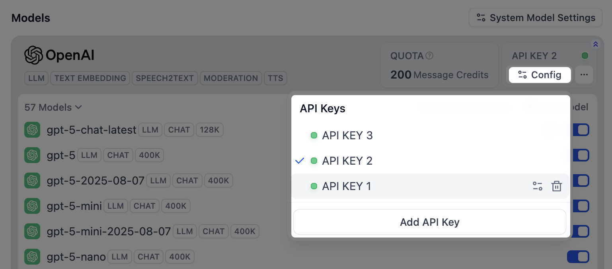
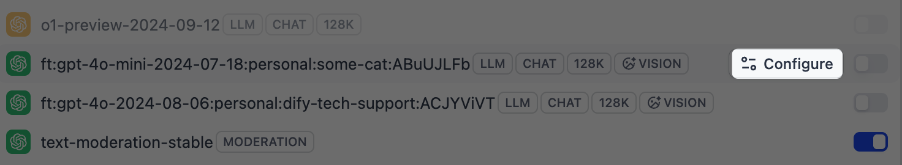
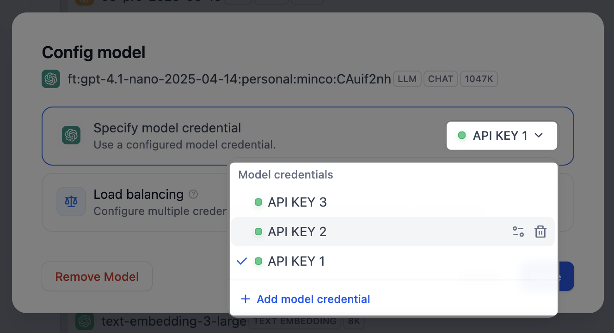
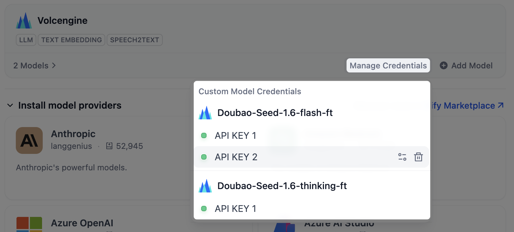
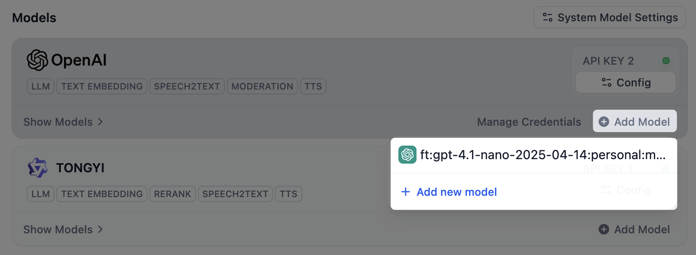

> このドキュメントは AI によって自動翻訳されています。不正確な部分がある場合は、[英語版](/en/self-host/use-dify/workspace/model-providers) を参照してください。

すべての Dify アプリには、少なくとも 1 つのモデルプロバイダーが必要です。プロバイダーをインストールして API キーを追加すると、ワークスペース内のすべてのアプリでそのモデルを利用できます。

<Warning>
API キーはワークスペース全体で有効になり、料金は各プロバイダーのアカウントに直接請求されます。プロバイダーを管理できるのは、ワークスペースのオーナーと管理者のみです。
</Warning>

## プロバイダーの追加

1. **連携** > **モデルプロバイダー** で **モデルプロバイダーをインストール** セクションを開きます。ほかの選択肢は [マーケットプレイス](https://marketplace.dify.ai/) で確認できます。

2. インストール後、プロバイダーカードの **API キーを追加** をクリックし、キーを入力します。カスタムエンドポイント URL や組織 ID など、プロバイダーが求める認証情報があれば、あわせて入力します。Dify は認証情報を検証してから、プロバイダーを利用可能にします。

## カスタムモデルの追加

プロバイダーを接続すると、そのモデルはすぐに使えます。手動で追加するのは、リリースされたばかりのモデルやファインチューニング済みモデルなど、必要なモデルが一覧にない場合だけです。

プロバイダーカードの **モデルを追加** をクリックし、モデル名と認証情報を指定します。提供するモデルが決まっているプロバイダーには、このオプションがありません。

<Info>
追加したモデルの名前とタイプが既存のものと同じ場合、Dify は新しく作らずに、既存のモデルへキーを追加します。
</Info>

## キーの管理

開発環境と本番環境を分けたい場合や、複数のアカウントに使用量を分散させたい場合は、1 つのプロバイダーに複数のキーを追加します。

- プロバイダー独自のモデルでは、プロバイダーカードの **コンフィグ** をクリックすると、これらのモデルに共通するキーを管理できます。
  <Frame>
  
  </Frame>
- 追加したカスタムモデルでは、そのモデルの **コンフィグ** をクリックすると、モデル固有のキーを管理できます。
    <Columns cols={2}>
      <Frame>
      
      </Frame>
      <Frame>
      
      </Frame>
    </Columns>

    <Warning>
    カスタムモデルが使うのは、そのモデル固有のキーだけです。キーが 1 つしかない状態でそれを削除すると、モデルも削除されます。
    </Warning>

    すべてのカスタムモデルのキーを 1 か所で確認するには、プロバイダーカードの **認証情報を管理** をクリックします。

    <Frame>
      
    </Frame>

    モデルを削除してもキーはここに残るため、再入力せずにモデルを後で追加し直せます。

    <Frame>
      
    </Frame>

## アプリが使うデフォルトモデルの選択

モデルを指定しないアプリやノードは、ワークスペースのデフォルトにフォールバックします。右上の **システムモデル設定** をクリックし、タスクごとにモデルを設定します。

- **システム推論モデル**：一般的な LLM タスクのデフォルトです。
- **埋め込みモデル**：ナレッジベースの内容をインデックス化し、検索します。
- **Rerank モデル**：検索結果を関連度で並べ替えます。
- **音声からテキストへの変換モデル**：音声をテキストに変換します。
- **テキストから音声への変換モデル**：テキストを音声に変換します。

デフォルトモデルが未設定だと、そのモデルを使う機能は動作しません。たとえば、テキストから音声への変換モデルを設定していないと、アプリで **テキストから音声へ** を使えません。
