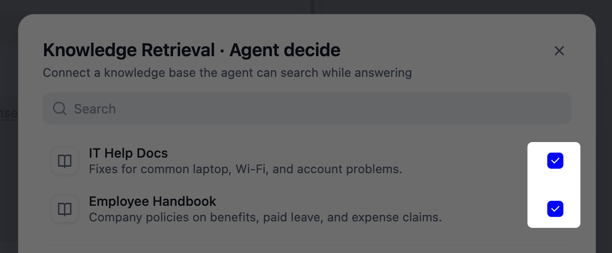
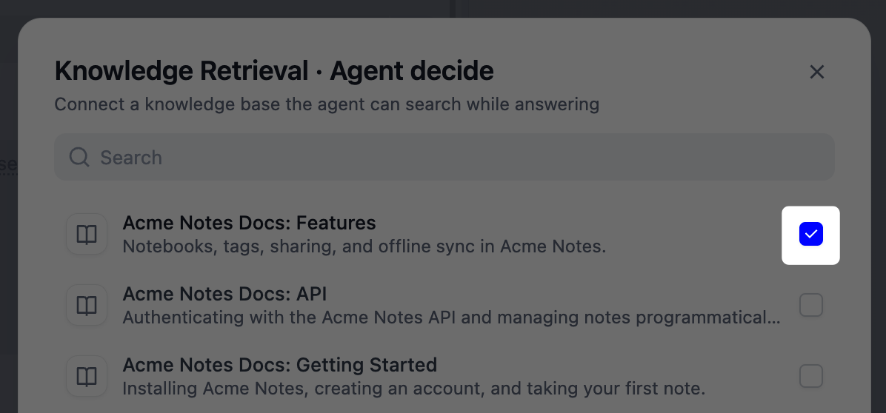
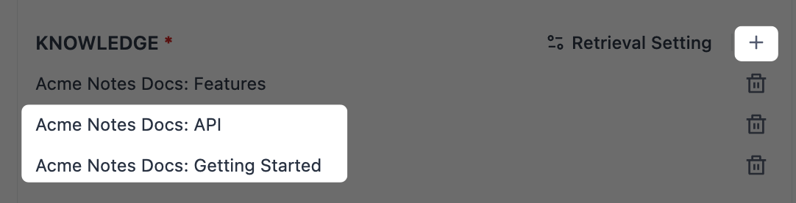

> 本文档由 AI 自动翻译。如有任何不准确之处，请参考 [英文原版](/en/cloud/use-dify/build/new-agent/build)。

<Info>
新 Agent 目前处于 Beta 阶段。
</Info>

## 创建 Agent

在 **Agents** 页面点击 **创建** > **创建空白应用**，为 Agent 取名，也可选填角色（如「研究助理」）和描述。其余一切都在 **配置** 中完成。

想从现成的 Agent 起步，可改选 **从应用模板创建**。使用模板前可先试用：打开模板的 **详情** > **试用**。试用不消耗你的 AI 消息额度，也不使用你的 API Key。

若要通过应用包（`.ifpkg`）或 DSL 文件（`.yml` 或 `.yaml`）创建 Agent，点击 **创建** > **导入应用**。DSL 文件不包含 Skill 和文件，导入后需自行添加。

<Info>
创建和管理 Agent 需要「编辑」及以上角色。
</Info>

## 配置能力

可逐项手动设置能力，也可进入 [构建模式](#build-by-chatting)，通过对话描述需求来构建。

你在 **配置** 中设置的一切都会保存为 Agent 的能力，供之后的每个任务使用。另外，Agent 在自己的沙箱（20 GB 存储空间）中工作，过程中随时运行命令、处理文件。

Agent 的能力只能在这里修改：即使终端用户要求已发布的 Agent 更改自己的提示词、Skill 或工具，它也不会照做。

### 模型

选择 Agent 运行的对话模型。优先选推理能力强、原生支持工具调用的模型，因为 Agent 要自行判断何时行动、哪个工具合适、如何解读结果。

<Note>
Agent 表现好不好，很大程度取决于模型，尽量选较新的模型。

旧模型可能用不好沙箱：常见的表现是 Agent 始终不去运行命令或安装工具，即使任务需要也不动手。
</Note>

### 提示词 {#prompt}

在提示词中设定 Agent 的角色和工作方式。具体说明它应如何推理、何时借助工具，以及要避免什么。

以下几点值得写进去：

- **角色与目标**：Agent 以什么身份行动，要达成什么。
- **工作方法**：处理典型任务时期望的步骤或顺序。
- **工具与文件的使用**：点名说明各自何时使用。
- **输出**：期望的格式、长度或语气。

你可以让 Agent 使用指定的 Skill、文件、工具或知识检索，也可以交给它自己选择：

- **在提示词中引用**：输入 `/` 引用，Agent 会在你指定的位置直接用上它。适合某个步骤依赖特定资源的场景。
- **只添加不引用**：把它加到对应区域，何时使用由 Agent 自行决定。适合你更愿意相信 Agent 的判断、不想事事写死的场景。

### Skill {#skills}

Skill 是 Agent 针对某项特定任务遵循的一套流程。提示词设定 Agent 的整体角色，而 Skill 只负责这一项任务。

例如，客服 Agent 的提示词可把它设定为处理各类问题的客服助手，而 `refund-requests` Skill 只处理退款：查询订单、仅处理 30 天内的退款，并在最后提供帮助中心链接。

点击 **添加**，上传 Skill 包：`.zip` 或 `.skill` 格式、内含 `SKILL.md` 的文件，大小不超过 50 MB。关于 Skill 包格式，参见 [Agent Skills](https://agentskills.io/home)。

你也可在 [构建模式](#build-by-chatting) 中让 Agent 替你创建 Skill。

<Tip>
要让某个 Dify 工具或文件成为 Agent 自身能力的一部分，请将其直接添加给 Agent，而不是放进 Skill 包。
</Tip>

### 文件 {#files}

文件是 Agent 工作时可查阅的参考文档，如规格说明、模板或指南。与 Skill 不同，文件只是供阅读的材料，不是可执行的流程。

大小上限按文件类型区分：

| 文件类型 | 上限 |
|:---------|:-----|
| 文档 | 15 MB |
| 图片 | 10 MB |
| 视频 | 100 MB |
| 音频 | 50 MB |

你也可在 [构建模式](#build-by-chatting) 中让 Agent 创建文件并保存到这里。Agent 创建并保存的文件，单个不超过 50 MB。

### 工具 {#tools}

为 Agent 添加 [Dify 工具](/zh/cloud/use-dify/workspace/tools)，让它能在聊天之外采取行动：包括工作空间中的插件、自定义 API、工作流和 MCP 服务器。部分工具需先认证才能使用。包含人工介入节点的工作流工具，Agent 无法使用。

<Tip>
除了你在这里添加的 Dify 工具，Agent 需要时还能在沙箱内自行安装并运行命令行工具。这类工具不会出现在工具列表中。

Agent 在 [构建模式](#build-by-chatting) 中安装的工具，发布后仍可使用；而在发布后的运行中安装的内容只是临时的。
</Tip>

### 知识检索 {#knowledge-retrieval}

Agent 可检索 [Agent 知识库](/zh/cloud/use-dify/knowledge-base/overview) 和 [经典知识库](/zh/cloud/use-dify/knowledge/readme)，同一个 Agent 也可同时使用这两类知识库。

<Tabs>
  <Tab title="Agent 知识库" id="agent-knowledge-base">
    Agent 会根据每个 Agent 知识库的名称和描述判断什么时候该用它，再阅读其中的文档，按语义和关键词检索内容。如果使用支持视觉的模型，Agent 还能查看检索到的图片。

    <Tip>
      要让回答标注所依据的知识库，在 **Chat 功能** 中开启 [**引用和归属**](/zh/cloud/use-dify/build/additional-features#引用与归属)。
    </Tip>

    #### 告诉 Agent 何时使用各个知识库

    在 **高级设置** 中，可为每个知识库另设名称和描述，只对当前 Agent 生效：

    - 如果知识库原本的名称无法让 Agent 看出里面有什么，就修改 **Agent 使用的名称**。同一 Agent 下的名称不要重复。

    - 描述要写明什么时候该用这个知识库，不要写成内容摘要：哪些问题或任务应该从这里找答案，哪些不该。例如：

      ```text wrap
      用于回答员工福利、休假和报销政策相关的问题。不要用于 IT 或安全相关的问题。
      ```

    #### 检查 Agent 查找的内容

    在 [构建对话](#build-by-chatting) 中，向 Agent 提一个知识库能回答的问题，然后展开 **已运行命令** 步骤。其中运行 `dify-agent knowledge` 的步骤就是 Agent 在查找知识库，每一步都会显示返回的结果。

    如果 Agent 没有去查，或查错了知识库，可改进该知识库的 [名称和描述](#告诉-agent-何时使用各个知识库)，或在提示词中用 [`/`](#prompt) 引用它。

    如果回答遗漏了知识库中明明有的内容，而 Agent 也没有查到它：

    1. 检查文档状态：新文档要显示为 **就绪** 后才能被检索到。

    2. 从 Agent 的 **已运行命令** 步骤中复制 `--query` 后面的查询，到知识库的 [**检索测试**](/zh/cloud/use-dify/knowledge-base/test-and-tune#测试检索) 页面以 **快速** 深度运行。返回的分段与 Agent 拿到的相同。

    3. [调优知识库](/zh/cloud/use-dify/knowledge-base/test-and-tune)，直到返回正确的分段。Agent 始终使用「快速」检索，所以把 [检索深度](/zh/cloud/use-dify/knowledge-base/retrieval-settings#retrieval-depth) 调深也没有用。

    <Note>
    在知识库的 **设置** 中关闭 **API 访问** 后，已发布的 Agent 就无法再检索它。在 [构建模式](#build-by-chatting) 和 [预览](#预览) 中，Agent 仍能检索它，所以在这两处测试发现不了这个问题。
    </Note>
  </Tab>
  <Tab title="经典知识库">
    Agent 从经典知识库中只能拿到针对查询检索出的片段，所以这类知识库更适合存放大量资料，比如一款产品的完整文档。

    <Tip>
      如果只是几份需要 Agent 从头读到尾的文档，比如模板或风格指南，改用 [文件](#files)。
    </Tip>

    #### 分别或合并检索知识库

    每勾选一个经典知识库，就会添加一项「检索」，各有自己的名称、描述和设置。一项检索也可包含多个知识库，所以要先想好怎么分组：

    - **每个知识库一项检索**：各知识库分别检索。

      适合每个知识库各管一个主题的场景，比如员工手册和 IT 帮助文档：请假问题查手册，电脑故障查 IT 文档。

      在列表中逐个勾选知识库即可。默认情况下，Agent 根据它们的名称和描述从中挑选。

      <Frame>
        
      </Frame>

    - **多个知识库合为一项检索**：一次检索覆盖其中所有知识库，不分来源，返回最匹配的结果。

      答案可能落在任何一个知识库里时选这种，比如分散在多个知识库里的产品文档。

      先勾选一个知识库，再展开列表下方的 **高级设置**，点击 **知识** 旁的 **+** 添加其余知识库。

      <Frame caption="勾选一个知识库">
        
      </Frame>

      <Frame caption="在「知识」中添加其余知识库">
        
      </Frame>

    #### 选择查询方式

    在 **高级设置** 中，为每项检索设置 **查询**：

    - **Agent 决定**：由 Agent 判断是否需要检索，并根据对话自行编写查询。

      问题多变、希望 Agent 自己判断该查什么时选这种，比如用户问什么就检索什么的文档助手。

    - **自定义查询**：由你编写固定的查询。检索在 Agent 开始工作前就会执行，Agent 基于返回的匹配结果完成任务。

      适合始终按同一方式检索某个来源的场景，比如退货助手：无论用户怎么提问，都从退货政策中查找内容。

    #### 帮 Agent 选对检索

    使用 **Agent 决定** 时，Agent 根据每项检索的名称和描述判断该用哪一项。你可另设名称和描述，仅对当前 Agent 生效：

    - 默认名称无法让 Agent 看出这项检索包含什么内容时，修改 **知识检索名称**。

    - **描述** 要写明什么时候该检索这里，不要写成内容摘要：哪些问题该从这里找答案，哪些不该。例如：

      ```text wrap
      用于员工福利、请假和报销政策相关的问题。不要用于 IT 或安全类问题。
      ```

    #### 调整检索结果

    在 **召回设置** 中，设定保留多少条结果，以及结果要匹配到什么程度：

    - **Top K**：最多保留的结果数。答案需要更多片段时调高；想让 Agent 更聚焦时调低。

    - **Score 阈值**：每条结果都会按与查询的匹配程度打分，低于该分数的结果会被丢弃。值越高越严格，越低覆盖面越广。如果检索里只有一个知识库，且它采用经济索引，该设置不起作用。

    一项检索包含多个知识库时，还要在 **Rerank 设置** 中选择如何将各知识库的结果合并为一个排序：

    - **Rerank 模型**：由另一个模型为每条结果与查询的相关性打分。

    - **权重设置**：在语义相关与关键词精确匹配之间取得平衡。

      <Info>
      仅当该检索中的所有知识库都使用高质量索引、使用同一供应商的同一嵌入模型，且都不是外部知识库时，才会出现 **权重设置**。
      </Info>

    若只想检索带有特定 [元数据](/zh/cloud/use-dify/knowledge/metadata) 的文档，设置 **元数据过滤**：

    - 过滤条件每次都相同时（比如限定某条产品线），选择 **手动** 并添加条件。
    - 过滤条件取决于具体问题时，选择 **自动**：由你选定的模型为每次检索设置条件。

    #### 检查 Agent 检索到的内容

    在 [构建对话](#build-by-chatting) 中，向 Agent 提一个知识库能回答的问题。**Agent 决定** 的每次检索都会显示为一个 `knowledge_base_search` 步骤，展开即可看到 Agent 编写的查询和返回的片段。**自定义查询** 在 Agent 开始工作前就已执行，所以不显示步骤。

    如果 Agent 没有检索，或用错了检索，可改进该检索的 [名称和描述](#帮-agent-选对检索)，或在提示词中用 [`/`](#prompt) 引用它。

    如果回答遗漏了知识库中明明有的内容：

    - 确认该文档已完成索引并已启用。
    - 检查分段长度。每条结果交给 Agent 前都会截断到 2,000 个字符，因此较长的分段（比如父子模式下的父分段）末尾会被截掉。改用更短的 [分段](/zh/cloud/use-dify/knowledge/create-knowledge/chunking-and-cleaning-text) 可保留完整内容，但分段设置会作用于所有检索该知识库的应用。
    - 检查 **Top K**。单次检索的全部结果合计会截断到 12,000 个字符，因此 **Top K** 设得过高时，排在后面的结果可能被截断或丢弃。适当调低即可。
    - 检查工作空间是否已达到 [知识库请求频率限制](/zh/cloud/use-dify/knowledge/knowledge-request-rate-limit)。每次检索都会计入该限制。达到上限后，Agent 并不会运行失败，只是拿不到检索结果，照常继续工作。

    <Info>
    即使开启了 **引用和归属**，回答也不会标注来自经典知识库的引用。
    </Info>
  </Tab>
</Tabs>

### 环境变量 {#environment-variables}

在 **高级设置** 中可添加环境变量。环境变量以键值对的形式保存，Agent 工作时可在沙箱中读取。

假设你的 Agent 的几个 Skill 都要访问同一套订单系统：一个查库存、一个下订单、一个拉报表。把系统的地址以 `ORDER_API_URL` 为名存在这里，所有脚本都按这个名字读取。要从测试系统切换到正式系统，只需在这里改这一个值，各个 Skill 都会跟着切换。

可导入 `.env` 文件，一次添加多个。你也可在 [构建模式](#build-by-chatting) 中让 Agent 代为设置。

## 通过对话构建 {#build-by-chatting}

除了逐项手动设置，你也可通过描述 Agent 该做什么来构建它：对话过程中，它会自行配置好提示词、Skill、文件和环境变量。

例如，你可以这样开场：

```text wrap
帮我构建一个会议纪要 Agent：把原始会议记录整理成结构化纪要，包含参会人、决议和行动项。
```

与你对话的就是真实运行的 Agent：边构建边测试，看它如何反应，并在同一场构建对话中继续打磨。

Agent 工作时会直接修改面板中的配置。点击 **应用** 保留这些更改，或点击 **放弃** 全部丢弃。两者都会退出构建模式并清空对话。

<Note>
**放弃** 会丢弃本次构建对话中的一切：对配置以及 [**文件系统**](#文件系统) 中长期文件的所有更改。
</Note>

构建模式下配置面板是只读的，想改什么直接告诉 Agent 即可。不过它改不了模型和工具，这两项请在退出构建模式后自己设置。

### 文件系统

在构建模式下，Agent 的工作会在沙箱里留下真实的文件：生成的产物（Artifacts）、自行安装的程序，以及过程中用到的其他内容。构建对话期间，点击右上角的 **文件系统** 即可浏览。

因为构建对话就是在塑造 Agent 本身，所以它添加的内容（比如起草的模板、安装的工具）默认为 **长期** 文件，在之后的每一次对话和工作流运行中均可用。实际上，这些文件和提示词、Skill 一样，都是 Agent 配置的一部分。

对于一次性的工作，比如测试文件或只用一次的转换工具，可在对话中直接告诉 Agent，例如「把这个文件设为临时」：它会归入 **临时** 文件，并在本次构建对话结束后清除。

在发布后的运行中，Agent 添加的任何内容都是临时的，因此运行中发生的一切都不会改变 Agent 本身。

### 构建笔记 {#the-build-note}

在构建对话中，Agent 会把配置内容记录在「构建笔记」里，即一个 `build_note.md` 文件，在你首次点击 **应用** 后出现在 **文件** 中。

这份笔记会随 Agent 的配置一起保存。每次新对话开始时，Agent 都会重新读取笔记，将它与你的 **提示词** 组合成自己的指令。

应用之后，打开构建笔记，看看 Agent 记录了什么：

  - 内容符合预期，就无需再动。

  - 要修改笔记内容，可回到构建模式让 Agent 修订。

    <Info>
    Agent 只维护自动生成的构建笔记：下载后再上传的副本只是普通文件，下次构建对话会另外生成一份新笔记。
    </Info>

  - 有遗漏的话，补充到 **提示词** 中。

  - 想让 Agent 从头重新记录，可在 **文件** 中删除这份笔记。

在多次构建对话之间，这份笔记也相当于 Agent 的记忆。比如你在一次对话中定好了会议纪要 Agent 的格式，之后再开一次对话补充行动项负责人时，它会在已有格式和决定的基础上继续，而不是从头再来。

## 预览

将右侧面板从 **构建** 切换到 **预览**，即可按发布后终端用户看到的样子试用 Agent：回复干净整洁，Chat 功能生效。

在预览中对话不会改动 Agent 的任何配置，适合作为发布前的最后检查。

## 发布 {#publish}

编辑内容会自动保存为草稿。Agent 就绪后，发布即可让该版本上线。可随时打开版本历史，回看早期版本或将其恢复（恢复适用于 <Badge color="blue">Professional</Badge> 和 <Badge color="blue">Team</Badge> 套餐）。

<Info>
恢复版本时，Agent 沙箱中的长期文件也会一并恢复到该版本。
</Info>

<Tip>
要打磨聊天体验，可在 **Chat 功能** 中添加欢迎语、建议问题、语音等附加功能。详见 [应用工具箱](/zh/cloud/use-dify/build/additional-features)。
</Tip>

在 **访问入口** 标签页中，可将它托管为 Web 应用并获得可分享的链接、嵌入你的网站，或在你的代码中通过 [服务 API](/zh/api-reference/guides/agent) 调用。

你也可将 Agent 请进工作流的 [Agent 节点](/zh/cloud/use-dify/nodes/agent#new-agent)，负责其中一步。

若要把 Agent 分享到其他工作空间，在它的菜单中点击 **导出 Agent**。导出的是当前草稿，尚未发布的改动也包含在内。若要分享某个已发布版本，在该版本的菜单中导出即可（适用于 <Badge color="blue">Professional</Badge> 和 <Badge color="blue">Team</Badge> 套餐）。

### 运行限制

- **时长**

    单次 Agent 运行无论从哪个访问入口发起（Web 应用、服务 API 或工作流），都会在 1 小时后被终止，未完成的回复会被清除。

    若运行被中断，可重试或把任务拆分成更小的步骤。

- **模型请求次数**

    Agent 每次调用模型都会计入单次运行 500 次的上限，推理越密集、工具用得越多，消耗越快。

    可尝试把任务拆分成更小的步骤，让每次运行保持在上限之内。

- **回复文件**

    Agent 在回复中发回的文件，单个不超过 50 MB，超出的文件不会被送达。

## 故障排查

<AccordionGroup>
  <Accordion title="使用 OpenAI 兼容模型时，Agent 报错或从不调用工具">
    通过 OpenAI 兼容端点提供的模型（如 vLLM 部署）往往缺少完整的原生工具调用支持，而无论在构建对话还是发布后的运行中，Agent 都依赖这一能力。

    选择原生支持工具调用的模型。若兼容模型仍然报错，在供应商的模型设置中检查 **token 参数名**：部分较新的模型要求使用 `max_completion_tokens`，自动判断可能不准确。

    部分 OpenAI 官方模型在开启推理的情况下，无法通过 Chat Completions 协议调用工具。此时可在供应商凭据中将 **API 协议** 改为 Responses API。
  </Accordion>
  <Accordion title="Agent 看不到上传的图片">
    无论 Agent 用的是什么模型，**Chat 功能** 中的 **文件上传** 都会接收图片，但只有支持视觉的模型才看得到。

    为 Agent 改用带 **Vision** 标签的模型；在模型列表中将鼠标悬停在某个模型上，即可查看它的标签。
  </Accordion>
  <Accordion title="Agent 无法获取内网中的文件或页面">
    Agent 的沙箱运行在云端，无法访问你私有网络中的主机。公网 URL 可正常访问；内部资料请改为添加到 Agent 的 [文件](#files) 中。
  </Accordion>
</AccordionGroup>
