> 本文档由 AI 自动翻译。如有任何不准确之处，请参考 [英文原版](/en/self-host/use-dify/nodes/human-input)。

人工介入节点会在工作流的关键环节暂停运行，并发出一份可自定义的请求表单。收件人可通过表单审核信息、填写内容，再从预设的决策中选择一项，决定工作流接下来怎么走。

把人工判断放在真正需要的地方，就能 **兼顾自动化效率与人工监督**。

<Info>
人工介入节点有新旧两个版本。如需将工作流从旧版迁移到新版，参见 [从旧版节点迁移](#migrate-from-the-old-node)。
</Info>

<Tabs>
  <Tab title="新版人工介入" id="new-human-input">

  新版人工介入节点会把请求送到大家日常工作的地方：所有收件人都会收到邮件，工作空间成员还会在团队的 IM（即时通讯应用）中收到请求。只有请求的收件人才能响应。

  <Note>
  新版人工介入节点需要以下设置，才能把请求送达收件人：

  - [`CONSOLE_WEB_URL`](/zh/self-host/deploy/configuration/environments#console_web_url) 和 [`APP_WEB_URL`](/zh/self-host/deploy/configuration/environments#app_web_url) = 收件人能打开的地址
  - 对于 [以卡片形式展示请求](/zh/self-host/use-dify/workspace/channels/overview#连接-im) 的 IM，[`TRIGGER_URL`](/zh/self-host/deploy/configuration/environments#trigger_url) = IM 能通过互联网访问的地址，这样成员点击卡片按钮后，Dify 才能收到

  通过邮件发送请求，还需在部署中完成 [邮件配置](/zh/self-host/deploy/configuration/environments#邮件配置)。
  </Note>

  <a id="choose-who-responds"></a>

  ## 选择由谁响应

  在 **收件人** 中添加的每个人都能响应，以第一个响应为准，请求随即对其他人关闭。所以，谁的决定你能接受，就只添加谁。

  添加方式决定了请求以什么途径送达对方：

  | 收件人 | 适用场景 | 送达方式 |
  |:--|:--|:--|
  | 联系人 | 经常共事的人。从工作空间的 [联系人](/zh/self-host/use-dify/workspace/contacts) 中选择。<br/><br/>对方的邮箱变更后，新请求会自动发往新地址，工作流无需任何改动。<Info>如果团队里任何人都可以做决定，改为选择整个工作空间。这种方式不包括外部联系人。</Info> | <ul><li>工作空间成员：通过邮件收到请求；在联系人中 [绑定 IM 身份](/zh/self-host/use-dify/workspace/contacts#bind-im-identities) 后，还会在团队的 IM 中收到。<br/><br/></li><li>外部联系人：只通过邮件收到请求，无需 Dify 账户即可响应。</li></ul> |
  | 邮箱地址 | 临时的收件人，不必把对方保存到联系人中。直接输入即可。 | 通过邮件。 |
  | 变量 | 在运行时才确定由谁响应，例如前面某个节点收集到的邮箱地址。<br/><br/>变量中只能有一个地址，值为空或无效时直接跳过。 | 即使该地址属于工作空间成员，也只通过邮件送达。 |
  | 发起人 | 由运行应用的人亲自确认这一步。<br/><br/>由触发器启动的工作流不能选择发起人。 | <ul><li>在 Web 应用中，表单直接显示在应用里。<br/><br/></li><li>通过 [Service API](/zh/api-reference/guides/human-input-flow) 运行时，由调用 API 的程序负责响应。</li></ul> |

  如果请求无法送达任何收件人，运行会在此节点失败。若某个收件人在运行时可能缺失（例如变量的值为空），就再添加一个确定能收到请求的收件人。

  <a id="write-the-notification"></a>

  ## 编写通知

  消息模板就是引导收件人打开表单的通知，会以邮件和 IM 消息的形式发出。

  在 **消息模板** 中填写主题和正文，说明需要对方决定什么，再点击 **插入请求 URL** 加入表单链接。主题和正文都可使用变量，正文还可使用 Markdown。

  <Columns cols={2}>
    <Frame caption="消息模板">
      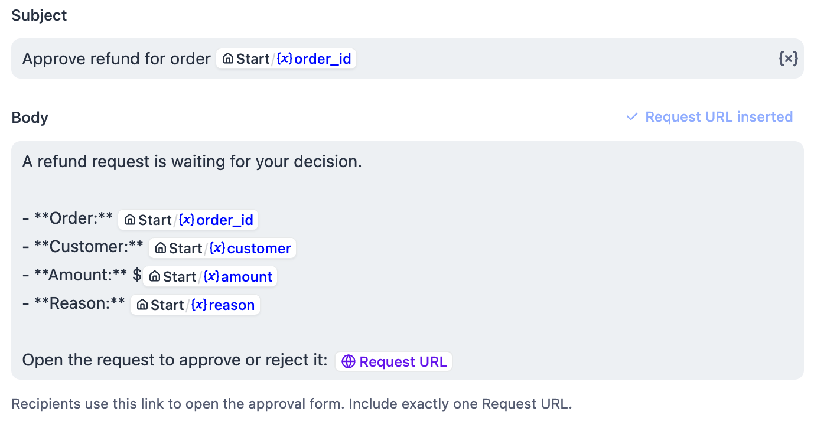
    </Frame>
    <Frame caption="以链接消息形式发送的请求">
      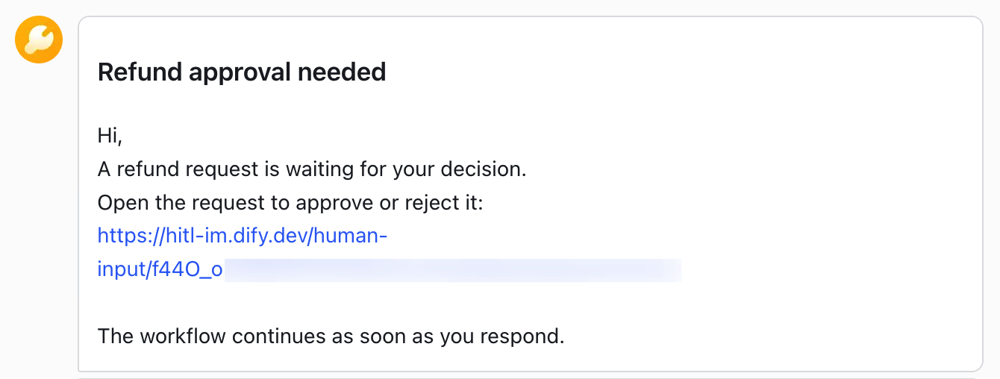
    </Frame>
  </Columns>

  <Info>
    如果 IM [以卡片形式展示请求](/zh/self-host/use-dify/workspace/channels/overview#连接-im)，收件人收到的就是表单本身，可直接在 IM 中响应。卡片的标题就是节点标题，因此要给节点起一个能说明请求内容的标题。

  <Frame caption="以 IM 卡片形式展示的请求">
    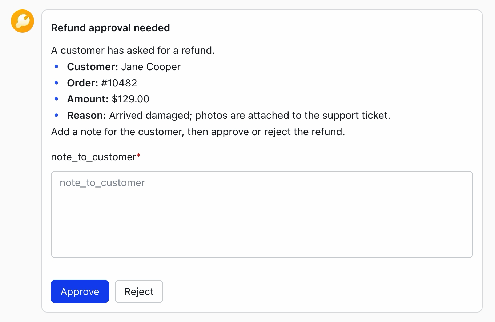
  </Frame>
  </Info>

  如需查看通知的效果，使用 **测试消息**：在 **测试渠道** 中选择你的 IM，点击 **保存并测试** 发给自己。测试消息始终以链接消息的形式送达；如需查看收件人收到的卡片，可 [开启调试模式后测试运行](#test-without-notifying-recipients)。

  <a id="design-the-form"></a>

  ## 设计表单

  表单分为两部分：收件人阅读和填写的内容，以及用于做出决定的按钮。

  <a id="card-or-link"></a>

  <Info>
  如果希望成员直接在 IM 中响应，不要使用文件字段。在以卡片展示请求的 IM 中，含文件字段的表单会改以链接消息的形式送达。
  </Info>

  ### 表单内容

  写下收件人做决定所需的信息，可用 Markdown 排版。引用变量即可显示其值，例如上游 LLM 撰写的草稿。

  <Info>
    推理模型会在最终答案之外输出思考过程，引用 LLM 节点的 `text` 变量时两者都会显示。如需只显示答案，在该 LLM 节点中开启 **启用推理标签分离**。
  </Info>

  在内容中需要收件人填写的位置插入输入字段。在 **保存响应为** 中给字段起的名称，就是它在下游的变量名。

  | 字段类型 | 收件人的操作 |
  |:---------|:-------------|
  | 段落 | 输入文本。字段初始可为空，也可预填变量（例如待润色的 LLM 输出）或静态文本。<br></br><br></br>没有长度上限，但过长的输入可能超出下游 LLM 的上下文窗口。<Tip>如果这项输入可填可不填，可预填「None」之类的静态文本，收件人不用输入也能提交。</Tip> |
  | 下拉选项 | 选择一个选项。可自行列出选项，也可从 `array[string]` 变量中获取。 |
  | 单文件 / 文件列表 | 上传一个或多个文件。<Info>文件上传限制可通过环境变量调整：<ul><li>`UPLOAD_FILE_SIZE_LIMIT`、`UPLOAD_IMAGE_FILE_SIZE_LIMIT`、`UPLOAD_VIDEO_FILE_SIZE_LIMIT` 和 `UPLOAD_AUDIO_FILE_SIZE_LIMIT` 按扩展名限制单个文件大小。</li><li>`WORKFLOW_FILE_UPLOAD_LIMIT` 限制文件列表字段最多可配置接收的文件数。</li></ul>默认值详见 [环境变量](/zh/self-host/deploy/configuration/environments)。</Info> |

  <Tip>
  如果某个决定会影响工作流的走向（例如批准或拒绝），使用 **用户操作** 中的按钮，不要用下拉选项字段。下拉选项字段只记录答案，不会让工作流产生分支。
  </Tip>

  ### 用户操作

  添加供收件人选择的按钮。每添加一个按钮，节点就多出一条分支，因此要把每条分支连到这个决定之后应执行的步骤。

  <a id="use-the-response"></a>

  ## 使用响应结果

  有人响应后，下游节点可以使用：

  - 各输入字段的值。
  - `__action_id`：在 **用户操作** 中为被点击的按钮设置的操作 ID。
  - `__action_value`：该按钮的文本。
  - `__rendered_content`：填入提交值后的表单内容，适合用来留存或传递已填写表单的记录。

    文件字段显示为纯文本占位符：单文件为 `[file]`，文件列表为 `[N files]`。

  在 **超时设置** 分支上，`__action_id` 和 `__action_value` 为空，`__rendered_content` 是未填入任何值的表单内容。

  <a id="set-a-timeout"></a>

  ## 设置超时

  在 **超时设置** 中设定这个决定最多能等多久。等待时间耗尽仍无人响应时，运行会沿节点的 **超时设置** 分支继续。可将这条分支连接到兜底步骤，例如通知某人或采用默认决定。如果不连接，运行会直接在此结束。

  此外，每次运行还有一个总时限，默认为 7 天，从运行开始时算起。到达总时限时，所有仍在等待的请求都会过期，运行随即停止，不会进入任何分支。因此，运行中靠后的人工介入节点，剩余时间可能比它自己的超时时间还短。

  例如，工作流中有两个相连的人工介入节点，第一个请求发出 5 天后才有人响应。运行到第二个节点时，只剩 2 天。如果第二个节点的超时时间是 3 天，运行会在 2 天后停止，该节点的 **超时设置** 分支永远不会执行。

  要确保靠后节点的兜底步骤能执行，就把它的超时时间设得比运行到达该节点时剩余的时间更短。也可通过 [`HUMAN_INPUT_GLOBAL_TIMEOUT_SECONDS`](/zh/self-host/deploy/configuration/environments#human_input_global_timeout_seconds) 调高总时限，该设置对部署上的所有运行生效。

  <a id="test-without-notifying-recipients"></a>

  ## 测试时不通知收件人

  在编辑器中测试运行时，请求会真实发送给收件人。如果测试时不想打扰其他人，有两种方式：

  - 如果已连接 IM，且你自己的 IM 身份已 [绑定到你的联系人](/zh/self-host/use-dify/workspace/contacts#bind-im-identities)，开启 **调试模式** 后测试运行会走完整个流程，但请求只会在团队的 IM 中发给你自己，送达形式与收件人收到的一致。

  - **运行此步骤** 只在编辑器中显示表单，不会向任何人发送请求。

  <a id="what-recipients-see"></a>

  ## 收件人如何响应

  - 请求以 IM 卡片形式送达时，工作空间成员可直接在卡片中响应。通过链接打开时，他们需使用接收请求的账户登录 Dify。

    他们无需拥有该应用本身的访问权限。

    <Columns cols={2}>
      <Frame caption="以 IM 卡片形式展示的请求">
        
      </Frame>
      <Frame caption="以链接消息形式发送的请求">
        
      </Frame>
    </Columns>

  - 外部联系人，以及通过邮箱地址或变量添加的收件人，打开链接后需输入发送到该邮箱的验证码，才能响应。

  一旦有人响应，其他人就无法再响应。

  <a id="examples"></a>

  ## 示例

  <Tabs>
    <Tab title="审批退款">

      <Frame caption="退款审批工作流">
        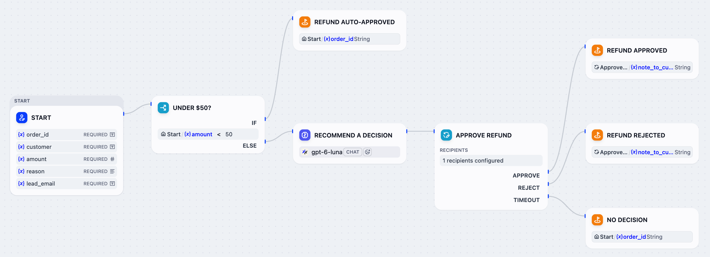
      </Frame>

      这个工作流处理一家网店的退款申请。小额退款自动批准；金额较大的，先由 LLM 对照退款政策审查申请并给出建议，再由负责该订单的客服主管批准或拒绝。

      <Tip>
      如需在你的工作空间中试用这个工作流，可从 [Dify Marketplace](https://marketplace.dify.ai) 获取对应的模板。
      </Tip>

      它的设计目标如下：

      <Steps>
        <Step title="只有需要人工判断的退款才交给主管">
          1. 在开始节点之后紧接一个条件分支节点，检查数字类型的输入 `amount` 是否小于 50。
              <Frame caption="条件分支的判断条件">
                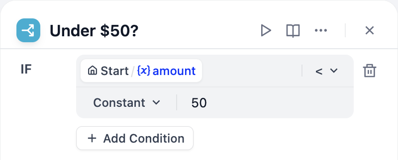
              </Frame>
          2. 将小于 50 的分支直接连到输出节点（「Refund auto-approved」），另一条分支连到 LLM 节点。

        </Step>
        <Step title="主管能看到 AI 的建议和理由">
          1. 在 LLM 节点（「Recommend a decision」）中：

              - 把退款政策写进系统提示词，把订单信息写进用户提示词：订单 ID、客户、金额和退款原因，均取自开始节点。

              - 要求它在第一行给出结论（「Approve」或「Reject」），再用一两句话引用政策说明理由。

              <Frame caption="「Recommend a decision」中的提示词">
                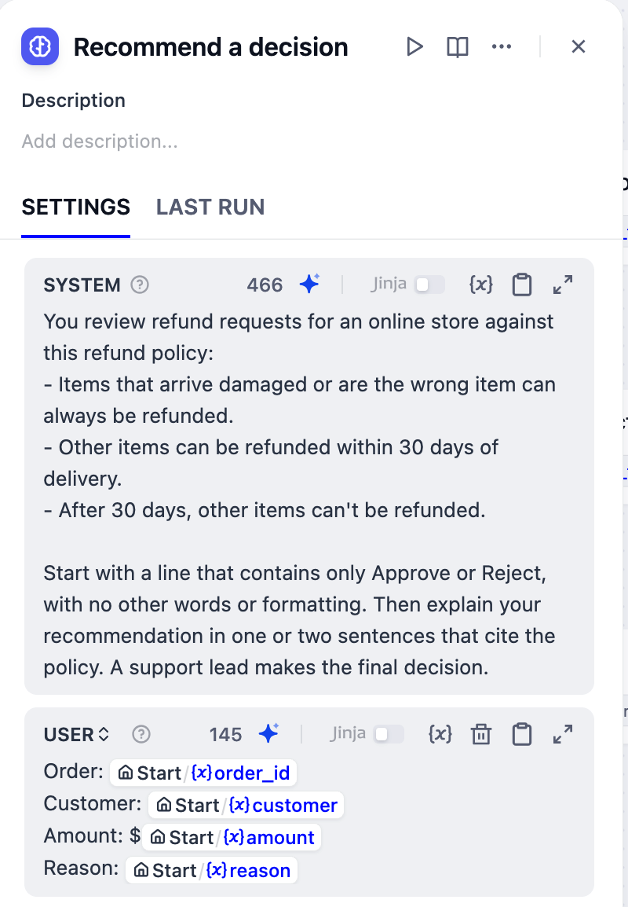
              </Frame>

          2. 在人工介入节点的 **表单内容** 中，先列出订单详情，再在加粗的「AI recommendation」标签下显示 LLM 的 `text` 输出。

              看得到理由，主管就能发现有误的建议。

              <Frame caption="包含 AI 建议的表单内容">
                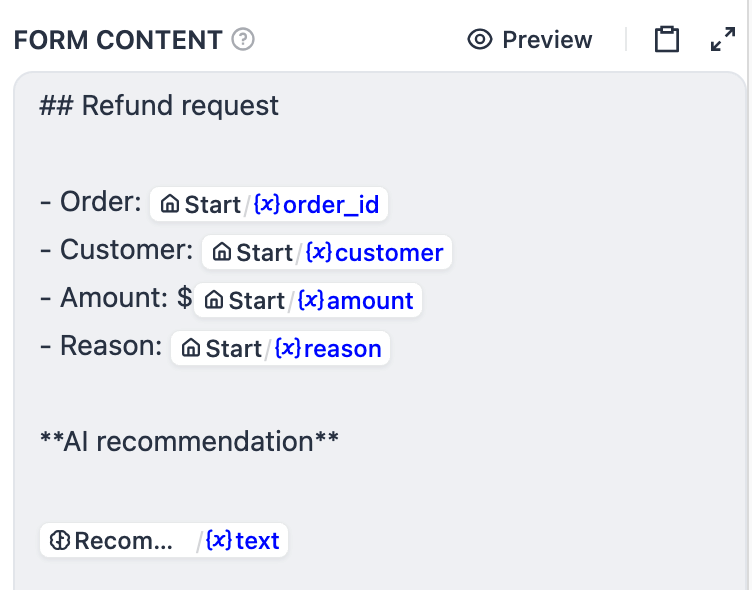
              </Frame>
        </Step>
        <Step title="每个申请都发给负责该订单的主管">
          不同订单可能由不同主管负责，所以工作流不指定某一个人，而是从每个订单中取主管的邮箱。

          1. 在开始节点添加一个文本输入 `lead_email`，由订单系统填入主管的邮箱。

          2. 在人工介入节点的 **收件人** 中，点击 **插入变量**，选择 `lead_email`。

              <Frame caption="以主管邮箱作为收件人">
                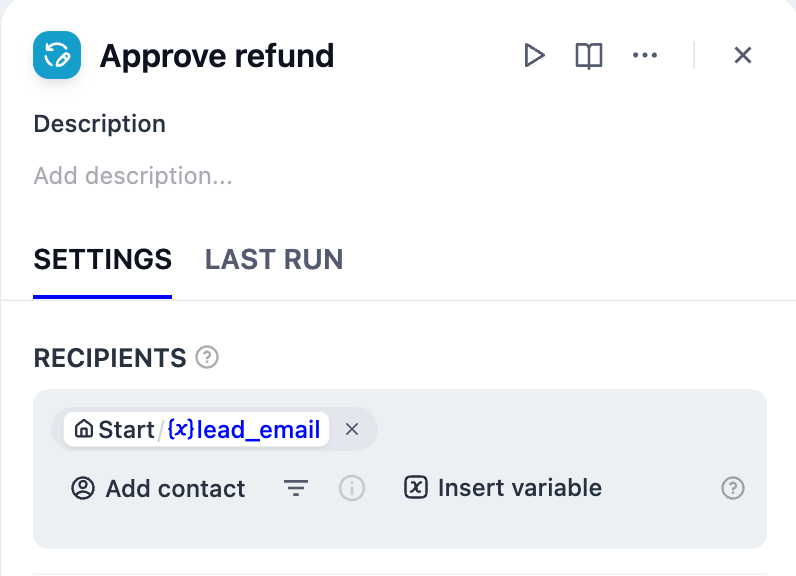
              </Frame>

          <Tip>
            如果所有退款都由同一位主管处理，就不需要变量：直接在 **收件人** 中添加这个人即可。
          </Tip>
        </Step>
        <Step title="主管点一下就能响应，备注可写可不写">
          1. 在 **用户操作** 下添加两个按钮：**Approve** 和 **Reject**。

          2. 备注用一个段落字段，命名为 `note_to_customer`，并预填静态文本「None」，这样主管不用输入任何内容也能批准或拒绝。

          <Columns cols={2}>
            <Frame caption="预填「None」的备注字段">
              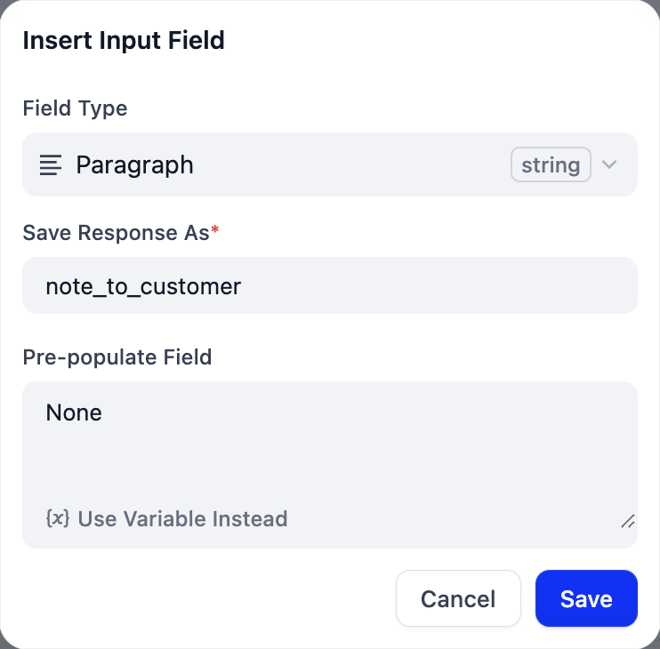
            </Frame>
            <Frame caption="退款请求">
              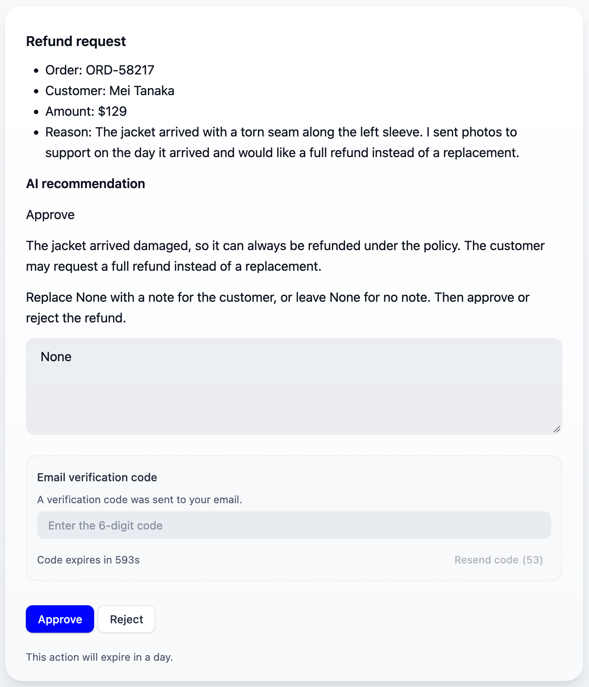
            </Frame>
          </Columns>
        </Step>
        <Step title="从结果能看出退款已批准、已拒绝，还是无人决定">
          1. 将 **Approve** 和 **Reject** 分别连到各自的输出节点（「Refund approved」和「Refund rejected」），两者都返回备注。

          2. 将 **超时设置** 分支连到第三个输出节点（「No decision」），这样无人决定的退款不会算作已批准或已拒绝。
        </Step>
      </Steps>

    </Tab>
    <Tab title="修改草稿直至通过">

      <Frame caption="草稿修订工作流">
        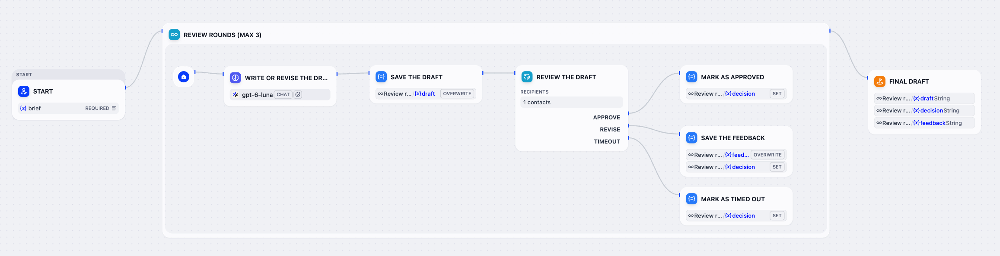
      </Frame>

      这个工作流先让 LLM 根据写作要求写一篇短博客，再由审核人批准草稿，或附上反馈退回给 LLM 修改。这样来回最多进行三轮。

      最后，工作流返回最终草稿和审核的结束方式：已批准、已超时，或三轮后仍未通过。

      <Tip>
      如需在你的工作空间中试用这个工作流，可从 [Dify Marketplace](https://marketplace.dify.ai) 获取对应的模板。
      </Tip>

      它的设计目标如下：

      <Steps>
        <Step title="审核人可以来回审阅多轮">
          1. 把 LLM 节点（「Write or revise the draft」）和人工介入节点放进 [循环](/zh/self-host/use-dify/nodes/loop) 节点，这样每一轮都会向审核人发出一个新请求，附上这一轮的草稿。

              每一轮都是同样的两步：LLM 撰写或修改草稿，然后审核人审阅。循环节点会重复这两步，直到满足停止条件，因此只需搭建一次，不必每轮复制一份。

          2. 在人工介入节点中，将审核人添加到 **收件人**，并在 **用户操作** 下添加两个按钮：**Approve** 和 **Request changes**。

          <Frame caption="循环内部">
            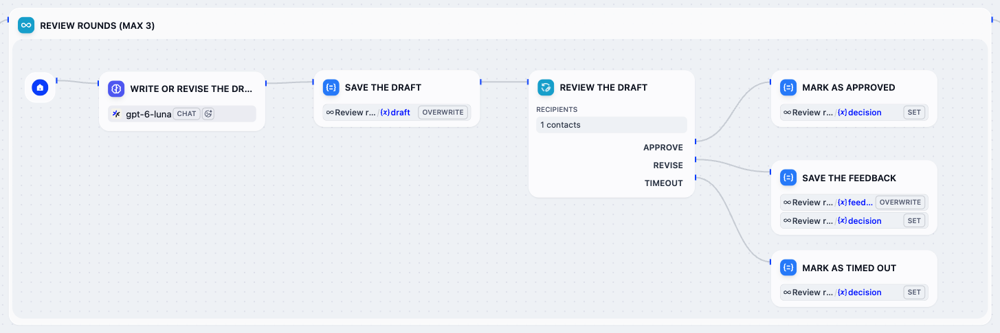
          </Frame>
        </Step>
        <Step title="审核人可以附上反馈，把草稿退回修改">
          在人工介入节点的 **表单内容** 中显示草稿，再添加一个名为 `feedback` 的段落字段，并预填「None」，这样审核人不用输入也能批准。

          <Columns cols={2}>
            <Frame caption="包含反馈字段的表单内容">
              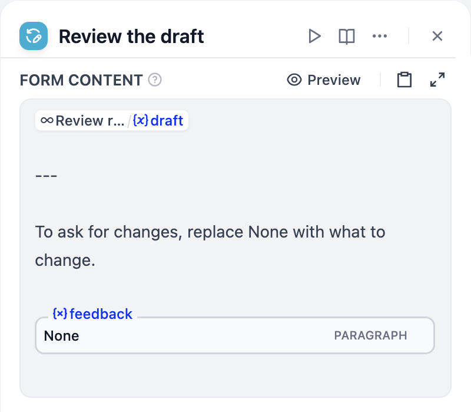
            </Frame>
            <Frame caption="审核请求">
              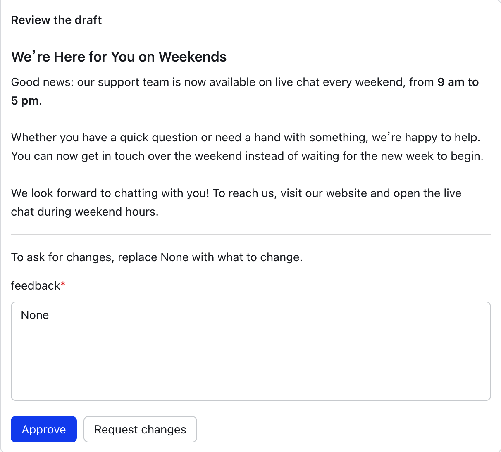
            </Frame>
          </Columns>
        </Step>
        <Step title="每一轮都接着上一版草稿修改，不从头重写">
          新一轮开始时，上一轮各节点的输出都会清空：第 2 轮读不到 LLM 在第 1 轮写的草稿，也读不到审核人填写的反馈。能延续到下一轮的只有循环变量，以及工作流本身的输入（例如写作要求）。

          因此，在循环节点的 **循环变量** 中添加 `draft` 和 `feedback`，两者都是初始为空的字符串。

          <Frame caption="循环变量">
            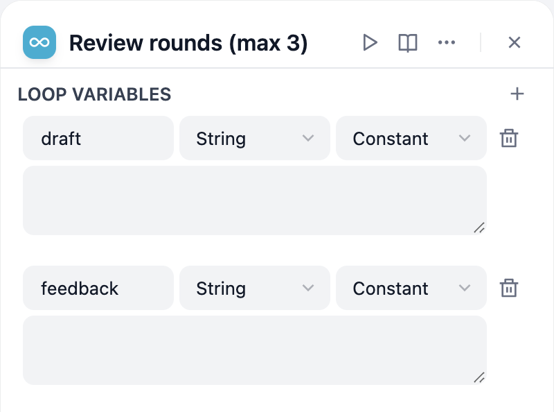
          </Frame>

          要把值存入循环变量，需使用变量赋值节点。为两个变量各添加一个：

          - 在 LLM 节点之后紧接着添加「Save the draft」，用 LLM 的输出覆盖 `draft`。下一轮就在这份草稿上修改。

            <Frame caption="「Save the draft」变量赋值节点">
              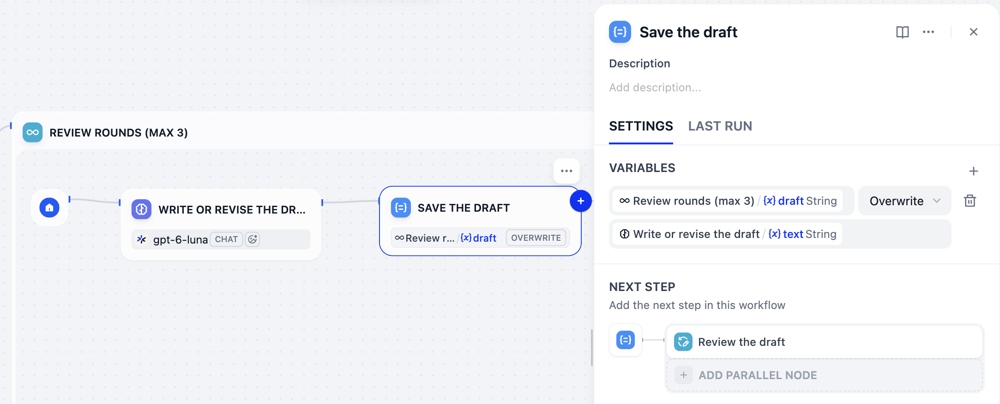
            </Frame>

          - 在 **Request changes** 分支末尾添加「Save the feedback」，用审核人填写的内容覆盖 `feedback`，让下一轮的 LLM 能看到。

            <Frame caption="「Save the feedback」变量赋值节点">
              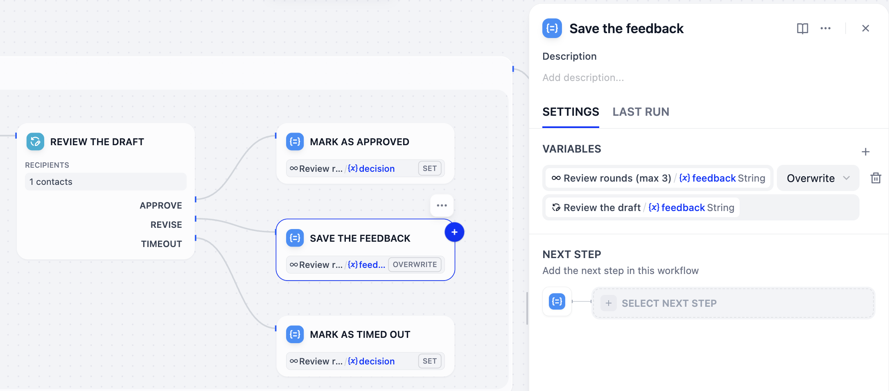
            </Frame>

          在 LLM 的提示词中提供开始节点中的写作要求、`draft` 和 `feedback`。告诉它：`draft` 为空时先写初稿，之后只按反馈的要求修改。

          <Frame caption="「Write or revise the draft」中的提示词">
            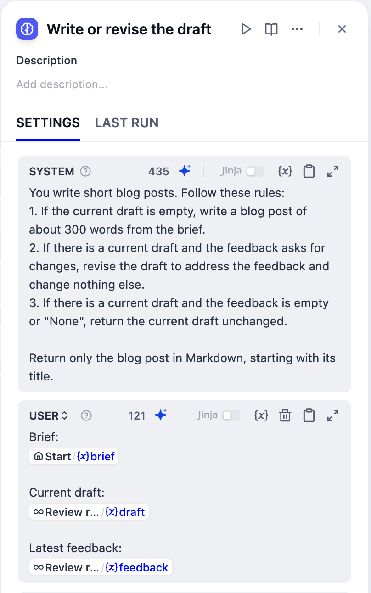
          </Frame>
        </Step>
        <Step title="审核人批准、无人响应或满三轮时，审核即结束">
          为了让循环节点知道何时停止，先记录每一轮是怎么结束的：

          1. 在 **循环变量** 中添加第三个变量 `decision`，初始值为 `pending`。

          2. 在 **Approve** 分支末尾添加一个变量赋值节点（「Mark as approved」），用它将 `decision` 设为 `approved`。

              <Frame caption="「Mark as approved」变量赋值节点">
                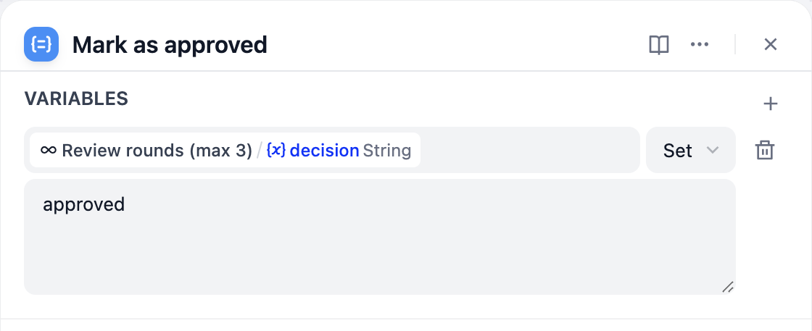
              </Frame>

          3. 在 **超时设置** 分支末尾再添加一个（「Mark as timed out」），用它将 `decision` 设为 `timed_out`。

          然后设置循环节点何时停止：

          1. 将循环节点的 **循环终止条件** 设为 `decision` 是 `approved` OR `decision` 是 `timed_out`。

              <Frame caption="循环终止条件">
                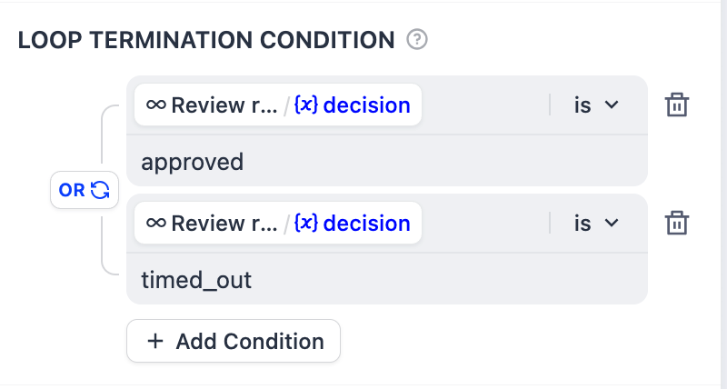
              </Frame>

          2. 将 **最大循环次数** 设为 3。这样循环会停在第三版草稿，审核人最后一次的反馈不会再应用到草稿上。

              <Frame caption="最大循环次数">
                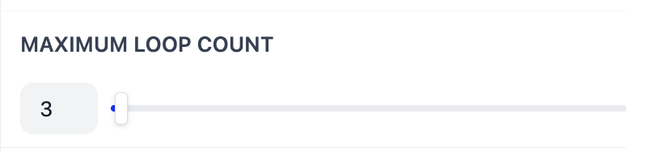
              </Frame>
        </Step>
        <Step title="从结果能看出审核是怎么结束的">
          循环结束后，由输出节点（「Final draft」）返回草稿、`decision` 和 `feedback`。

          <Frame caption="「Final draft」的输出变量">
            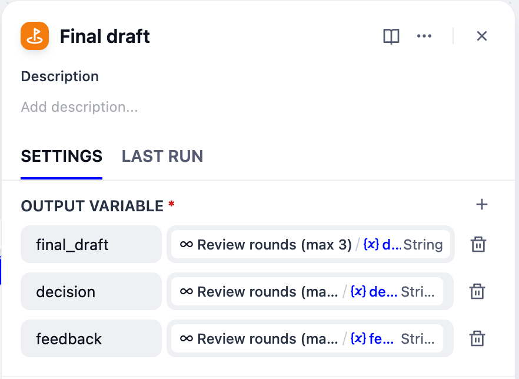
          </Frame>

          `decision` 已能说明审核人是批准了还是没有响应。如果还想标记出因轮次用尽而结束的审核，回到「Save the feedback」，再添加一个变量，将 `decision` 设为 `changes_requested`。

          <Frame caption="含两个变量的「Save the feedback」变量赋值节点">
            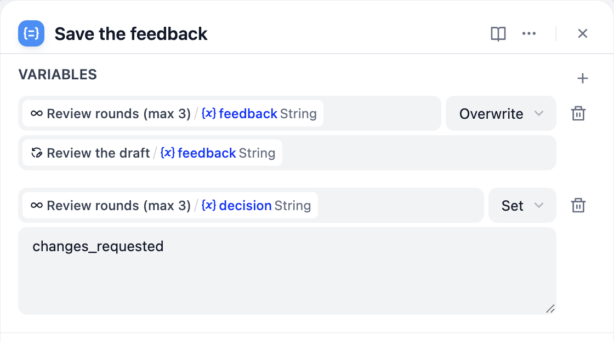
          </Frame>

          这时 `feedback` 中保存的是审核人最后一次提出的修改要求，没有哪一轮来得及处理。负责定稿的人可以从这里接着改。
        </Step>
      </Steps>

    </Tab>
  </Tabs>

  <a id="migrate-from-the-old-node"></a>

  ## 从旧版节点迁移

  升级到带有新版节点的版本后，现有工作流不会改变。其中的旧版节点照常运行，正在等待响应的旧版表单也仍可作答。

  同一个工作流中不能混用新旧两版人工介入节点。如需在仍含旧版节点的工作流中添加新版节点，先完成迁移：点击画布顶部的 **立即迁移**，一次性转换草稿中的所有旧版节点。再次发布前，已发布的版本不会变化，因此可先检查转换后的节点。

  迁移时，各项配置的对应关系如下：

  | 旧版节点 | 新版节点 |
  |:---------|:---------|
  | Web 应用提交方式 | 发起人 |
  | 按名称选择的成员 | 这些成员的联系人 |
  | 外部邮箱地址 | 邮箱地址 |
  | 工作空间全体成员 | 你的工作空间，涵盖所有成员 |
  | 邮件主题和正文 | 消息模板，内容不变 |

  其余配置保持原样：表单内容、输入字段、按钮、超时时间、节点的连线，以及下游节点引用的输出变量。

  只要有一个节点无法迁移，工作流就不会有任何改动。常见原因如下：

  | 原因 | 处理方法 |
  |:-----|:---------|
  | 已禁用的交付方式仍包含配置 | 你关闭的某个邮件提交方式中仍有收件人或文本。将其清空；如果希望保留这些收件人，则重新开启该方式。 |
  | 无法将工作区成员解析为联系人或有效邮箱 | 你选择的某位成员已离开工作空间。将其移除。 |
  | 已启用的邮件交付方式配置不完整 | 填写邮件的主题和正文。 |
  | 收件人邮箱格式无效 | 更正或删除该地址。 |

  迁移后如需改回旧版节点，从版本历史中恢复更早的已发布版本。

  </Tab>

  <Tab title="旧版人工介入" id="old-human-input">

  使用旧版人工介入节点时，请求会在 Web 应用中展示给正在运行应用的人，或以邮件链接的形式发出，任何持有链接的人都能响应。

  <Tip>
    工作流设计示例，参考 [示例：内容审核工作流](#示例：内容审核工作流)。
  </Tip>

  ## 配置

  该节点如何请求和处理人工输入，由以下几项配置决定：

  - **提交方式**：请求表单如何送达收件人。

  - **表单内容**：收件人看到哪些信息，能填写或操作哪些内容。

  - **用户操作**：收件人能做出哪些决定，以及工作流随后怎么走。

  - **超时设置**：等待多久以及如果无人响应会发生什么。

  ### 提交方式

  选择发送请求的渠道。当前可用的方式：

  - **Webapp**：向 Web 应用终端用户显示请求表单。在由触发器启动的工作流中不可用。

    <Info>
      外部客户端可通过 Service API 驱动 Web 应用表单的生命周期。详见 [API 集成流程](/zh/api-reference/guides/human-input-flow)。
    </Info>

  - **Email**：将请求链接发送至特定工作空间成员、外部邮箱地址或工作空间全体成员。任何持有链接的人都可响应，无需 Dify 账户。

  <Note>
      无论采用何种提交方式，请求都将在收到第一个响应后关闭。
  </Note>

  ### 表单内容

  自定义收件人看到并操作的表单：

  - **使用 Markdown 排版和组织内容**

    使用标题、列表、粗体、链接和其他 Markdown 元素清晰地呈现信息。

  - **使用变量显示动态数据**

    引用工作流变量以显示动态内容，例如供审核的 AI 生成文本，或他人在上游人工介入节点上传、待审批的文件。

    在 Web 应用提交方式下，表单本身会直接展示给终端用户。表单中引用的变量会直接显示其值，因此 **无需在人工介入节点之前再添加直接回复或输出节点**。

      <Tip>
          推理模型会在最终答案之外输出思维过程。引用 `text` 输出变量时，默认同时显示两者。

          如需仅显示答案，为对应的 LLM 节点开启 **启用推理标签分离**。
      </Tip>

  - **使用表单字段收集输入**

    在请求表单中添加字段，向收件人收集各类输入。每个字段都会成为下游可用的变量。

    例如，在博客审核工作流中，你可以将收件人的反馈传递给下游 LLM 节点用于内容修订。

    | 字段类型 | 描述 |
    |:---------|:-----|
    | 段落 | 文本输入。初始可为空，也可预填变量（例如待润色的 LLM 输出）或静态文本（示例或默认值）。<br></br><br></br>无最大长度限制，但过长的输入可能超出下游 LLM 的上下文窗口。 |
    | 下拉选项 | 从选项列表中进行单选。可手动定义选项，或引用一个 `array[string]` 变量，用其中的值作为选项。 |
    | 单文件 / 文件列表 | 单个或多个文件上传。<Info>文件上传限制可通过环境变量进行调整：<ul><li>`UPLOAD_FILE_SIZE_LIMIT`、`UPLOAD_IMAGE_FILE_SIZE_LIMIT`、`UPLOAD_VIDEO_FILE_SIZE_LIMIT` 和 `UPLOAD_AUDIO_FILE_SIZE_LIMIT` 按扩展名限制单个文件大小。</li><li>`WORKFLOW_FILE_UPLOAD_LIMIT` 限制文件列表字段可配置的最大文件数。</li></ul>默认值详见 [环境变量](/zh/self-host/deploy/configuration/environments)。</Info> |

    <Note>仅段落为选填；下拉选项、单文件和文件列表均为必填。在所有必填字段填写完毕之前，表单的操作按钮将无法点击。</Note>

  收件人响应后，填入所有值的表单内容可作为 `__rendered_content` 变量供下游使用。文件字段的值会以纯文本占位符呈现：单文件为 `[file]`，文件列表为 `[N files]`。

  ### 用户操作

  定义收件人可点击的决策按钮，每个按钮将工作流路由到不同的执行路径。

  例如，`Post` 分支可能会通向触发内容发布的节点，而 `Regenerate` 分支可能会循环回 LLM 节点以修改内容。

  每个按钮包含显示标题和操作 ID。点击按钮后，其 ID 作为 `__action_id`、标题（按钮文本）作为 `__action_value` 供下游使用。

  <Frame>
    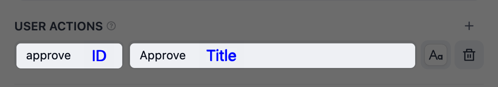
  </Frame>

  <Tip>
      使用预设按钮样式在视觉上区分操作。

      例如，对 `Approve` 等关键操作使用醒目的样式，对次要选项使用较淡的样式。
  </Tip>

  ### 超时策略

  配置请求保持开启的时长，默认 3 天。

  如果在超时前没有收件人响应，工作流将沿节点的超时分支继续。可将该分支连接到后备路径，例如发送通知或重试。

  如果未连接超时分支，工作流将结束。

  ## 示例：内容审核工作流

  <Columns cols={2}>
    <Frame caption="工作流示例">
      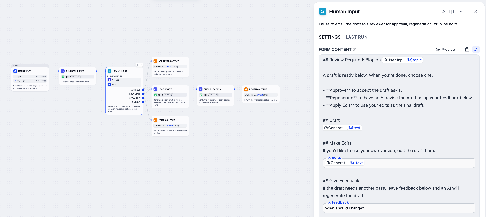
    </Frame>
    <Frame caption="请求表单示例">
      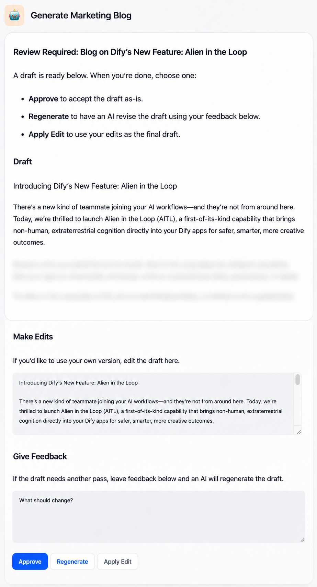
    </Frame>
  </Columns>

  该工作流根据工作流发起者输入的 `topic` 和 `language` 起草一篇博客文章，将草稿通过邮件发送给审核人，并根据审核人的选择确定最终输出。

  这个工作流要让审核人能做到三件事：

  1. **查看 AI 生成的草稿**：在表单中引用上游 LLM 节点的 `text` 变量，让渲染后的表单直接显示草稿。

  2. **按需编辑草稿**：在表单中添加一个段落输入字段 `edits`，并预填同一个 `text` 变量，让审核人以草稿为起点就地修改。

     博客文章通常较长，用表单的 Markdown 显示草稿（第 1 点）比单用段落字段更好读。内容较短时，只用预填的段落字段就能兼顾阅读和编辑。

  3. **提供反馈，由 AI 修订**：

      1. 在表单中添加一个段落输入字段 `feedback`，用于收集审核人的反馈。
      2. 依次连接两个下游 LLM 节点：
          1. Regenerate 节点，用于根据原始草稿 `text` 和审核人反馈 `feedback` 生成修订后的草稿。
          2. Check Revision 节点，用于根据 `feedback` 和 Regenerate 节点生成的修订草稿，检查修订是否落实了反馈。检查后的结果会作为最终输出流向下游。

  审核人在收到的请求表单中，根据判断填写相应的段落字段（或留空），然后点击对应的操作按钮。每个操作连接到不同的输出：

  - **Approve**：来自上游 LLM 的原始草稿
  - **Apply Edit**：审核人在 `edits` 字段中编辑过的内容
  - **Regenerate**：来自经下游 LLM 节点处理过的修订草稿

  <Accordion
    title="LLM 节点提示词参考"
  ><Tabs>
    <Tab title="Generate Draft">
      **System**

      ```text wrap
      围绕给定主题，用指定语言撰写一篇营销博客文章。
      ```

      **User**

      ```text
      主题：{{#user_input.topic#}}
      语言：{{#user_input.language#}}
      ```

    </Tab>
    <Tab title="Regenerate">
      **System**

      ```text wrap
      根据用户反馈重新生成草稿。
      ```

      **User**

      ```text
      草稿：{{#generate_draft.text#}}
      用户反馈：{{#human_input.feedback#}}
      ```

    </Tab>
    <Tab title="Check Revision">
      **System**

      ```text wrap
      检查下面的草稿是否落实了用户的反馈。如果已落实，原样返回草稿；如果没有，按反馈修改草稿。
      ```

      **User**

      ```text
      用户反馈：{{#human_input.feedback#}}
      重新生成的草稿：{{#regenerate.text#}}
      ```

    </Tab>
  </Tabs>

  </Accordion>

  </Tab>
</Tabs>
