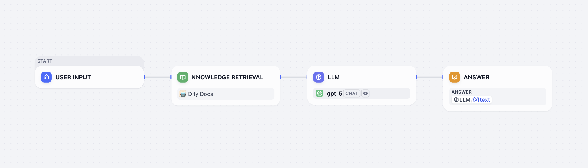

> 本文档由 AI 自动翻译。如有任何不准确之处，请参考 [英文原版](/en/self-host/use-dify/nodes/knowledge-retrieval)。

知识检索节点可将已有知识库接入工作流。它在指定知识库中检索与查询相关的信息，并将结果作为上下文输出，供下游节点（如 LLM）使用。

知识检索节点在 Chatflow 中的典型用例如下：

1. **用户输入** 节点收集用户问题。

2. **知识检索** 节点在指定知识库中检索与用户问题相关的内容，并输出检索结果。

3. **LLM** 节点基于用户问题和检索结果生成回复。

4. **直接回复** 节点将 LLM 的回复输出给用户。

<Frame>
  
</Frame>

使用知识检索节点前，确保至少有一个可用的知识库。创建知识库的方法详见 [知识库](/zh/self-host/use-dify/knowledge/readme#set-up)。

## 配置知识检索节点

知识检索节点需指定以下内容才能正常工作：

- **检索什么**（查询内容）

- **在哪里检索**（知识库）

- **如何处理检索结果**（节点级检索设置）

还可按文档元数据筛选检索范围，进一步提升检索精度。

### 指定查询内容

提供查询内容，节点会据此在所选知识库中检索。

- **查询文本**：选择一个文本变量。例如，在 Chatflow 中可用 `userinput.query` 引用用户输入，在 Workflow 中可选择自定义的文本类型用户输入变量。

- **查询图片**：选择一个图片变量（如用户通过用户输入节点上传的图片），通过图片进行检索。

    每张图片默认不得超过 2 MB，可通过环境变量 `ATTACHMENT_IMAGE_FILE_SIZE_LIMIT` 调整该上限。

    <Info>
        当添加了至少一个多模态知识库时，才会出现 **查询图片** 选项。

        此类知识库带有 **Vision** 标签，表示使用了多模态嵌入模型。
    </Info>

### 选择检索的知识库

为节点添加一个或多个知识库，用于检索与查询内容相关的信息。

添加了多个知识库时，会同时检索所有知识库，合并结果并根据 [节点级检索设置](#调整节点级检索设置) 进行处理。

<Info>
   带有 **Vision** 标签的知识库支持跨模态检索：按语义相关性同时返回文本和图片。
</Info>

点击已添加知识库旁的 **编辑** 图标，可修改该知识库的 [设置](/zh/self-host/use-dify/knowledge/manage-knowledge/introduction)。

### 调整节点级检索设置

如需微调节点对检索结果的处理方式，点击 **召回设置**。

<Info>
    检索设置分为知识库级和节点级两层。
    
    可将其理解为先后两道筛选：知识库设置决定初步的检索结果池，节点设置再进一步筛选。节点检索两个及以上知识库时，还会先对结果重排序（Rerank）。
</Info>

- **Rerank 设置**

    仅在节点检索两个及以上知识库时生效。只检索一个知识库时，由该知识库自身的检索设置决定排序。

    - **权重设置**

        语义相似度与关键词匹配的权重。语义权重高则更注重语义相关性，关键词权重高则更偏向精确匹配。

        仅当所有已添加的知识库使用的索引方式均为高质量时，才会出现 **权重设置** 的选项。

    - **Rerank 模型**

        该模型根据结果与查询内容的相关性，重新打分并排序。

        <Note>
            若添加了多模态知识库，还需选择多模态重排序模型（带有 **Vision** 标签）。否则，检索到的图片不会参与重排序，也不会出现在最终输出中。
        </Note>

- **Top K**

    重排序后返回的最大结果数。

    选择重排序模型后，该值会根据模型的最大输入容量（即模型一次能处理的文本量）自动调整。

- **Score 阈值**

    返回结果的最低相似度分数。低于该阈值的结果会被过滤。阈值高表示对结果的相关性更严格，阈值低则更宽松。

### 启用元数据过滤

默认情况下，检索范围覆盖整个知识库。如需只检索特定文档，可启用手动或自动元数据过滤。

启用后检索更精确，在知识库规模较大或内容涉及多种场景时尤其有效。

关于创建和管理文档元数据，详见 [元数据](/zh/self-host/use-dify/knowledge/metadata)。

## 输出变量

知识检索节点将检索结果输出为 `result` 变量，即一个包含分段内容、元数据、标题等属性的文档分段数组。

若检索结果中包含图片附件，`result` 变量中将增加包含图片元数据的 `files` 字段。

## 搭配 LLM 节点使用知识检索节点

如需在 LLM 节点中将检索结果用作上下文：

1. 在 **上下文** 字段中，选择知识检索节点的 `result` 变量。

2. 在系统指令中引用 `上下文` 变量。

3. （可选）若 LLM 支持视觉能力，可启用 **视觉**，处理检索结果中的图片附件。

    <Info>
        无需将检索结果指定为视觉输入。启用 **视觉** 后，LLM 会自动获取检索到的所有图片。
    </Info>

在 Chatflow 中，回复若引用了知识库内容，默认会一并显示引用来源。如不需要，可在画布右上角的 **功能** 中关闭 **[引用和归属](/zh/self-host/use-dify/build/additional-features#引用与归属)**。
