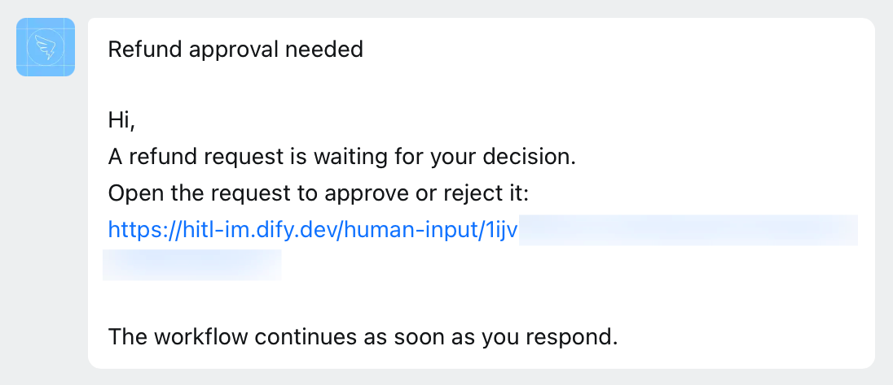

> 本文档由 AI 自动翻译。如有任何不准确之处，请参考 [英文原版](/en/self-host/use-dify/workspace/channels/dingtalk)。

Dify 通过你创建的企业内部应用接入钉钉。该应用：

- 通过其机器人向成员发送请求，每条请求都是一条带链接的文本消息，链接指向 Dify 中的表单。
- 让 Dify 读取成员通讯录，并按邮箱将每个人匹配到工作空间成员。

## 开始之前

确认以下几点：

- 你有权在钉钉组织的开发者后台中创建企业内部应用。
- [`CONSOLE_WEB_URL`](/zh/self-host/deploy/configuration/environments#console_web_url) 已设为成员能打开的地址，因为每条请求的链接都指向这里。

## 创建应用

在 [钉钉开发者后台](https://open-dev.dingtalk.com/) 中进入 **应用开发** > **钉钉应用**，点击 **创建应用**。填写应用名称和描述，点击 **保存**。然后：

1. 在应用中打开 **添加应用能力**，点击 **机器人** 卡片上的 **添加**。

2. 打开 **机器人** 页面，开启 **机器人配置**，填写必填项，然后点击 **发布**。

    - 在 **机器人名称** 中填写成员能认出的名称，例如「Dify」：成员会看到请求来自这个名称的机器人。

    - **消息接收模式** 保持为 **Stream模式**。

3. 在 **权限管理** 的 **请选择通讯录接口权限范围** 中选择 **全部员工**。然后逐一搜索以下权限代码并开通：

    - `qyapi_robot_sendmsg`
    - `qyapi_get_department_list`
    - `qyapi_get_department_member`
    - `qyapi_get_member`
    - `fieldEmail`

4. 在 **版本管理与发布** 中点击 **创建新版本**，将 **应用可用范围** 设为 **全部员工**，然后点击 **保存**。

   如果你不是钉钉管理员，可能需要先由管理员审批。等版本发布后，再到 Dify 中连接。

## 在 Dify 中连接

1. 在 **设置** > **渠道** 中找到钉钉，点击 **连接**。

   <Info>
   如果已连接其他 IM（即时通讯应用），改为点击 **替换**。操作前先了解 [替换会清除哪些内容](/zh/self-host/use-dify/workspace/channels/overview#替换或移除-im)。
   </Info>

2. 填入钉钉中的以下信息：

    - **Corp ID**：开发者后台首页上的 **CorpId**。
    - **Client ID** 和 **Client Secret**：位于应用的 **凭证与基础信息** 页面。

   <Note>
   在钉钉中更改其中任何一项后，都要在 Dify 中同步更新。
   </Note>

3. 点击 **连接**。Dify 会先检查连接，再保存。

## 同步与测试

1. 在 **渠道** 中点击 **立即同步**，绑定成员的 IM 身份。各项同步结果的含义参见 [同步成员](/zh/self-host/use-dify/workspace/channels/overview#同步成员)。

2. 绑定你自己的 IM 身份后，给自己发一条测试请求：

    - 如需快速确认消息能否送达，使用人工介入节点 **消息模板** 中的 **测试消息**：在 **测试渠道** 中选择钉钉，点击 **保存并测试**。这会直接把消息发给你，不运行工作流。
    - 如需检查完整流程，在该节点中开启 [调试模式](/zh/self-host/use-dify/nodes/human-input#test-without-notifying-recipients)，选择钉钉，然后测试运行工作流。消息发到你与机器人的单聊后，打开链接，登录并响应，确认运行继续进行。

   如果测试失败或没有收到消息，参见 [故障排除](#故障排除)。

## 成员看到的内容

每条请求都会发到成员与机器人的单聊中。这是一条根据节点 [消息模板](/zh/self-host/use-dify/nodes/human-input#write-the-notification) 生成的文本消息：先是主题，然后是带链接的正文。

<Frame caption="以钉钉消息形式发送的请求">
  
</Frame>

成员最先看到的是主题，因此要在主题中写明需要他们决定什么，例如「审批订单 1042 的退款」。

成员打开链接后，使用接收请求的账户登录 Dify 并响应。链接转发给其他人无效，因此要把所有需要响应的人都添加为收件人。

## 故障排除

<AccordionGroup>
  <Accordion title="连接时提示无法建立连接">
    根据提示信息的结尾判断：

    - 提示到此为止，后面没有 HTTP 状态码或错误码：通讯录接口权限范围未设为 **全部员工**，Dify 无法读取完整的钉钉通讯录。在 **权限管理** 中修改。
    - 提示以 `API error code: 88` 或 `60011` 结尾：应用缺少 `qyapi_get_department_list` 权限。在 **权限管理** 中开通。
    - 提示以 `HTTP status: 500. API error code: unknownError.` 结尾：Corp ID 填错了。到开发者后台首页重新复制。

    然后再次点击 **连接**。
  </Accordion>
  <Accordion title="同步时提示无法读取通讯录">
    通常是应用缺少 `qyapi_get_department_member` 权限。在 **权限管理** 中开通该权限，然后重新同步。
  </Accordion>
  <Accordion title="同步后成员仍显示为未匹配">
    Dify 没有找到与他们匹配的邮箱。根据受影响的范围处理：

    - 所有成员：应用缺少 `fieldEmail` 权限。在 **权限管理** 中开通该权限，然后重新同步。
    - 部分成员：Dify 读取的是成员钉钉个人资料中的邮箱，而不是钉钉企业邮箱。对于只有企业邮箱的成员，在其个人资料中添加邮箱后重新同步，或 [手动绑定](/zh/self-host/use-dify/workspace/contacts#手动绑定)。
  </Accordion>
  <Accordion title="测试请求发送失败">
    Dify 发不出请求：**测试消息** 提示「测试失败，请检查渠道配置后重试。」，或调试模式下的运行失败并提示「No one can approve this step.」。

    检查以下几项：

    - 应用已开通 `qyapi_robot_sendmsg` 权限。
    - 机器人已发布，且之后你又发布了一个应用版本。
    - 你自己的 IM 身份已绑定。
  </Accordion>
</AccordionGroup>
