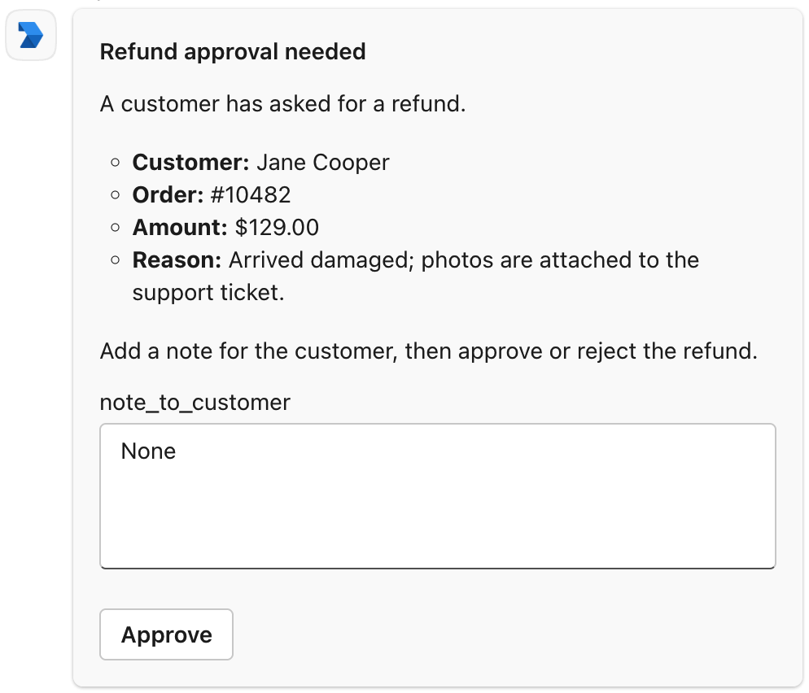
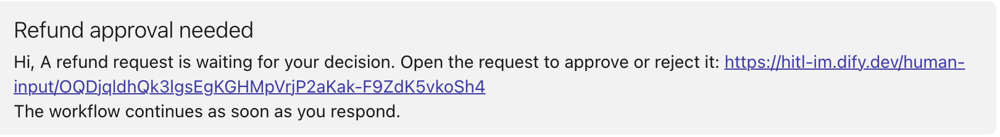

> 本文档由 AI 自动翻译。如有任何不准确之处，请参考 [英文原版](/en/self-host/use-dify/workspace/channels/ms-teams)。

Dify 通过你在 Azure 中注册的机器人接入 Microsoft Teams，再由一个 Teams 应用把这个机器人引入你的组织。两者配合完成以下工作：

- 在成员与机器人的一对一聊天中发送请求。
- 让 Dify 读取组织的用户列表，并按邮箱将每个人匹配到 Dify 工作空间中的成员。
- 成员点击请求上的按钮时，将其响应传回 Dify。

## 开始之前

完成设置需要三类 Microsoft 管理权限，往往分别掌握在不同的人手中。确认你具备以下条件，或能请到相应的人协助：

- **创建机器人**：一个可在其中创建资源的 Azure 订阅。
- **为机器人授权**：Microsoft Entra ID 中拥有 Privileged Role Administrator 或 Global Administrator 角色的人，由其授予管理员同意。
- **安装 Teams 应用**：拥有 Teams Administrator 或 Global Administrator 角色的人，由其在 Teams admin center 中审批并安装应用。

在 Dify 这边，确认以下几点：

- [`TRIGGER_URL`](/zh/self-host/deploy/configuration/environments#trigger_url) 已设为 Microsoft Teams 能通过互联网访问的 HTTPS 地址，这样成员点击卡片按钮后，Dify 才能收到。
- [`CONSOLE_WEB_URL`](/zh/self-host/deploy/configuration/environments#console_web_url) 已设为成员能打开的地址，因为以链接消息形式送达的请求会指向这个地址。

## 创建机器人

<Steps>
  <Step title="创建 Azure Bot">
    1. 在 Azure portal 中 [创建 Azure Bot](https://portal.azure.com/#create/Microsoft.AzureBot)。**Basics** 页签按需填写，但以下几项要按要求设置：

        - **Data residency**：选择 **Global**。
        - **Pricing tier**：选择 **Free** 即可。
        - **Type of App**：选择 **Single Tenant**。
        - **Creation type**：选择 **Create new Microsoft App ID**。

    2. 点击 **Review + create** > **Create**。
  </Step>
  <Step title="添加 Teams 通道">
    1. 部署完成后，点击 **Go to resource** 打开机器人。
    2. 在 **Settings** > **Channels** 的 **Available Channels** 下，点击 **Microsoft Teams**。
    3. 在 **Messaging** 页签中选择 **Microsoft Teams Commercial (most common)**，点击 **Apply**。
  </Step>
  <Step title="记下机器人的 ID">
    打开 **Settings** > **Configuration**，记下 **Microsoft App ID** 和 **App Tenant ID**。之后在 Teams 应用和 Dify 中都要填写。

    随时可从 [Azure Bot 列表](https://portal.azure.com/#browse/Microsoft.BotService%2FbotServices) 回到这个机器人。
  </Step>
</Steps>

## 授予权限并创建密钥

<Steps>
  <Step title="打开机器人的应用注册">
    在 Microsoft Entra ID 中打开 [App registrations](https://portal.azure.com/#view/Microsoft_AAD_RegisteredApps/ApplicationsListBlade)，选择与机器人同名的那一项。
  </Step>
  <Step title="授予权限">
    1. 在 **API permissions** 中点击 **Add a permission** > **Microsoft Graph** > **Application permissions**，勾选 `User.Read.All` 和 `Organization.Read.All`，然后点击 **Add permissions**。
    2. 点击 **Grant admin consent for …** 并确认。

    有了这些权限，Dify 才能读取你的组织及其用户，包括用户的邮箱和头像。
  </Step>
  <Step title="创建客户端密钥">
    1. 在 **Certificates & secrets** > **Client secrets** 中点击 **New client secret**，选择过期时间，然后点击 **Add**。
    2. 离开页面前，复制新密钥的 **Value**，Microsoft 不会再次显示它。注意复制的是 **Value**，而不是 **Secret ID**。
  </Step>
</Steps>

<Note>
记下密钥的过期日期。密钥过期后，Dify 将无法向 Teams 发送请求，也无法同步成员。

过期前就创建好新密钥，并 [填入 Dify](#requests-stopped-arriving-though-channels-still-shows-connected)。
</Note>

## 创建 Teams 应用

<Steps>
  <Step title="创建应用">
    在 [Teams Developer Portal](https://dev.teams.microsoft.com/apps) 中点击 **New app**，起一个名称，然后点击 **Create**。
  </Step>
  <Step title="填写基本信息">
    1. 在 **Configure** > **Basic information** 中填写必填项，并在 **Application (client) ID** 中填入在 [创建机器人](#创建机器人) 时记下的 **Microsoft App ID**。
    2. 点击 **Save**。

    <Info>
    页面上方的 **App ID** 是 Teams 应用自身的 ID，保持不变即可。
    </Info>
  </Step>
  <Step title="添加机器人">
    1. 在 **Configure** > **App features** 中点击 **Bot**。
    2. 在 **Identify your bot** 下选择 **Enter a bot ID**，再次填入机器人的 **Microsoft App ID**。
    3. 在 **Select the scopes where people can use your bot** 下勾选 **Personal**，然后点击 **Save**。
  </Step>
  <Step title="提交审批">
    点击 **Distribute** > **Publish to your organisation** > **Get started**。
  </Step>
</Steps>

此时应用需要等待 Teams 管理员审批。在此期间，可以先 [在 Dify 中连接](#在-dify-中连接) 并 [设置回调](#设置回调)，只有最后的测试需要先安装应用。

## 审批并安装应用

<Steps>
  <Step title="审批应用">
    1. 在 Teams admin center 中打开 [Manage apps](https://admin.teams.microsoft.com/policies/manage-apps)，按名称搜索并打开该应用。
    2. 点击 **Publish** 并确认。
  </Step>
  <Step title="为成员安装">
    1. 在 **Users and groups** 页签中选中 **Installs**，点击 **Install app**。
    2. 将 **Install to** 设为 **Everyone**，或设为 **Specific users or groups** 并涵盖所有需要接收请求的人，然后点击 **Apply**。

    在这里安装后，成员无需自行添加应用就能收到请求。没有该应用的人，在 Teams 中收不到 Dify 的任何消息。
  </Step>
</Steps>

## 在 Dify 中连接

1. 在 Dify 的 **设置** > **渠道** 中找到 Microsoft Teams，点击 **连接**。

   <Info>
   如果已连接其他 IM（即时通讯应用），改为点击 **替换**。操作前先了解 [替换会清除哪些内容](/zh/self-host/use-dify/workspace/channels/overview#替换或移除-im)。
   </Info>

2. 在 **应用凭据** 中填入在 [创建机器人](#创建机器人) 时记下的 ID，以及复制的密钥：

    - **Tenant ID**：机器人的 **App Tenant ID**。
    - **Client ID**：机器人的 **Microsoft App ID**。
    - **Client Secret**：密钥的 **Value**。

3. 点击 **保存并继续**。Dify 会先检查连接，再保存。如果检查未通过，参见 [报错的含义](#saving-in-dify-fails)。

4. 在 **配置回调** 中复制 **回调 URL**。

## 设置回调

1. 在 [Azure Bot 列表](https://portal.azure.com/#browse/Microsoft.BotService%2FbotServices) 中打开机器人，进入 **Settings** > **Configuration**。

2. 将从 Dify 复制的回调 URL 粘贴到 **Messaging endpoint** 中，点击 **Apply**。

<Info>
如果之后 [`TRIGGER_URL`](/zh/self-host/deploy/configuration/environments#trigger_url) 发生变化，回调 URL 也会随之改变。

在 **渠道** 中打开 Microsoft Teams 的设置获取新地址，并更新机器人的 **Messaging endpoint**。
</Info>

## 同步与测试

1. 在 **渠道** 中点击 **立即同步**，绑定成员的 IM 身份。各项同步结果的含义参见 [同步成员](/zh/self-host/use-dify/workspace/channels/overview#同步成员)。

   Dify 按 Microsoft Entra ID 账户中的邮箱地址匹配人员。账户里没有邮箱的人会归入 **未匹配**。这些人可在联系人中 [手动绑定](/zh/self-host/use-dify/workspace/contacts#手动绑定)。

2. 给自己发一条测试请求：确认你自己的 IM 身份已绑定，然后在工作流的人工介入节点中开启调试模式，选择 Microsoft Teams，再测试运行工作流。

   使用调试模式，不要用 **测试消息**：测试消息始终以链接消息的形式送达，无法验证卡片和点击是否正常。

卡片会发到你与机器人的一对一聊天中。点击其中一个按钮，确认运行继续进行。

<Info>

  - 如果收到的是链接消息，说明表单中含有 [卡片无法展示的内容](#成员看到的内容)。
  - 如果什么都没收到，或运行没有继续，参见 [故障排除](#故障排除)。

</Info>

## 成员看到的内容

<Columns cols={2}>
  <Frame caption="以 Teams 卡片形式展示的请求">
    
  </Frame>
  <Frame caption="以链接消息形式发送的请求">
    
  </Frame>
</Columns>

设计表单时注意以下几点：

- 卡片的标题就是节点标题。给节点起一个收件人能看懂的标题，例如「审批退款」，而不是「人工介入 2」。

- 成员必须填写所有字段，才能提交卡片。

表单包含以下内容时，会以链接消息而不是卡片的形式送达：

- 文件字段
- 很长的内容，例如从变量插入的长篇报告

## 故障排除

<AccordionGroup>
  <Accordion title="在 Dify 中保存失败" id="saving-in-dify-fails">
    根据提示信息中的错误判断原因：

    - **AADSTS7000215**：Client Secret 有误，常见原因是粘贴了 **Secret ID** 而不是 **Value**。填入密钥的 **Value**；如果已经找不到，就新建一个密钥。
    - **AADSTS700016**：Tenant ID 对应的组织中没有 Client ID 所指的应用。从机器人的 **Configuration** 页面重新复制这两个 ID；Teams Developer Portal 中的 **App ID** 不能用。
    - **Internal Server Error**：Tenant ID 找不到对应的组织，常见原因是两个 ID 填反了。重新复制 **App Tenant ID**。
    - **HTTP status: 403**：Dify 无权读取你的用户列表。检查管理员同意是否 [已授予](#授予权限并创建密钥)。
  </Accordion>
  <Accordion title="测试请求发送失败">
    Dify 发不出请求：**测试消息** 提示「测试失败，请检查渠道配置后重试。」，或调试模式下的运行失败并提示「No one can approve this step.」。

    检查以下几项：

    - 你自己的 IM 身份已绑定。
    - 你的 Teams 中已有该应用。如果没有在 Teams admin center 中为所有人安装，可在 Teams 的 **Apps** > **Built for your org** 中自行添加。
    - 在 Azure 机器人的 **Settings** > **Channels** 下，Microsoft Teams 通道已开启。
  </Accordion>
  <Accordion title="所有卡片上的按钮都没有反应">
    点击没有传回 Dify。按顺序检查以下几项：

    - 机器人的 **Messaging endpoint** 是 **渠道** 中当前的回调 URL。
    - [`TRIGGER_URL`](/zh/self-host/deploy/configuration/environments#trigger_url) 已设为 Microsoft Teams 能通过互联网访问的 HTTPS 地址。
  </Accordion>
  <Accordion title="部分卡片上的按钮无效">
    根据原因处理：

    - 卡片上有字段为空：填写所有字段后再点击。
    - 请求已超时、所属运行已停止，或该成员已离开你的 Dify 工作空间：如果仍需要有人做出决定，重新发起一次运行。
    - 卡片发出后，该成员的 IM 绑定发生了变化，或你替换或删除了 IM：如果部署已完成 [邮件配置](/zh/self-host/deploy/configuration/environments#邮件配置)，成员仍可通过邮件响应。否则，发起一次新的运行。
  </Accordion>
  <Accordion title="某位成员在 Teams 中收不到请求">
    在 **联系人** 中检查此人的 IM 身份是否已绑定。如果没有，重新同步或 [手动绑定](/zh/self-host/use-dify/workspace/contacts#手动绑定)。

    如果已绑定，可能是 Teams 应用还没有安装到此人的 Teams 中。对方可在 Teams 中自行添加：进入 **Apps** > **Built for your org**，点击该应用的 **Add**。

    在此期间，如果部署已完成 [邮件配置](/zh/self-host/deploy/configuration/environments#邮件配置)，此人仍可通过邮件收到请求。
  </Accordion>
  <Accordion title="请求不再送达，但渠道中仍显示已连接" id="requests-stopped-arriving-though-channels-still-shows-connected">
    客户端密钥可能已过期。如需确认，在 **渠道** 中打开 Microsoft Teams 的设置，回到 **应用凭据**，点击 **测试连接**。如果密钥已过期，测试会失败并提示 AADSTS7000222。

    [新建一个客户端密钥](#授予权限并创建密钥)，在同一设置的 **应用凭据** 中填入。成员的绑定和回调 URL 都保持不变，因此无需重新同步，也无需更新 **Messaging endpoint**。
  </Accordion>
</AccordionGroup>
