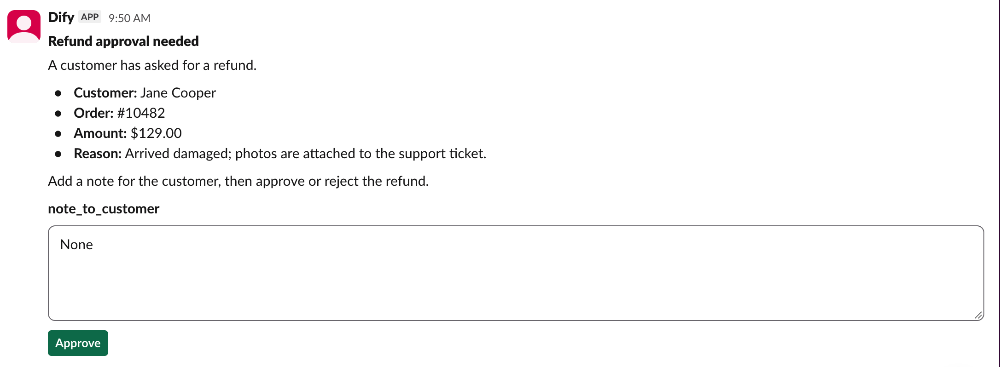
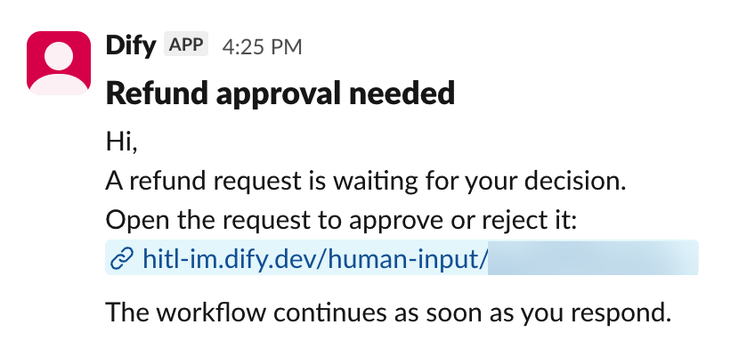

> 本文档由 AI 自动翻译。如有任何不准确之处，请参考 [英文原版](/en/self-host/use-dify/workspace/channels/slack)。

Dify 通过你在 Slack 工作区中创建的应用接入 Slack。该应用：

- 通过其机器人向成员发送请求。
- 让 Dify 读取 Slack 工作区的成员列表，并按邮箱将每个人匹配到 Dify 工作空间中的成员。
- 成员点击请求上的按钮时，将其响应传回 Dify。

## 开始之前

确认以下几点：

- 你有权在 Slack 工作区中安装应用，或能请 Slack 管理员批准安装。
- [`TRIGGER_URL`](/zh/self-host/deploy/configuration/environments#trigger_url) 已设为 Slack 能通过互联网访问的地址，这样成员点击卡片按钮后，Dify 才能收到。
- [`CONSOLE_WEB_URL`](/zh/self-host/deploy/configuration/environments#console_web_url) 已设为成员能打开的地址，因为以链接消息形式送达的请求会指向这个地址。

## 创建应用

在 [Slack 开发者后台](https://api.slack.com/apps) 中点击 **Create an App**。在 **From scratch** 下选择 **Pick features**，点击 **Continue**。然后：

1. 给应用起一个成员能认出的名称，例如「Dify」：成员会看到请求来自这个名称的应用。在 **Workspace** 中选择团队所用的 Slack 工作区。

2. 在 **Bot scopes** 下点击 **Add Bot Scopes**，添加 `chat:write`、`im:write`、`users:read` 和 `users:read.email`。

   有了这些权限，应用才能向成员发起私信、发送卡片并在有人响应后更新卡片，以及读取成员列表和每位成员的邮箱。

3. 在事件设置这一步不添加任何内容，直接点击 **Continue**。

4. 点击 **Create and Install**，然后在 Slack 的授权窗口中点击 **Allow**。

5. 在应用设置中打开 **Socket Mode**，关闭 **Enable Socket Mode**。开启该选项后，成员点击按钮，Dify 都收不到。

## 在 Dify 中连接

1. 在 **设置** > **渠道** 中找到 Slack，点击 **连接**。

   <Info>
   如果已连接其他 IM（即时通讯应用），改为点击 **替换**。操作前先了解 [替换会清除哪些内容](/zh/self-host/use-dify/workspace/channels/overview#替换或移除-im)。
   </Info>

2. 在 **应用凭据** 中填入 Slack 应用的以下信息：

    - **Client ID**、**Client Secret** 和 **Signing Secret**：位于应用 **Basic Information** 页面的 **App Credentials** 下。
    - **Bot Token**：即 **OAuth & Permissions** > **OAuth Tokens** 下的 **Bot User OAuth Token**。

   <Note>
   在 Slack 中更改其中任何一项（例如重新生成 Signing Secret）后，都要在 Dify 中同步更新。
   </Note>

3. 点击 **保存并继续**。Dify 会先检查连接，再保存。

4. 在 **配置回调** 中复制 **回调 URL**。

## 设置回调

1. 在 Slack 应用中打开 **Interactivity & Shortcuts**，开启 **Interactivity**。

2. 将从 Dify 复制的回调 URL 粘贴到 **Request URL** 中，点击 **Save Changes**。

<Info>
如果之后 [`TRIGGER_URL`](/zh/self-host/deploy/configuration/environments#trigger_url) 发生变化，回调 URL 也会随之改变。

在 **渠道** 中打开 Slack 的设置获取新地址，并在 Slack 应用中更新。
</Info>

## 同步与测试

1. 在 **渠道** 中点击 **立即同步**，绑定成员的 IM 身份。各项同步结果的含义参见 [同步成员](/zh/self-host/use-dify/workspace/channels/overview#同步成员)。

2. 给自己发一条测试请求：确认你自己的 IM 身份已绑定，然后在工作流的人工介入节点中开启 [调试模式](/zh/self-host/use-dify/nodes/human-input#test-without-notifying-recipients)，选择 Slack，再测试运行工作流。

   使用调试模式，不要用 **测试消息**：测试消息始终以链接消息的形式送达，无法验证卡片和点击是否正常。

卡片会以应用私信的形式送达。点击其中一个按钮，确认运行继续进行。

<Info>

  - 如果收到的是链接消息，说明表单中含有 [卡片无法展示的内容](#成员看到的内容)。
  - 如果什么都没收到，或运行没有继续，参见 [故障排除](#故障排除)。

</Info>

## 成员看到的内容

<Columns cols={2}>
  <Frame caption="以 Slack 卡片形式展示的请求">
    
  </Frame>
  <Frame caption="以链接消息形式发送的请求">
    
  </Frame>
</Columns>

设计表单时注意以下几点：

- 卡片的标题就是节点标题。给节点起一个收件人能看懂的标题，例如「审批退款」，而不是「人工介入 2」。

- 成员必须填写所有字段，才能提交卡片。

表单包含以下内容时，会以链接消息而不是卡片的形式送达：

- 文件字段
- 很长的内容，例如从变量插入的长篇报告
- 下拉选项字段中的选项超过 100 个，或有选项超过 75 个字符

## 故障排除

<AccordionGroup>
  <Accordion title="测试请求发送失败">
    Dify 发不出请求：**测试消息** 提示「测试失败，请检查渠道配置后重试。」，或调试模式下的运行失败并提示「No one can approve this step.」。

    检查以下几项：

    - 应用仍安装在你的 Slack 工作区中，且 Dify 中填写的是当前的 Bot Token。
    - 你自己的 IM 身份已绑定。
  </Accordion>
  <Accordion title="所有卡片上的按钮都没有反应，或 Slack 报错">
    点击没有传回 Dify。按顺序检查以下几项：

    - Slack 应用中的 **Socket Mode** 已关闭。
    - **Interactivity** 已开启，且其 **Request URL** 是 **渠道** 中当前的回调 URL。
    - Dify 中的 Signing Secret 与 **Basic Information** > **App Credentials** 下的一致。
    - [`TRIGGER_URL`](/zh/self-host/deploy/configuration/environments#trigger_url) 已设为 Slack 能通过互联网访问的地址。
  </Accordion>
  <Accordion title="部分卡片上的按钮无效">
    根据原因处理：

    - 卡片上有字段为空：填写所有字段后再点击。
    - 请求已超时、所属运行已停止，或该成员已离开你的 Dify 工作空间：如果仍需要有人做出决定，重新发起一次运行。
    - 卡片发出后，该成员的 IM 绑定发生了变化，或你替换或删除了 IM：如果部署已完成 [邮件配置](/zh/self-host/deploy/configuration/environments#邮件配置)，成员仍可通过邮件响应。否则，发起一次新的运行。
  </Accordion>
</AccordionGroup>
