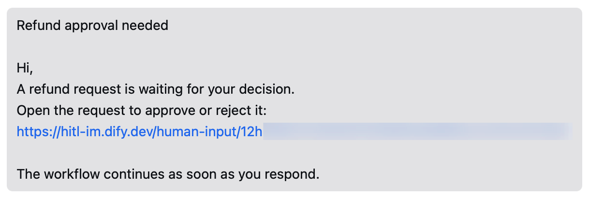

> 本文档由 AI 自动翻译。如有任何不准确之处，请参考 [英文原版](/en/self-host/use-dify/workspace/channels/wecom)。

Dify 通过你在企业微信管理后台创建的自建应用接入企业微信。该应用：

- 向成员发送请求，每条请求都是一条带链接的文本消息，链接指向 Dify 中的表单。
- 让 Dify 读取有权使用该应用的成员。

## 开始之前

企业微信只接受来自特定 IP 地址的调用，这些地址要由你添加到应用中。添加 IP 之前，企业微信会要求你验证一个公司名下的域名。确认以下几点：

- 你是企业微信组织的管理员，或能与管理员配合操作。
- 你知道 Dify 服务器发出请求时使用的公网 IP 地址。企业微信看到的就是这个地址，它可能与 Dify 域名指向的地址不同。在服务器上运行 `curl ifconfig.me` 即可查看。
- 你有一个公司名下的域名，其 ICP 备案主体为你的公司或关联公司，并且你能在该域名网站的根目录下放置文件。
- [`CONSOLE_WEB_URL`](/zh/self-host/deploy/configuration/environments#console_web_url) 已设为成员能打开的地址，因为每条消息中的链接都指向这里。

## 创建应用

在 [企业微信管理后台](https://work.weixin.qq.com/wework_admin/frame) 中进入 **应用管理** > **应用**，在 **自建** 下点击 **创建应用**。然后：

1. 上传 **应用logo**，并在 **应用名称** 中填写成员能认出的名称，例如「Dify」：成员会看到请求来自这个名称的应用。

2. 在 **可见范围** 中点击 **选择部门 / 成员**，选中所有需要接收请求的人。然后点击 **创建应用**。

## 信任 Dify 服务器的 IP

1. 在应用页面找到 **企业可信IP**，点击 **配置**。

2. 在弹出的对话框中点击 **设置可信域名**，然后：

    1. 在第一个 **可信域名** 框中填写公司的域名。
    2. 点击底部的 **申请校验域名**，下载校验文件，放到该域名网站的根目录下。
    3. 点击 **确定**。

3. 回到 **企业可信IP** > **配置**，填入 Dify 服务器的公网 IP 地址并保存。

   等待约 1 分钟让设置生效，再到 Dify 中连接。

## 在 Dify 中连接

1. 在 **设置** > **渠道** 中找到企业微信，点击 **连接**。

   <Info>
   如果已连接其他 IM（即时通讯应用），改为点击 **替换**。操作前先了解 [替换会清除哪些内容](/zh/self-host/use-dify/workspace/channels/overview#替换或移除-im)。
   </Info>

2. 填入企业微信中的以下信息：

    - **Corp ID**：管理后台 **我的企业** 页面底部的 **企业ID**。
    - **Agent ID**：应用页面上的 **AgentId**。
    - **Secret**：在应用页面点击 **Secret** 旁的 **查看**，再点击 **发送**。企业微信会通过 **企业微信团队** 发来一条消息，在企业微信中打开该消息并点击 **前往查看**。

   <Note>
   在企业微信中更改其中任何一项后，都要在 Dify 中同步更新。
   </Note>

3. 点击 **连接**。Dify 会先检查连接，再保存。

## 同步并绑定成员

1. 在 **渠道** 中点击 **立即同步**。同步到的所有成员都会归入 **未匹配**。

   <Info>
   Dify 当前不支持自动匹配企业微信成员。
   </Info>

2. 在 **联系人** 中 [逐一手动绑定成员](/zh/self-host/use-dify/workspace/contacts#手动绑定)，先绑定你自己，以便测试。如果有两位成员同名，可根据各自下方显示的企业微信用户 ID 区分。

Dify 只能同步应用 **可见范围** 内的成员，也只能向他们发送请求。有新人需要接收请求时，如果对方还不在其中，先将其加入，然后重新同步并绑定。

之后的同步会保留你已完成的绑定；如果你把某人移出了 **可见范围**，同步会移除此人的绑定。

## 发送测试请求

绑定你自己的 IM 身份后，给自己发一条测试请求：

- 如需快速确认消息能否送达，使用人工介入节点 **消息模板** 中的 **测试消息**：在 **测试渠道** 中选择企业微信，点击 **保存并测试**。这会直接把消息发给你，不运行工作流。
- 如需检查完整流程，在该节点中开启 [调试模式](/zh/self-host/use-dify/nodes/human-input#test-without-notifying-recipients)，选择企业微信，然后测试运行工作流。收到消息后，打开链接，登录并响应，确认运行继续进行。

如果测试失败或没有收到消息，参见 [故障排除](#故障排除)。

## 成员看到的内容

每条请求都是应用发来的一条文本消息，根据节点的 [消息模板](/zh/self-host/use-dify/nodes/human-input#write-the-notification) 生成：先是主题，然后是带链接的正文。

<Frame caption="以企业微信消息形式发送的请求">
  
</Frame>

成员最先看到的是主题，因此要在主题中写明需要他们决定什么，例如「审批订单 1042 的退款」。

企业微信会截断超过 2048 字节的文本消息，消息模板过长时，链接可能会被截掉。尽量缩短模板，或把请求 URL 放在正文靠前的位置。

成员打开链接后，使用接收请求的账户登录 Dify 并响应。链接转发给其他人无效，因此要把所有需要响应的人都添加为收件人。

## 故障排除

<AccordionGroup>
  <Accordion title="连接失败，API 错误码为 60020">
    企业微信不接受来自 Dify 服务器 IP 地址的请求。在 **企业可信IP** 中 [添加服务器的公网 IP](#信任-dify-服务器的-ip)，等待约 1 分钟后再次点击 **连接**。

    如果已添加过地址，确认它就是 Dify 服务器发出请求时使用的地址。
  </Accordion>
  <Accordion title="连接时提示凭据无效，或失败并显示其他错误码">
    三项信息中有一项填错，或它们来自不同的应用。从 **我的企业** 复制 **企业ID**，并从同一个应用复制 **AgentId** 和 Secret。
  </Accordion>
  <Accordion title="测试请求发送失败">
    Dify 发不出请求：**测试消息** 提示「测试失败，请检查渠道配置后重试。」，或调试模式下的运行失败并提示「No one can approve this step.」。

    检查以下几项：

    - 你自己的 IM 身份已绑定。
    - 你在应用的 **可见范围** 内。
    - Dify 服务器当前的公网 IP 已在 **企业可信IP** 中。
  </Accordion>
  <Accordion title="同步失败，或配置成功后不再收到消息">
    通常是 Dify 服务器的公网 IP 变了，企业微信不再接受其请求。如需确认，在 **渠道** 中打开企业微信的设置，点击 **测试连接**。如果错误码是 60020，在 **企业可信IP** 中添加新的 IP。
  </Accordion>
</AccordionGroup>
