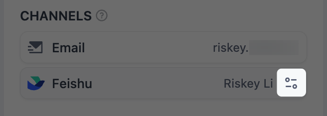

> 本文档由 AI 自动翻译。如有任何不准确之处，请参考 [英文原版](/en/self-host/use-dify/workspace/contacts)。

应用构建者在 [人工介入](/zh/self-host/use-dify/nodes/human-input#choose-who-responds) 节点中选择收件人时，可选的人都在联系人页面里。其中每个人都能通过邮件收到请求；成员绑定 IM 身份后，还会在团队的 IM（即时通讯应用）中收到请求。

只有工作空间所有者和管理员能在主导航中看到 **联系人**，也只有他们能添加、修改或绑定联系人。编辑者在节点中选择收件人时，仍可按名称或邮箱搜索联系人。

## 成员自动成为联系人

工作空间中所有已激活的成员都是联系人，与角色无关。受邀的人激活账户后，就会出现在联系人中。

成员的名称、邮箱和头像来自其 Dify 账户。成员在自己的 [个人资料](/zh/self-host/use-dify/workspace/personal-account-management#个人资料管理) 中修改后，联系人会立即同步更新。

成员只有被移出工作空间，才会从联系人中消失。移除任何人之前，先了解这会对请求和工作流 [造成哪些影响](#移除人员之前)。

## 添加外部联系人

如需添加合作伙伴、客户或其他工作空间之外的人，点击 **添加外部联系人**。

外部联系人只能通过邮件收到请求。响应时，他们输入发送到该邮箱的验证码即可，无需 Dify 账户。

<Info>
    如果某位同事需要在团队的 IM 中收到请求，改为 [邀请其加入工作空间](/zh/self-host/use-dify/workspace/team-members-management)，任何角色均可。

    如果对方已是外部联系人，加入工作空间后会在列表中出现两次。已选择该外部联系人的节点仍只向其邮箱发送请求，因此要告知构建者改选对应的成员。
</Info>

## 绑定成员的 IM 身份 {#bind-im-identities}

成员的 IM 身份绑定到其联系人后，才能在团队的 IM 中收到请求。同步会按邮箱自动绑定，同步遗漏的人则由你手动绑定。

### 与 IM 同步

在 [渠道](/zh/self-host/use-dify/workspace/channels/overview) 中连接团队的 IM 后，在该页面点击 **立即同步**。Dify 会读取 IM 的通讯录，将每个 IM 身份绑定到邮箱相同的工作空间成员（不区分大小写）。

只有点击 **立即同步** 时才会同步，因此有新人加入或有人更改邮箱后，需要再同步一次。

同步时未能与工作空间成员配对的 IM 身份，会在 **渠道** 的同步结果中显示为 **未匹配**。出现这种情况的原因有：

- IM 身份没有邮箱，或没有成员使用该邮箱。IM 中所有不在工作空间里的人都会归入此类。
- 两个成员使用同一个邮箱，或两个 IM 身份使用同一个邮箱。
- 使用该邮箱的成员已绑定另一个 IM 身份，且该身份仍在通讯录中。

如需完成配对，在 IM 或对方的 Dify 账户中更正邮箱后再次同步，或 [手动绑定](#手动绑定)。

### 手动绑定

只能选择同步时已读取的 IM 身份。如果对方在上次同步之后才加入 IM，先重新同步。

在 **联系人** 中点击该成员。在打开的详情里，找到 **联系方式** 中团队所用的 IM，点击 **绑定**，然后选择其 IM 身份。

<Note>
如果选择的 IM 身份已绑定到其他成员，该身份会直接转到当前成员名下，不会有任何提示，原成员也将无法再在 IM 中收到请求。如果是误操作，将该身份重新绑定回原成员即可。
</Note>

如需更换绑定，点击更换图标，不要点击 **绑定**。

<Frame>

</Frame>

只要对应的 IM 身份仍在通讯录中，之后的同步都会保留手动绑定。

在 [渠道](/zh/self-host/use-dify/workspace/channels/overview) 中替换或移除团队的 IM，会清除所有 IM 绑定，包括手动绑定。连接新的 IM 后，需重新同步，并重新完成手动绑定。

## 人员变动时

新请求始终按照人员的最新信息发送。但人员变动可能让已发出的请求失效，也可能影响指定了已离开人员的工作流。

### 移除人员之前

将成员移出工作空间，或从联系人中移除外部联系人后：

- 对方无法再响应已发给他们的请求：链接和 IM 卡片都会失效。
- 已发布的工作流照常运行，并跳过此人。
- 指定了此人的工作流，要等构建者将其从节点中移除后才能再次发布。

移除某人之前，先让对方响应完手头所有待处理的请求，并通知会给此人发请求的构建者。

移除外部联系人的操作无法撤销：再次添加同一个人会创建一个新联系人，构建者需要重新选择。如需修改对方的信息，直接编辑该联系人即可。

### 信息变更时

已发出的请求会受到什么影响，取决于变更的内容：

- 成员修改了 Dify 邮箱：已发出的链接仍然有效，因为成员通过自己的账户登录。
- 你修改了外部联系人的邮箱：发往旧地址的链接会失效。
- 成员的 IM 身份换了绑定（手动换绑，或成员换用新身份后由同步换绑）：通过旧绑定发出的卡片会失效。
