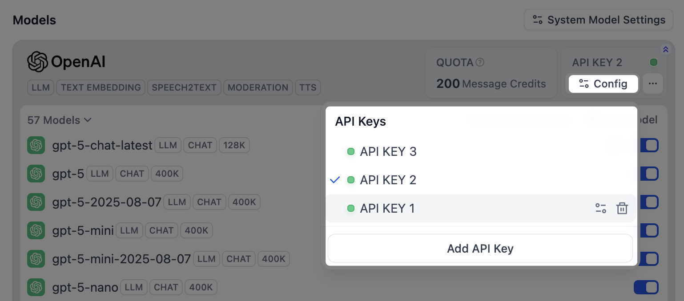
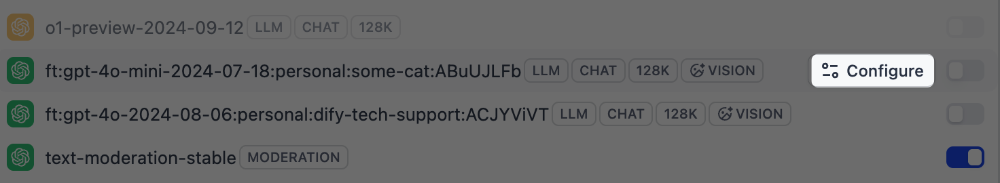
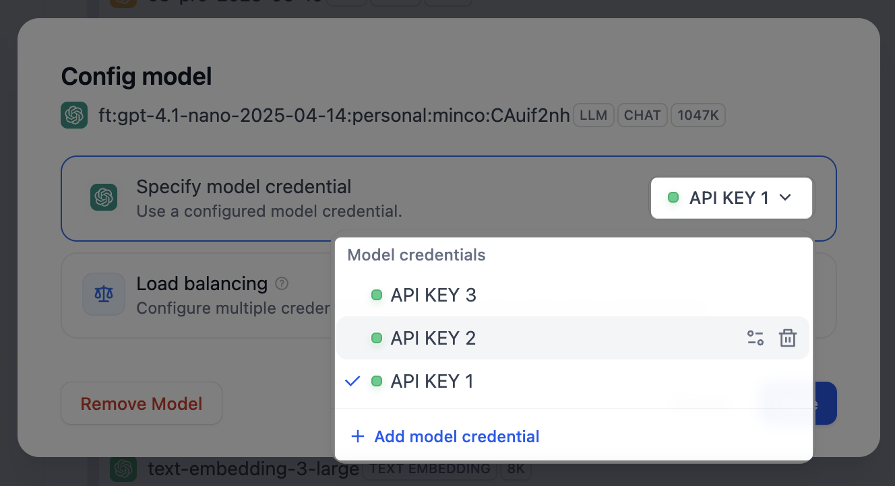
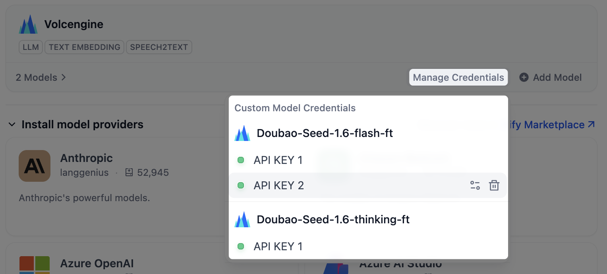
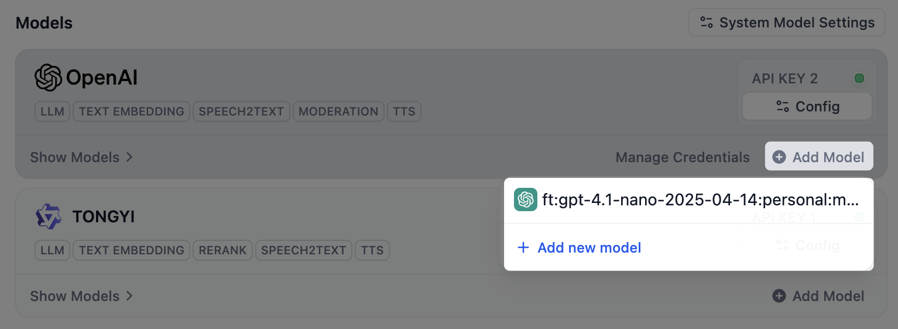

> 本文档由 AI 自动翻译。如有任何不准确之处，请参考 [英文原版](/en/self-host/use-dify/workspace/model-providers)。

每个 Dify 应用都至少需要一个模型供应商。安装供应商并填入 API 密钥后，工作空间内的所有应用都能使用它的模型。

<Warning>
添加的 API 密钥对整个工作空间生效，产生的费用直接计入对应供应商的账户。只有工作空间所有者和管理员可管理供应商。
</Warning>

## 添加供应商

1. 在 **集成** > **模型供应商** 中，浏览 **安装模型供应商** 区域，或访问 [Marketplace](https://marketplace.dify.ai/) 获取更多选项。

2. 安装完成后，点击供应商卡片上的 **添加 API 密钥**，填入密钥及供应商要求的其他凭据，如自定义端点 URL 或组织 ID。Dify 会先验证凭据，验证通过后供应商才可用。

## 添加自定义模型

授权供应商后，它的模型即可使用。只有所需模型不在列表中（如新发布的模型或微调模型）时，才需手动添加。

点击供应商卡片上的 **添加模型**，为模型填写名称和凭据。模型列表固定的供应商没有此选项。

<Info>
若添加的模型名称和类型与已有模型完全相同，Dify 会将新密钥附加到该模型上，而不会创建重复的模型。
</Info>

## 管理密钥

想隔离开发与生产环境，或把用量分摊到多个账户，可为同一供应商添加多个密钥。

- 对于供应商自带的模型，点击其卡片上的 **配置**，管理这些模型共享的密钥。
  <Frame>
  
  </Frame>
- 对于你添加的自定义模型，点击该模型上的 **配置**，单独管理它的密钥。
    <Columns cols={2}>
      <Frame>
      
      </Frame>
      <Frame>
      
      </Frame>
    </Columns>

    <Warning>
    自定义模型只使用自己的密钥。删除它仅有的一个密钥时，模型也会一并删除。
    </Warning>

    点击供应商卡片上的 **管理凭据**，可在同一处查看所有自定义模型的密钥。

    <Frame>
      
    </Frame>

    模型移除后，密钥仍保留在这里，日后重新添加该模型时无需再次录入。

    <Frame>
      
    </Frame>

## 选择应用默认使用的模型

未选择模型的应用和节点会使用工作空间的默认模型。点击右上角的 **默认模型设置**，为每类任务分别指定模型：

- **系统推理模型**：常规 LLM 任务的默认模型。
- **Embedding 模型**：为知识库内容建立索引并执行检索。
- **Rerank 模型**：按相关性对检索结果重新排序。
- **语音转文本模型**：将音频转换为文本。
- **文本转语音模型**：将文本转换为音频。

默认模型为空时，依赖它的功能就无法使用。例如，未设置文本转语音模型，应用中的 **文字转语音** 便不可用。
